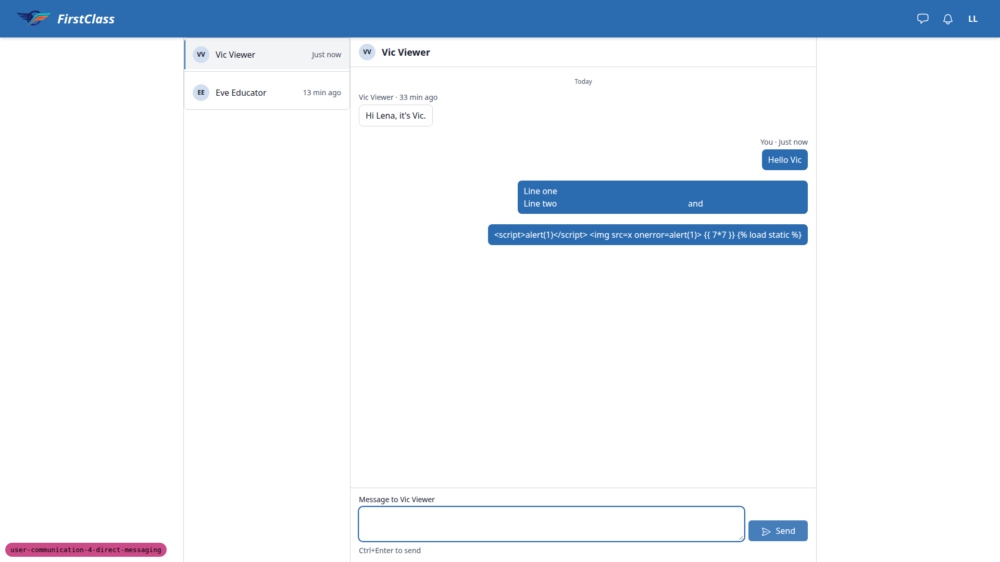
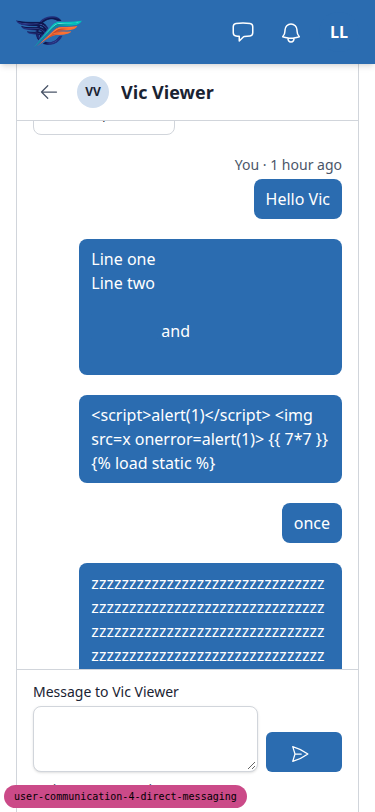
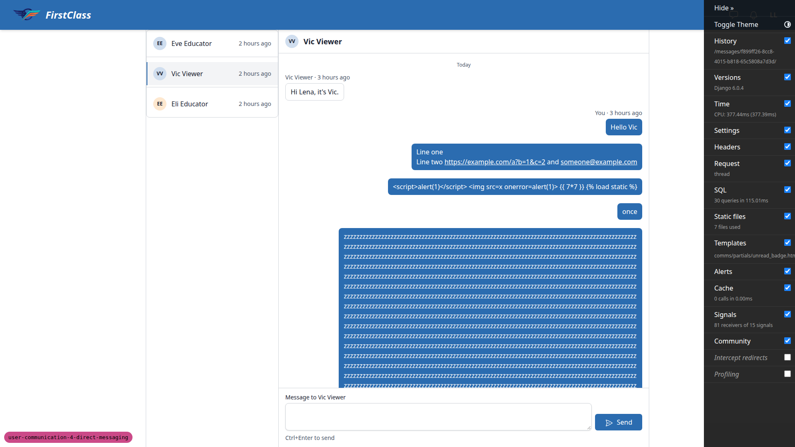
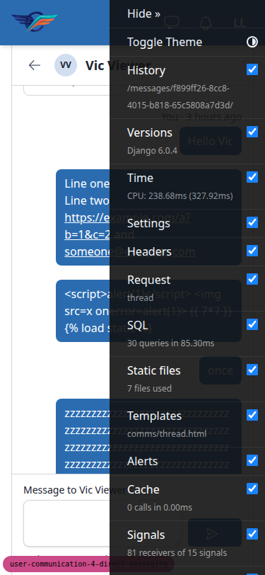
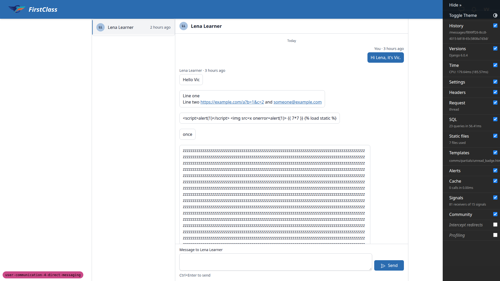

# Frontend QA report: user-communication-4-direct-messaging

## Methodology

- Playwright MCP, driven by hand. Viewports: 1920x1080 desktop (1280x800 for the §1 design state, 1442 for the educator design states), 375x812 mobile, 768x1024 tablet.
- Several browser contexts (Lena, Eve, Luis, admin) were used for the two-person polling tests.
- Screenshots were collected into `screenshots/` beside this report. Every image referenced here exists there. A few `.yml` snapshot/console files also sit there and are not referenced.
- Data: the dev DB was wiped and rebuilt from §0 (create_demo_data, content_save, qa_create_direct_messaging_scenario). The qa-data-helper then reshaped it to §0. The seed command builds a different conversation set: 3-message edu<->l1, extra edu2<->l1 and l1<->l2, no viewer<->l1.
- The helper also made mid-run changes: removing and restoring Lara and Bea, and creating a cross-site conversation on site Bloom.
- 8.10 used a second server with a scratchpad settings module (no repo edit).
- The Django debug toolbar was hidden with an injected style because it overlapped the header.

## Diff scoping

- Class: **FULL**.
- Files that triggered it:
  - `freedom_ls/base/templates/partials/header_bar.html`
  - `freedom_ls/comms/static/comms/js/alpine-components.js`
  - `freedom_ls/comms/templates/comms/*.html`
  - `freedom_ls/educator_interface/templates/educator_interface/**`
  - `freedom_ls/panel_framework/static/panel_framework/js/alpine-components.js`
  - `freedom_ls/panel_framework/templates/**`
  - plus about 130 .py, migration, test and spec files (168 total)
- Skipped: nothing. Desktop, mobile and tablet all ran.

## Smoke gate

Outcome: **pass**. Pages checked: `http://127.0.0.1:8742/` and `http://127.0.0.1:8742/messages/`.

## Test results

| Test id | Viewport | Status | Note |
|---|---|---|---|
| 1.1 | desktop | pass | Icon-only header Messages link beside the bell; name 'Messages, 1 unread', badge 1. |
| 1.2 | desktop | pass | Inbox ordered Eve then Vic (unread, bold, dot + Unread); no Read only tag, no New message button. |
| 1.4 | desktop | pass | l3 empty state with icon and learner text; no New message button. |
| 2.1 | desktop | pass | Two-pane layout, selected row, header, separator, composer label and hint; badge clears. |
| 2.2 | desktop | pass | Ctrl+Enter sends; right-aligned bubble, textarea cleared and focused, Vic row first. |
| 2.3 | desktop | fail | Line break and mailto/URL linking correct, but links in the sender's own bubble are invisible (B1). |
| 2.4 | desktop | pass | script/img/template syntax render literally. |
| 2.5 | desktop | pass | Counter at 150 left, maxlength 2000 enforced, counter hides when cleared. |
| 2.6 | desktop | pass | Empty send gives 422 and alert 'Type a message first.'; focus stays. |
| 2.7 | desktop | pass | Load earlier prepends 1-5, control removed, single date separator; anchor shifted up 44px (cosmetic). |
| 3.1-3.2 | desktop | pass | Polled message appeared in ~7s, status line announced; a one-off transient header badge '1' was not reproducible. |
| 3.3 | desktop | pass | Scrolled to top: scrollTop stays 0, 'New messages' button appears and works. |
| 3.4 | desktop | pass | Draft text, caret and focus kept while a polled message appended. |
| 3.5 | desktop | pass | Message to Luis leaves L unchanged; message to Lena marks Eve row Unread and badge 1 within ~20s. |
| 3.6 | desktop | pass | Opening the thread clears L badge; educator sidebar count unchanged. |
| 4.1 | desktop | pass | Sidebar Messages item with count 1; colleague conversation not counted. |
| 4.2 | desktop | pass | List correct; Gus Gone and Deleted user absent per spec (plan out of step). |
| 4.3 | desktop | pass | Sidebar navigation fires only section GETs; count element is hx-preserve. |
| 4.4 | desktop | pass | Per-organisation count element ids and hx-get for demodev. |
| 4.5 | desktop | pass | Thread panel works; standard back link not breadcrumb (plan); counts stale until 45s timer. |
| 4.7 | desktop | pass | Gus Gone via shared inbox: no composer, 'Replies are closed' note; section URL 404. |
| 4.8 | desktop | pass | Deleted user via shared inbox: generic header, read-only note, Read only rows; section URL 404. |
| 4.9 | desktop | pass | Shared inbox for Eve lists the colleague conversation too. |
| 5.1.1-5.1.2 | desktop | pass | Grouped recipient modal, filtering and identical no-match states; rows underlined (cosmetic). |
| 5.1.3 | desktop | pass | Choose Lara, composer focused, send closes modal and opens the new conversation. |
| 5.1.5 | desktop | pass | Second message to Lara lands on the same conversation. |
| 5.2 | desktop | pass | With learner_to_educator=open, learner gets New message; group 'COHORT ADMIN' lists educators, no emails; send redirects to thread. |
| 6.1-6.2 | desktop | pass | Lara removed mid-draft: poll keeps draft, send gives 422 alert, draft and client_key unchanged. |
| 6.3 | desktop | pass | Cleared box: poll swaps in 'Replies are closed' note; history readable; section URL 404. |
| 6.4 | desktop | pass | Lara restored: composer returns on poll and reload. |
| 6.5 | desktop | pass | Closing learner_to_educator leaves Lena able to reply to Eli (no note); plan expectation wrong. |
| 7.1 | desktop | pass | Bell '1 new'; row 'New message from Eve Educator' with Direct message and icon. |
| 7.2-7.3 | desktop | pass | One notification row for repeat messages; clicking opens thread and clears bell. |
| 7.4 | desktop | pass | New message after reading gives a fresh unread row above the read one. |
| 7.5 | desktop | pass | Toggling notification read state does not affect inbox read state. |
| 7.6 | desktop | pass | Sender never sees a notification for their own messages. |
| 7.7 | desktop | pass | Opening the thread clears the bell; polled messages in an open thread leave it at none. |
| 8.1 | desktop | pass | Double-click Send produces exactly one bubble. |
| 8.2 | desktop | pass | Offline send: 'Not sent. Check your connection.' + Retry, sent once; plan wording differs. |
| 8.3 | desktop | pass | 2001 chars gives 422 with limit message and text kept; 2000 accepted. |
| 8.4 | desktop | pass | Another pair's conversation: thread, poll, older and send all 404. |
| 8.5 | desktop | pass | Cross-site conversation on Bloom 404s on every URL. |
| 8.6 | desktop | pass | Cross-organisation section URLs 404. |
| 8.7 | desktop | pass | Viewer sees only own conversation; others 404. |
| 8.8 | desktop | pass | Educator-educator conversation 404 under the section, 200 on shared URL. |
| 8.9 | desktop | pass | Deleted-user conversation: section 404, shared URL 200 read-only. |
| 8.10 | desktop | pass | MESSAGING_ENABLED=False: no header button, sidebar item or quick-view box; /messages/ and section 404. |
| 8.11 | desktop | pass | Bad `before` cursor gives 400 with message, no traceback. |
| 8.12 | desktop | pass | Plan order gives generic 'no longer available' panel; typed-draft variant gives 422 and keeps draft; nothing created. |
| 9.1-9.3 | desktop | pass | Quick view shows last 3 messages, send keeps drawer open, Open conversation link works. |
| 9.4 | desktop | pass | No-conversation learner: composer only; link appears after first send without reload. |
| 9.5 | desktop | skip | Removed learners are not listed, so step not applicable. |
| 9.6 | desktop | pass | Discard prompt with Keep editing / Discard; Escape re-prompts; Discard loads the next learner. |
| 9.7 | desktop | pass | Simulated via htmx.trigger('learnerChanged'); draft kept; clean-box refetch half unconfirmed. |
| 9.8 | desktop | pass | Offline send in box: inline error + Retry, sent once. |
| 10.3 | desktop | pass | Accessible names, roles and live regions correct; markers readable in grayscale. |
| 10.1 | mobile | pass | 375 inbox and thread: no overflow, back link, composer visible, long words break. |
| 10.2.1 | mobile | pass | Section list as cards, no overflow; empty 'Status' label when no marker (cosmetic). |
| 10.2.2 | mobile | pass | Thread wraps long words, icon-only Send; header repeats name and back control (cosmetic). |
| 10.2.3 | mobile | pass | New message is a bottom sheet with grouped rows; names/emails underlined (cosmetic). |
| 10.2.4 | mobile | pass | Quick view is a full-width bottom sheet; send keeps it open. |
| 2.3 | mobile | fail | Same invisible-link defect at 375 (B1). |
| 10.1 (layout) | tablet | pass | 768 two-pane layout, no overflow, composer visible. |
| 10.2 (layout) | tablet | pass | 768 educator section table fits; thread and 510px modal render correctly. |
| 5.1 (modal) | tablet | pass | New message modal centred, 510px, grouped list intact. |

## Design check

| Test id | Viewport | This run | Design | Result |
|---|---|---|---|---|
| 1.3-design | desktop | [screenshot](screenshots/page-2026-10-18T12-12-02-122Z.png) | [design](design_screenshots/direct-messages__1280.png) | pass |
| 4.6-design | desktop | [screenshot](screenshots/page-2026-10-18T12-27-00-000Z.png) | [design](design_screenshots/educator-messages__01-inbox-and-thread.png) | pass |
| 5.1.4-design | desktop | [screenshot](screenshots/page-2026-10-18T12-30-01-000Z.png) | [design](design_screenshots/educator-messages__02-new-message.png) | pass |
| 10.1.4-design | mobile | [screenshot](screenshots/page-2026-10-18T13-14-00-000Z.png) | [design](design_screenshots/direct-messages__375.png) | pass |
| 10.2.1-design | mobile | [screenshot](screenshots/page-2026-10-18T13-17-00-000Z.png) | [design](design_screenshots/educator-messages__04-mobile.png) | pass |
| 10.2.2-design | mobile | [screenshot](screenshots/page-2026-10-18T13-18-00-000Z.png) | [design](design_screenshots/educator-messages__04-mobile-2.png) | pass |
| 10.2.3-design | mobile | [screenshot](screenshots/page-2026-10-18T13-19-00-000Z.png) | [design](design_screenshots/educator-messages__04-mobile-3.png) | pass |

## B1: Links in the sender's own message bubble are invisible (link colour equals bubble background)

Manifestations: 2.3 desktop, 2.3 mobile.

Desktop (1920x1080):

Mobile (375x812):

**Expected:** a URL or email in a message body renders as a visible, distinguishable link in every bubble, including the sender's own primary-coloured bubble (text-on-primary).

**Actual:** in the sender's own bubble (bg-primary text-on-primary), urlized `<a>` elements inherit the global link colour rgb(43,108,176), identical to the bubble background. 'Line two https://example.com/a?b=1&c=2 and someone@example.com' renders as 'Line two', a blank gap, 'and'. The recipient's surface-coloured bubble is unaffected.

## Bug status

- **FIXED** (commit: 3571eca1) — B1: Links in the sender's own message bubble are invisible

Fix: `freedom_ls/comms/templates/comms/partials/message_entry.html` makes links in the own (primary) bubble inherit the on-primary colour and stay underlined; a Playwright step in `freedom_ls/comms/tests/playwright/test_messaging_flow.py` failed before the fix and passes after. Re-verified in the browser: own-bubble links are now rgb(255,255,255), underlined, on rgb(43,108,176) at 1920 and 375; the recipient's (Vic's) view keeps blue links on the white bubble; the educator section thread still renders.

## General notes

**Test plan out of step with the spec** (code matches the spec; the plan needs correcting):
- 4.2/4.7/4.8 expect Gus Gone and Deleted user in the educator section, but the spec says the section lists only conversations whose learner has an active Learner row. Both were checked via the shared inbox instead, and their section URLs 404 as 8.9 expects.
- 4.5 names a breadcrumb, but the framework shows a '<- Messages' back link like every instance page.
- 6.5 expects a CLOSED_BY_CONFIGURATION note, but reply rights are symmetric (messaging-policy spec, decision 4), so Lena can still reply to Eli.
- 8.12 in plan order is refused at the choose step with a generic 'no longer available' panel. The variant with a typed draft gives the 422 and keeps the draft.
- Minor wording: 2.6 shows 'Type a message first.'; the 8.2 alert lacks 'and try again'.

**Counts that disagree:**
- Opening an unread thread in the educator Messages section (an htmx navigation) leaves the sidebar count and the header badge stale until the 45s timer. This is spec-conformant: counts refresh on the timer and on poll-with-news only.
- The shared /messages/ thread refreshes the header badge on page load.
- There was also a one-off transient header badge '1' while the learner's thread was open (the timer fired between send and thread poll). It was not reproducible.

**9.7:** simulated via `htmx.trigger('learnerChanged')`. The draft is protected, but the clean-box refetch half was not confirmed by that method.

**9.5:** skipped, because removed learners are not listed.

**Cosmetic:**
- Recipient picker rows (name, email, avatar initials) are underlined like prose links.
- Educator mobile cards show an empty 'Status' label when there is no marker.
- On the educator section thread at 375, the page header repeats the name and a second back control above the thread panel, leaving the log about 300px.
- The unread inbox row's tint leaves a thin untinted band from the 4px li padding.
- 2.7 Load earlier shifts the anchor message up by the removed control's height (44px).

**Unrelated:** the educator Learners table 'Registered courses' column shows '-' for learners whose quick view lists a cohort course registration.

**Superuser:** demodev sees the learner-flavoured empty state 'Your educators can message you, and you can reply.' on /messages/.

**Housekeeping:** stale files from earlier runs were moved out of qa-screenshots/ before collection, so they do not appear in this report.

status: ok
reason: 1 bug — 1 fixed, 0 unresolved; report rendered, screenshots verified
