# QA report: direct messaging

Every section of the frontend QA plan (§1 to §12) ran on branch `user-communication-4-direct-messaging`, and no bugs were found. Diff scoping classed the run as FULL, so desktop (1920x1080), mobile (375x812) and tablet (768x1024) all ran. The smoke gate passed. Every test record is `pass` except two optional or unreachable steps that were skipped (9.10 and 10.5; see General notes). Every design comparison passed with no misses.

## Methodology

- Screenshots were collected into `spec_dd/2. in progress/user-communication-4-direct-messaging/screenshots/`, and every image referenced below exists beside this report.
- The browser was driven through Playwright MCP with one browser context per persona, so polling between two people could be watched live.
- The Django debug toolbar was hidden before each shot.
- Run context: dev server on port 8784, desktop 1920x1080, mobile 375x812, tablet 768x1024, data from `qa_create_direct_messaging_scenario`.

## Diff scoping

- Class: **FULL**.
- File groups that triggered it: `freedom_ls/comms/templates/comms/*.html`, `freedom_ls/comms/static/comms/js/alpine-components.js`, `freedom_ls/educator_interface/templates/educator_interface/**`, `freedom_ls/panel_framework/templates/**`, `freedom_ls/panel_framework/static/**`, `freedom_ls/base/templates/partials/header_bar.html`, `freedom_ls/comms/*.py`, `freedom_ls/educator_interface/*.py`, `freedom_ls/messaging_policy/policy.py`, `freedom_ls/panel_framework/views.py`, `config/*.py`.
- Desktop, mobile and tablet all ran. Nothing was skipped by scoping.

## Smoke gate

Outcome: **pass**. Pages loaded: `http://127.0.0.1:8784/` and `http://127.0.0.1:8784/messages/`.

## Results by section

### §1 Members and roles, set up through the educator interface

| test id | viewport | status | notes |
|---|---|---|---|
| 1.1 | desktop | pass | Before any role: /educator/ and northside/messages 404 for edu. Inbox shows Lena (Unread), Eli, Luis, Deleted user, Gus Gone all Read only, no New message. Luis thread and Lena's Eve thread show the closed note with no composer. |
| 1.2 | desktop | pass | Empty members state with Add member. Lookup of org.admin@qa.test shows 'No account yet' with name fields; confirmation step before write; Oscar row listed. Mailpit got exactly one set-password email naming Northside; its link uses the Site domain 127.0.0.1:8000 rather than the request port, substituted by hand. Password set and Oscar landed on the dashboard. Sid South added on Southside via 'Existing account' lookup. |
| 1.3 | desktop | pass | Oscar sees Teaching/Administration groups and Messages. Eve added as Cohort admin on A+B, Eli on A (confirmation names cohorts, no new-account text). Cohort A Educators panel dialog has no cohort checklist; Vic added as Cohort viewer and panel refreshed in place. Members lists Eli, Eve, Oscar (You, no actions), Vic sorted by name, none suspended. |
| 1.4 | desktop | pass | Eve's inbox: Lena/Luis/Eli lost Read only, Gus Gone and Deleted user keep it, New message present, Lena still Unread; Luis composer back; sidebar Messages count 1. Oscar's picker grouped Cohort A / Cohort B / Colleagues, each person once, Gus/Sam/Sid absent. Oscar to Bea 'Hello from Oscar' opened the thread; Oscar's Messages section lists only Bea. Bea replied with the composer present. |

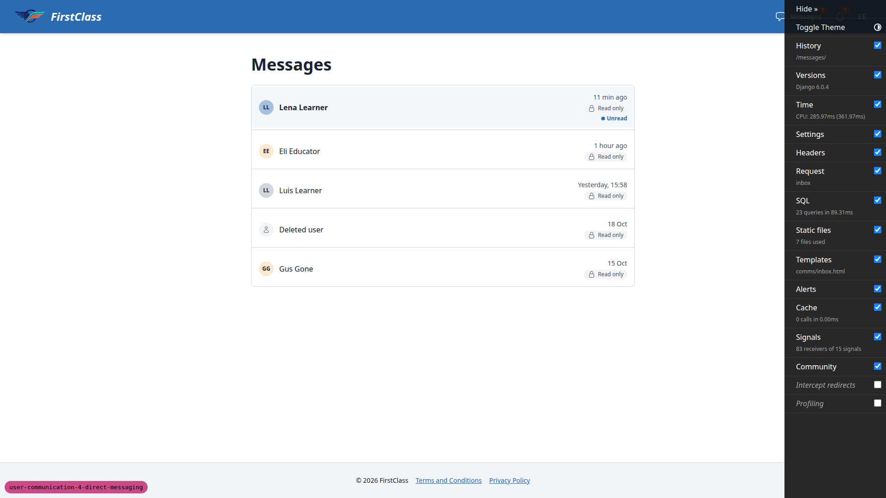
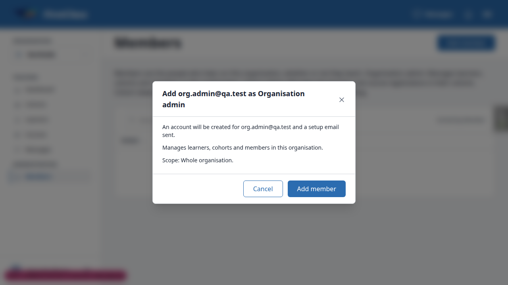
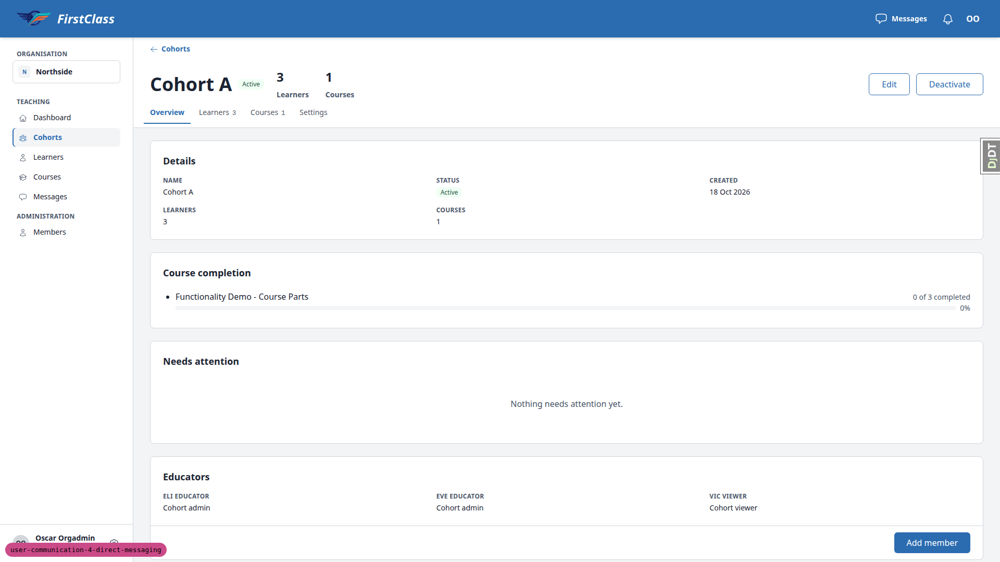
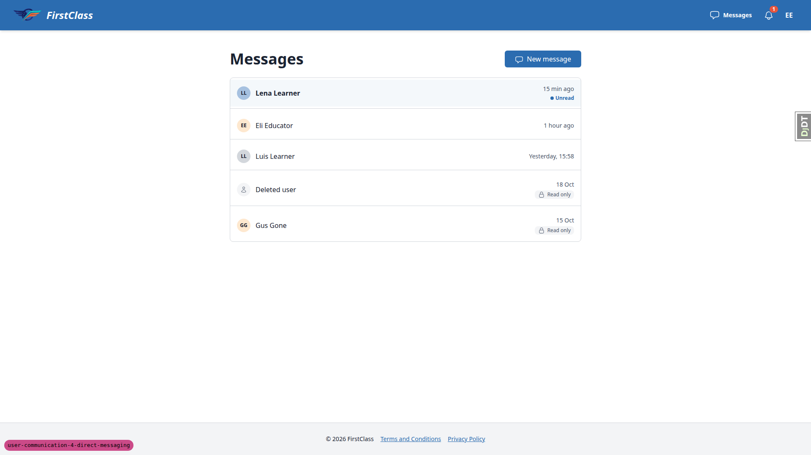

### §2 Header button and inbox

| test id | viewport | status | notes |
|---|---|---|---|
| 2.1 | desktop | pass | Header Messages button (icon + label) beside the bell, badge 1, status text 'Messages, 1 unread'. |
| 2.2 | desktop | pass | /messages/ heading Messages; Eve Educator (16 min ago) then Vic Viewer; Vic bold with dot + Unread; no Read only tags; no New message button; no empty state. |
| 2.4 | desktop | pass | Lara (no conversations): empty state with speech-bubble icon 'Your educators can message you, and you can reply.', no New message button. |

(2.3 is covered by the design check below.)

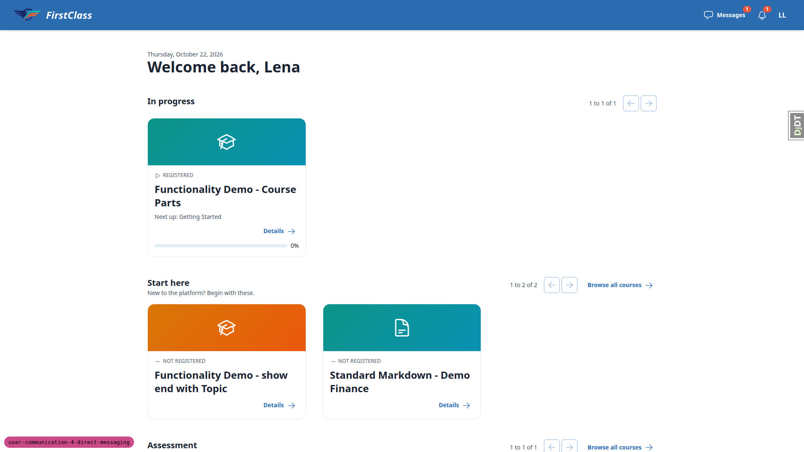
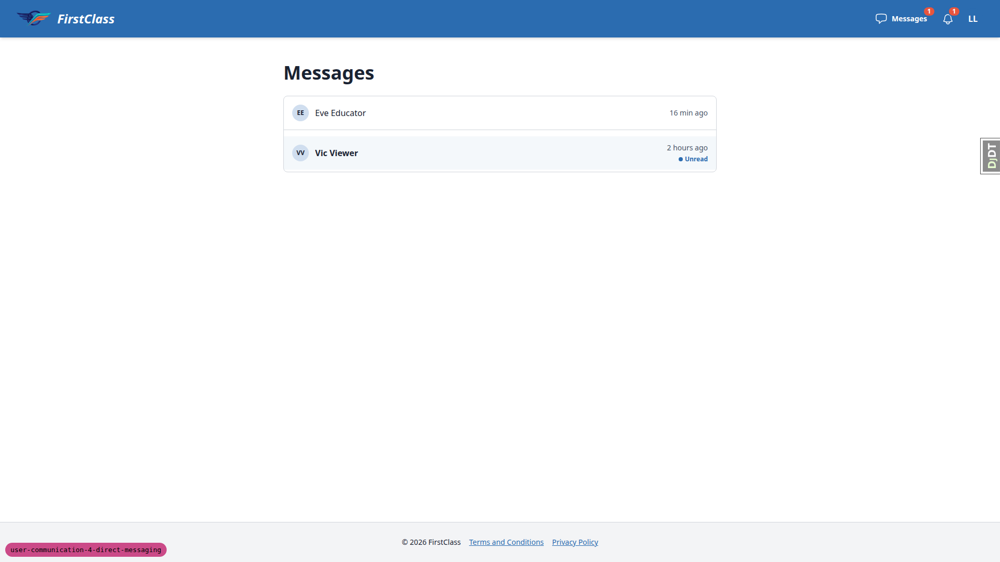
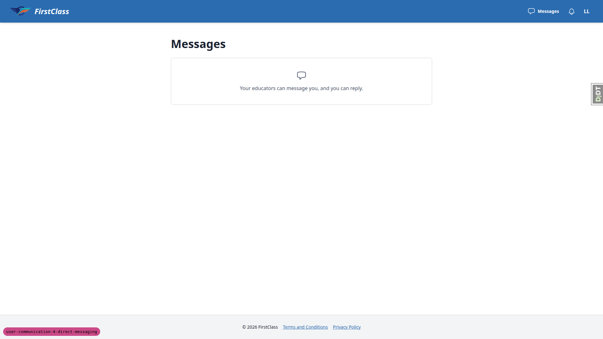

### §3 The thread

| test id | viewport | status | notes |
|---|---|---|---|
| 3.1 | desktop | pass | Thread URL /messages/<pk>/; list left, thread right, Vic row aria-current; header avatar + Vic Viewer; day separator, sender line, bubble; label 'Message to Vic Viewer', Send with icon, 'Ctrl+Enter to send'; role=log 'Messages with Vic Viewer'; header badge cleared and Unread marker gone. |
| 3.2 | desktop | pass | Ctrl+Enter sent 'Hello Vic': right-aligned bg-primary bubble under 'You · Just now'; textarea empty and focused; log at bottom; Vic row first with 'Just now'. |
| 3.3 | desktop | pass | Line break kept ( ), URL rendered as rel=nofollow link without target, email as mailto: link. |
| 3.4 | desktop | pass | <script>, , {{ 7*7 }} and  all rendered literally; no dialog fired, no img element, no 49. |
| 3.5 | desktop | pass | 1,850 chars shows '150 characters left'; maxlength=2000 stops input at 2,000 ('0 characters left'). |
| 3.6 | desktop | pass | Empty Send: role=alert 'Type a message first.', nothing sent, textarea keeps focus and gets an error outline. |
| 3.7 | desktop | pass | Eve thread opens with 30 bubbles scrolled to the bottom and a Load earlier messages control above the log; clicking prepends 5 (35 total), the anchored bubble stayed at the same y, control removed; day separators 'Monday 19 October' / 'Tuesday 20 October' once each (page-2026-10-22T17-06-44-263Z.png). Observation: sender lines on older days show the date ('You · 19 Oct') rather than a clock time, repeating the day separator. |

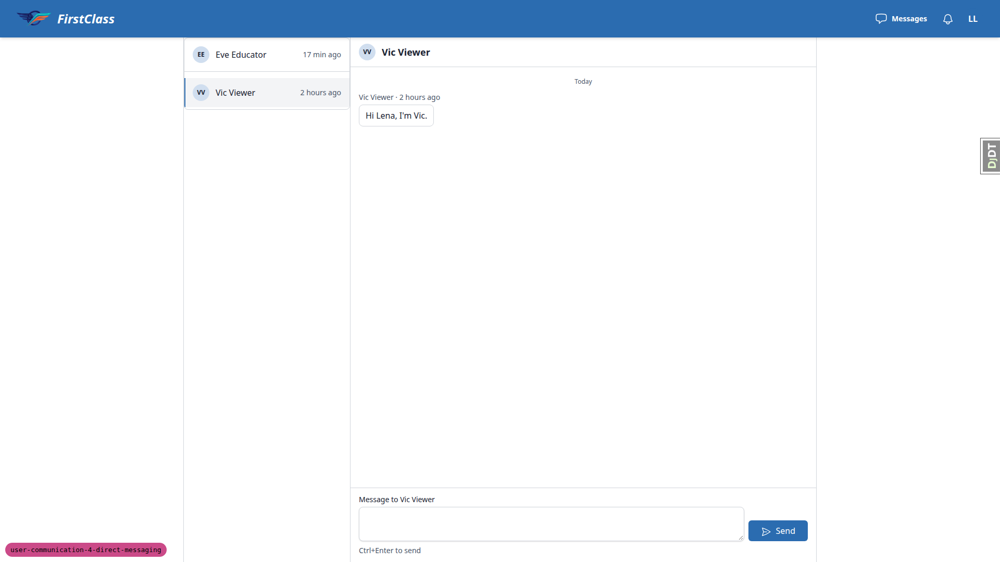
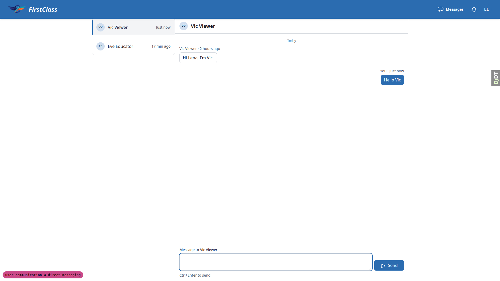
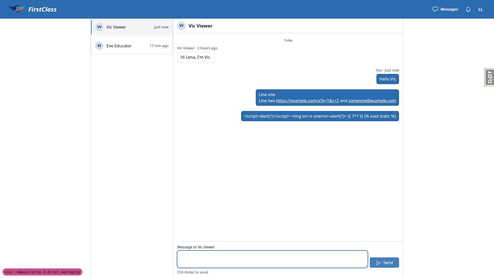
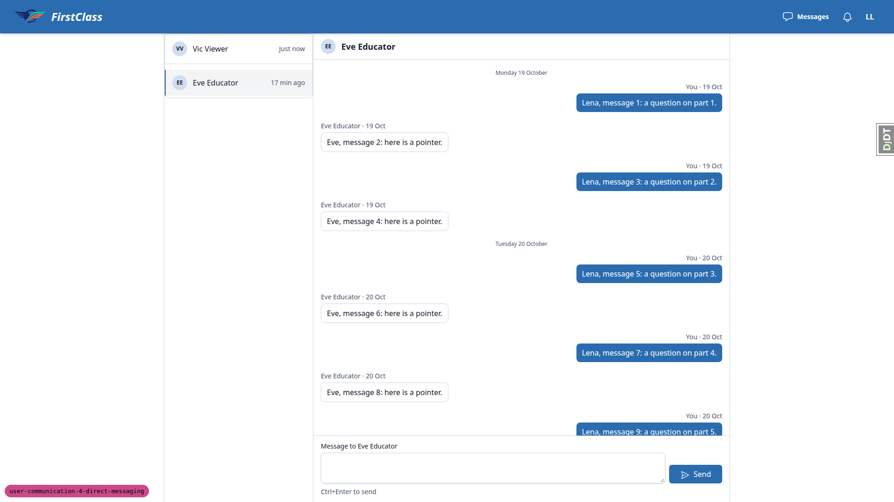

### §4 Polling between two people

| test id | viewport | status | notes |
|---|---|---|---|
| 4.1-4.2 | desktop | pass | Eve sent 'Ping from Eve'; Lena's open thread appended it by poll in ~3s under an 'Eve Educator' sender line; #thread-status (role=status, sr-only) read '1 new message from Eve Educator' with no body text; header badge stayed 'none unread'. |
| 4.3 | desktop | pass | With the log scrolled to the top, two more polled messages did not move scrollTop (0); a 'New messages' button appeared over the bottom of the log; clicking it smooth-scrolled to the bottom within ~750ms and the button went away. |
| 4.4 | desktop | pass | Draft 'unsent draft' with the caret at 6 survived a poll that appended a new message; textarea still focused, caret unchanged. |
| 4.5 | desktop | pass | Inbox open as Lena: Eve's message to Luis changed nothing in 62s (only /messages/unread-badge/ and /messages/poll/ requests fired). Eve's message to Lena moved the row to the top with 'Just now', the Unread marker and a header badge of 1 within ~7s. |
| 4.6 | desktop | pass | Opening the Eve thread cleared Lena's badge. Lena's reply arrived in Eve's open section thread by poll; Eve's sidebar count and header badge stayed at none because the thread was open and read (count is per educator and per unread state). |

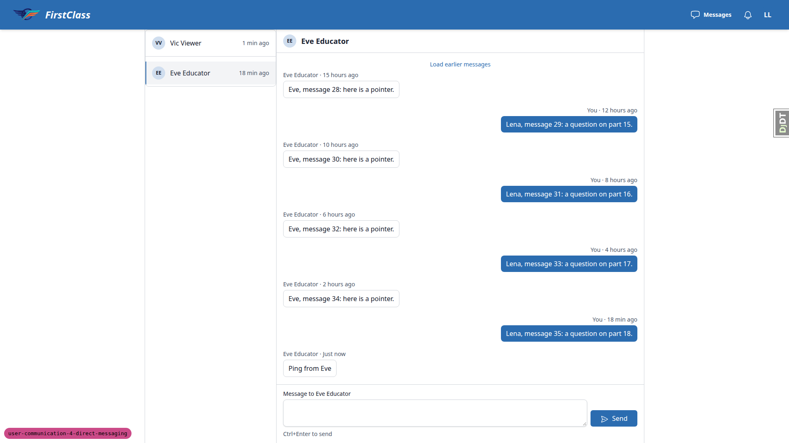
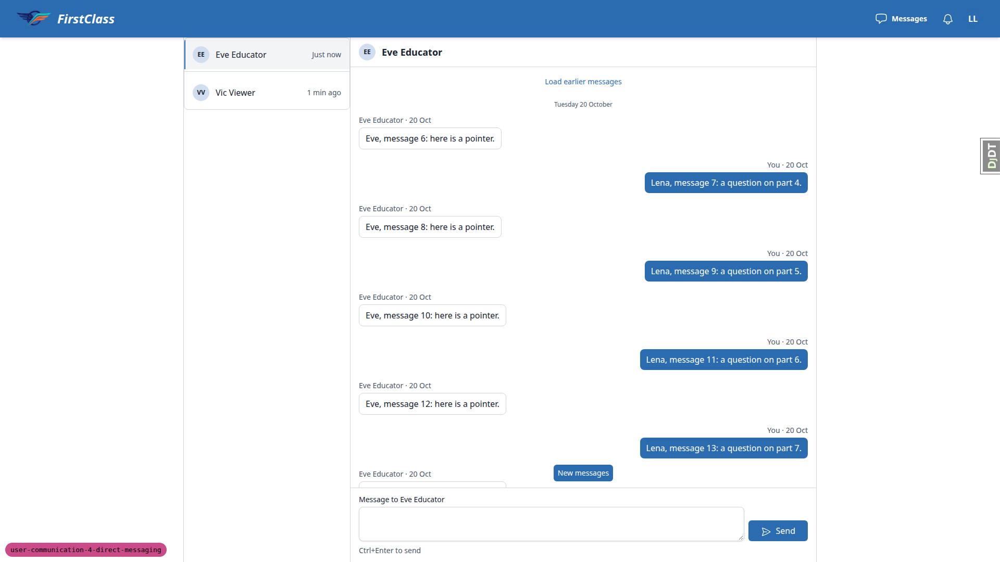
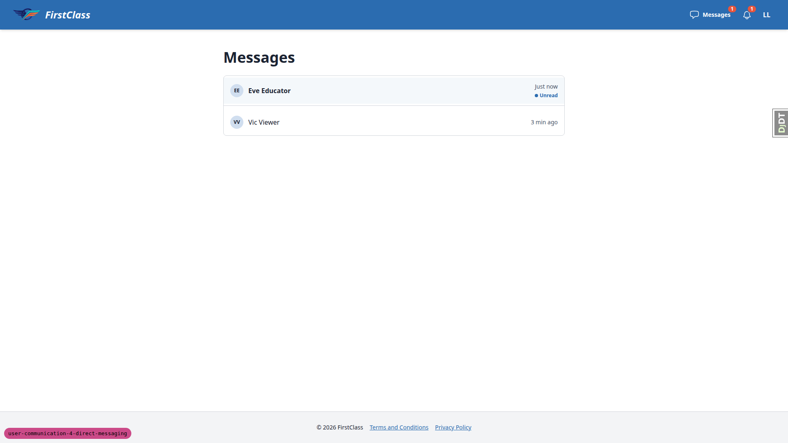
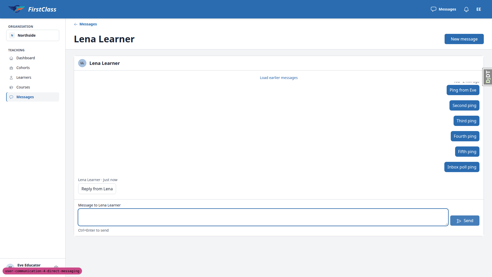

### §5 The educator Messages section

| test id | viewport | status | notes |
|---|---|---|---|
| 5.1 | desktop | pass | Sidebar Messages item with the speech-bubble icon and count 1 (Lena unread for Eve after a fresh message from Lena). |
| 5.2 | desktop | pass | Section lists Lena Learner (Unread) then Luis Learner only; Eli Educator, Gus Gone and the deleted-user conversation absent. |
| 5.3 | desktop | pass | Learners to Messages via the sidebar fired no unread-count or unread-badge request; the count element is hx-preserve with a 45s refresh timer and listens for conversationChanged. |
| 5.4 | desktop | pass | As demodev, Southside's sidebar renders its own count element #menu-count-messages-southside (empty, no conversations), distinct from Northside's. |
| 5.5 | desktop | pass | '← Messages' back link above the heading 'Lena Learner', returns to the section list. Thread panel has header, role=log, composer with label/hint. Opening the unread thread cleared the sidebar count (decided behaviour); 'Hi Lena from the section' appended. |
| 5.7 | desktop | pass | Header Messages button from the educator interface opens /messages/ listing Lena, Luis, Eli Educator, Deleted user and Gus Gone; Gus and Deleted user carry Read only with the lock icon. |
| 5.8 | desktop | pass | Gus Gone thread: no composer; role=status note with lock icon 'Replies are closed' / 'You can no longer message Gus from here. You can both still read this conversation.' No course, status or date named. |
| 5.9 | desktop | pass | Deleted user thread: header 'Deleted user' with generic person icon, their messages labelled 'Deleted user', note 'This conversation can't take new messages. You can still read it.' |

(5.6 is covered by the design check below.)

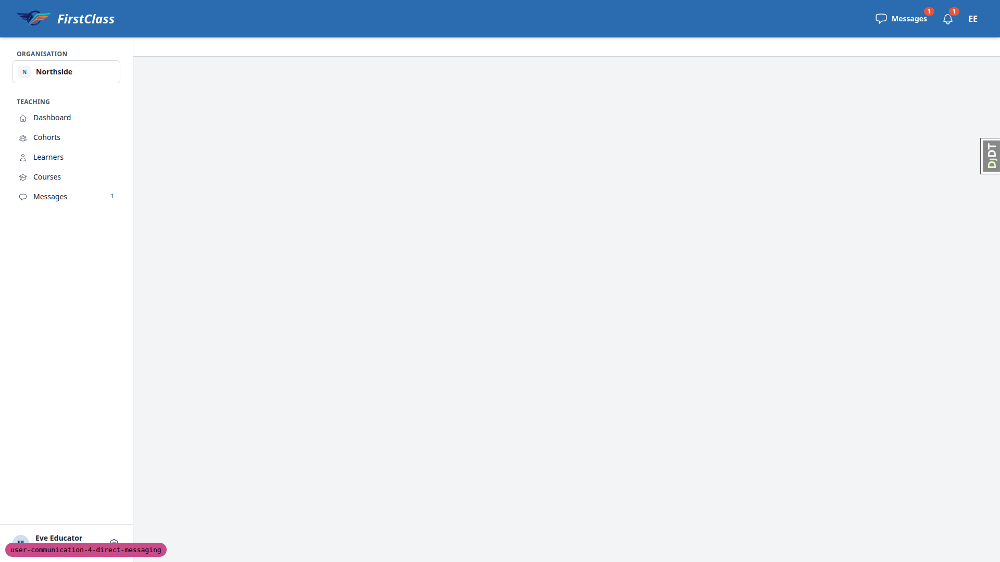
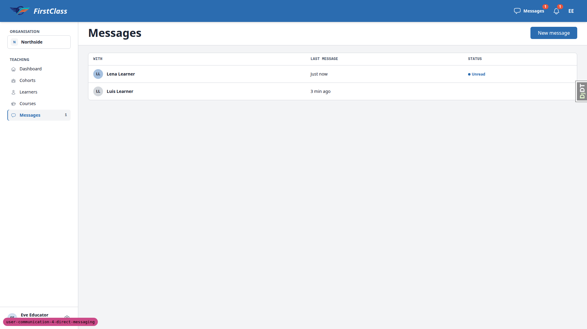
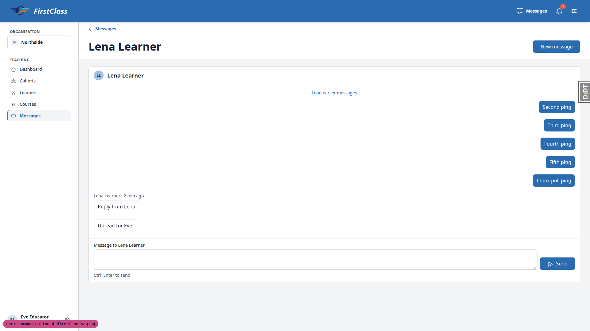
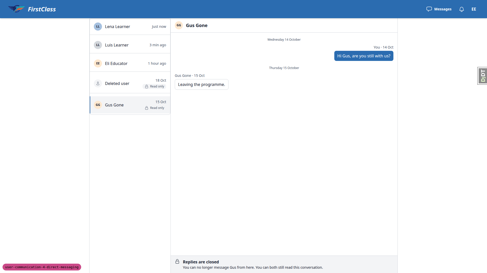

### §6 Starting a conversation

| test id | viewport | status | notes |
|---|---|---|---|
| 6.1 | desktop | pass | App modal 'New message', To field focused, full grouped list (Cohort A: Lara/Lena/Luis, Cohort B: Bea, name+email), Gus and Sam absent. 'la' narrows to Lara; 'zzz' and 'sam' both give the identical 'No one you can message matches ...' line. Choosing Lara shows 'To Lara Learner' + Change + composer with focus; Send closed the modal and navigated to the new section thread; list gained a Lara row; a second New message to Lara landed on the same conversation with both messages. |
| 6.2 | desktop | pass | With site learner_to_educator=open (set through the admin), Lena's inbox gains New message; /messages/new/ lists a 'Cohort admin' group with Eve and Eli only (Vic and Oscar absent), no email addresses, no 'instructors'. Choosing Eli and sending redirected to the new thread; inbox gained an Eli row. 'south' gives 'No one you can message matches ...'. Flag closed again afterwards. |

(6.4 is covered by the design check below.)

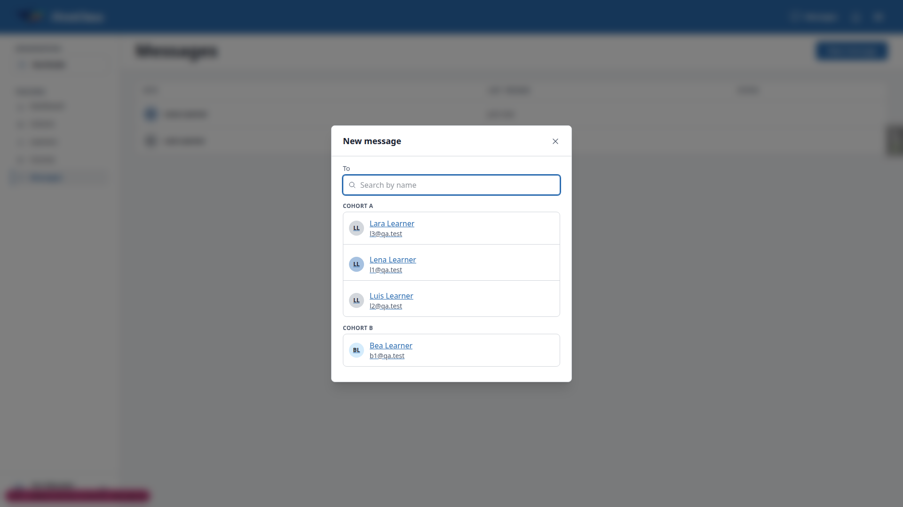
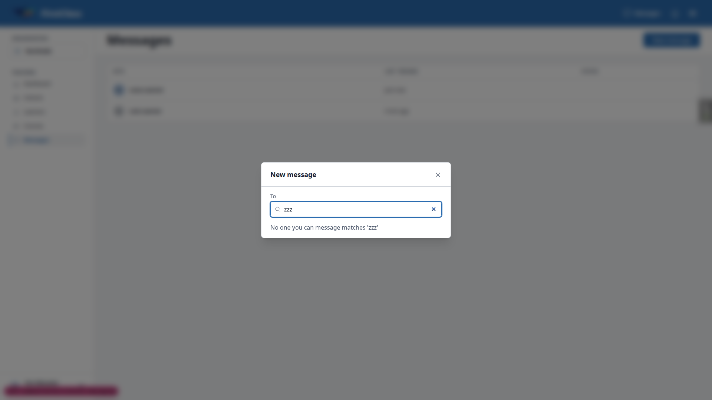
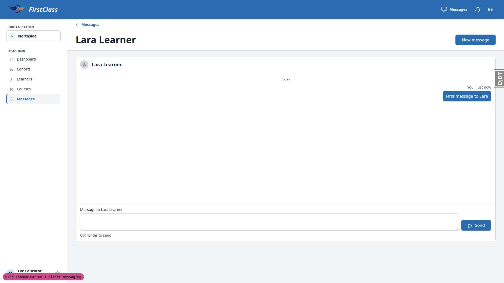
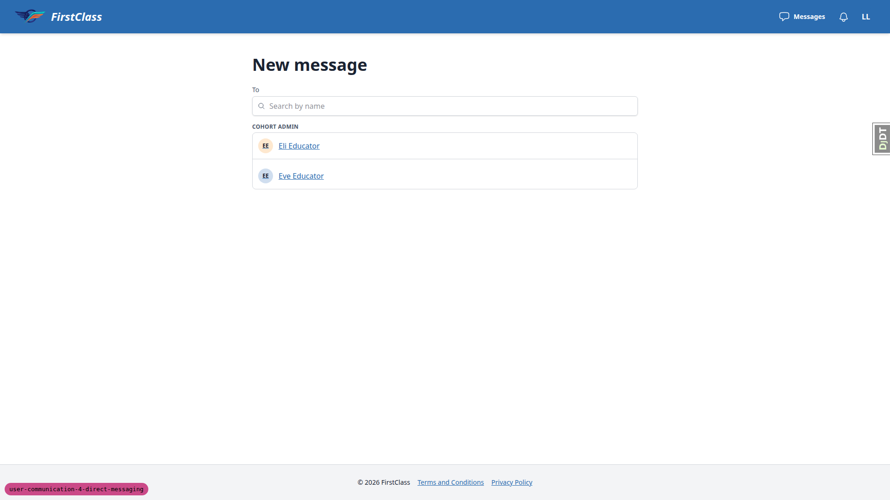

### §7 Closed threads and refusals

| test id | viewport | status | notes |
|---|---|---|---|
| 7.1-7.3 | desktop | pass | Lara removed from Cohort A and deactivated while Eve held a draft: after a poll the composer still held 'draft for Lara'; Send gave the alert 'Not sent. Lara can't receive messages from you here. Your text is still in the box.' with no Retry and the draft kept. After clearing, the next poll swapped in the closed note; history readable; /messages/ shows Lara with Read only in place. |
| 7.4 | desktop | pass | Lara restored (active, back in Cohort A): the section thread shows the composer again on load. |
| 7.5 | desktop | pass | learner_to_cohort_peer open: Lena's picker lists Lara and Luis under the course title group; 'Hi Lara' sent. Flag closed: poll kept the draft, Send refused with the alert, cleared box swapped to 'Messaging between you and Lara is closed here...'; Lara's side shows the same note naming Lena. Reopened: composer back on both sides. Closed again. |

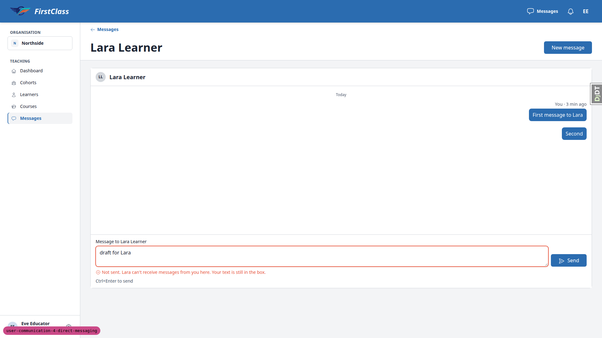
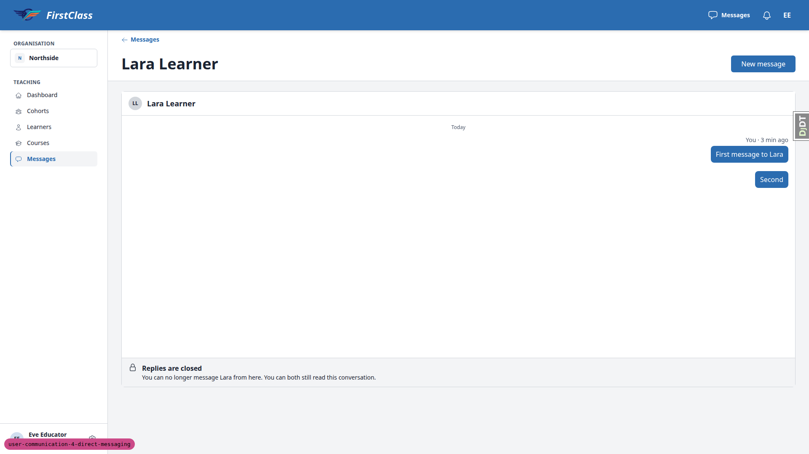
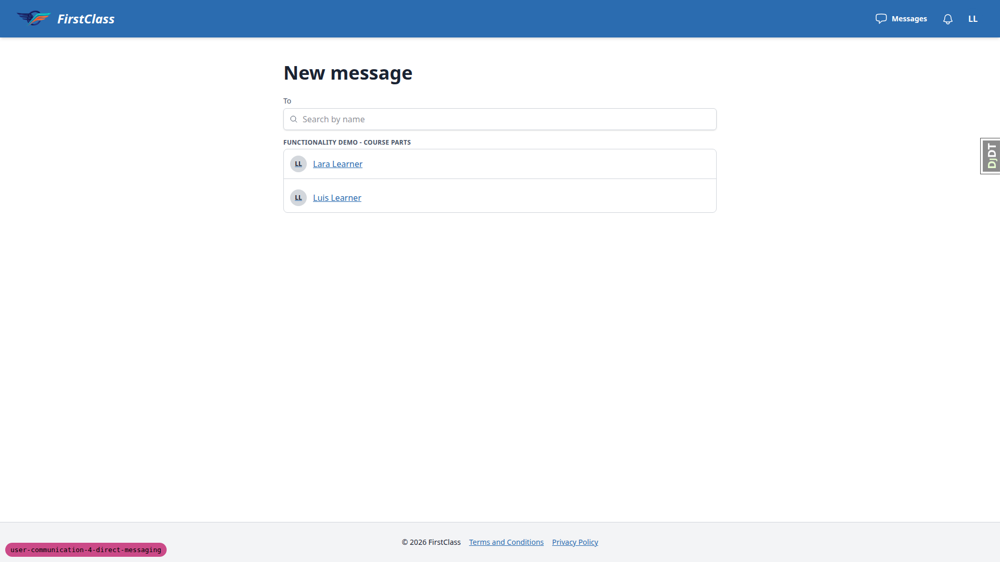

### §8 Notifications (rollup)

| test id | viewport | status | notes |
|---|---|---|---|
| 8.1-8.4 | desktop | pass | Luis's bell: 1 new, one row 'New message from Eve Educator' labelled 'Direct message' with the speech-bubble icon and no excerpt. Two more sends from Eve: still one row, 'Just now', badge 1. Clicking the row opened the Luis thread; bell then none new. One more send: a new unread row above the read one, badge 1. |
| 8.5 | desktop | pass | /notifications/: Mark unread, read, unread toggled the row's state while the Eve Educator inbox row stayed read each time; marked read before continuing. |
| 8.6 | desktop | pass | Eve's bell holds only 'New message from Lena Learner' rows (all read), nothing for her own messages. |
| 8.7 | desktop | pass | With an unread notification for the Eve thread, opening it directly cleared Lena's bell; with the thread open, a further message arriving by poll left the bell at none new (also after reload). |

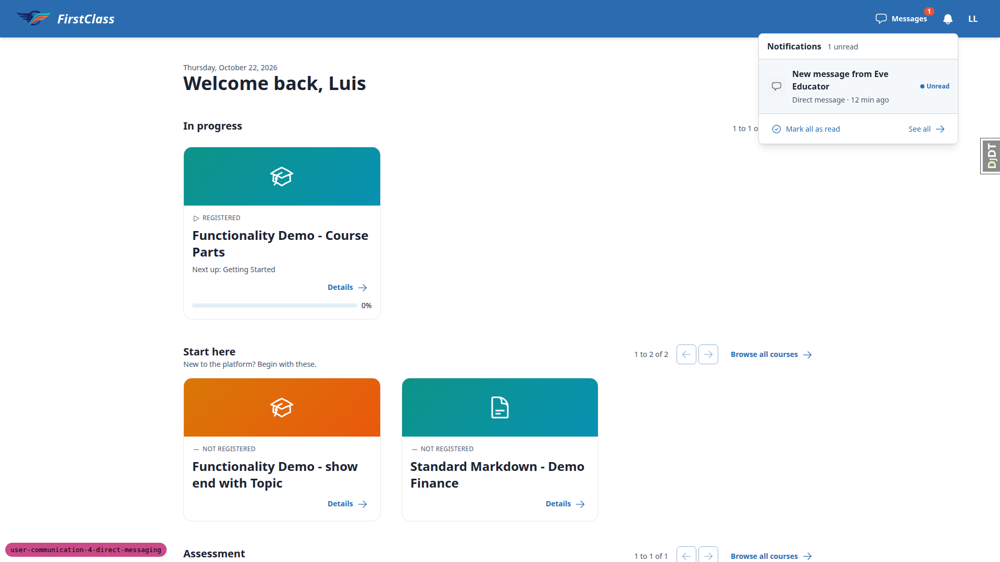
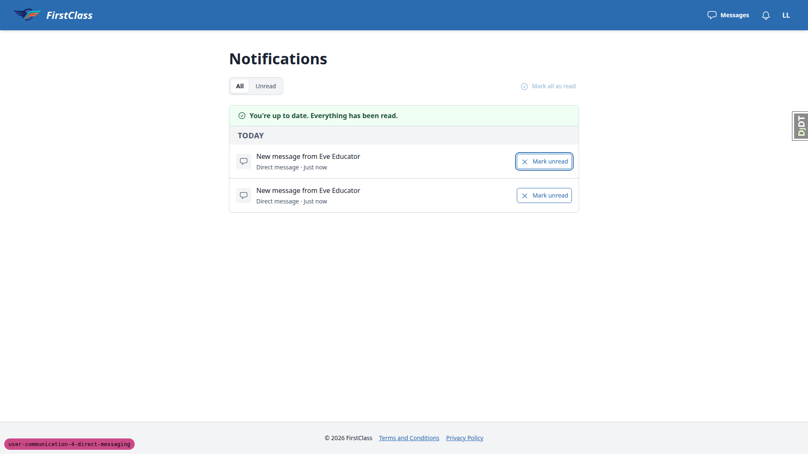

### §9 Failure modes and enumeration

| test id | viewport | status | notes |
|---|---|---|---|
| 9.1 | desktop | pass | Double-clicking Send produced exactly one 'once' bubble; the button was disabled during the request. |
| 9.2 | desktop | pass | Offline Send: alert 'Not sent. Check your connection and try again.' with Retry, text kept. Online + Retry: sent once, alert cleared. Retry double-clicked: still once. |
| 9.3 | desktop | pass | maxlength removed: 2,001 chars gives 422 with 'This message is too long. The limit is 2000 characters.' and the text kept; exactly 2,000 gives 200 and sent. |
| 9.4 | desktop | pass | As Lena, the edu<->l2 pk returns 404 for the page, POST send, poll and older. |
| 9.5 | desktop | pass | A conversation pk from site 4 returns 404 (no traceback) under /messages/<pk>/ and under the Northside section. |
| 9.6 | desktop | pass | Eve at northside/messages/<south.admin<->s1>: 404. Sid at southside/messages/<edu<->l1>: 404 (Sid's own Southside conversation: 200). |
| 9.7 | desktop | pass | Vic's Messages section lists only Vic's own Lena conversation; <edu<->l1> under the section: 404. |
| 9.8 | desktop | pass | edu<->edu2 under the section: 404; /messages/<pk>/: 200. |
| 9.9 | desktop | pass | Deleted-user conversation under the section: 404; /messages/<pk>/ renders read-only (see 5.9). |
| 9.10 | desktop | skip | Optional step needing a settings edit and server restart; not run. |
| 9.11 | desktop | pass | /older/?before=garbage gives 400 with no traceback. |
| 9.12 | desktop | pass | Stale picker, two paths. (a) Modal open, Bea removed+deactivated, then choosing Bea: the interface's 'This is no longer available' dialog (page-2026-10-22T17-24-43-435Z.png), nothing created. (b) Bea chosen and a draft typed, then removed, then Send: 422 from the new_message action with the alert 'Not sent. This person can't receive messages from you here. Your text is still in the box.' and the draft kept; no Bea row in the section or shared inbox afterwards. Bea restored. |

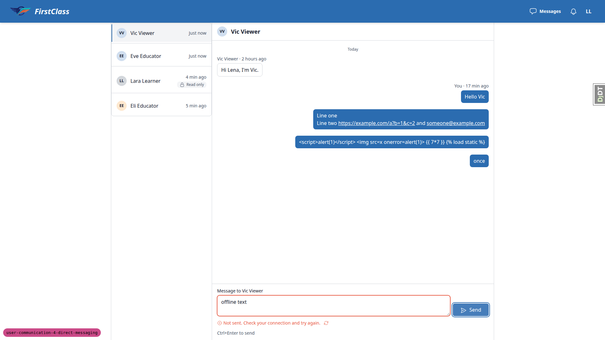
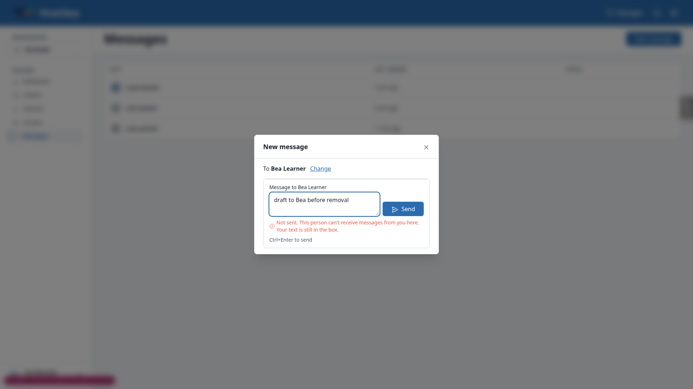
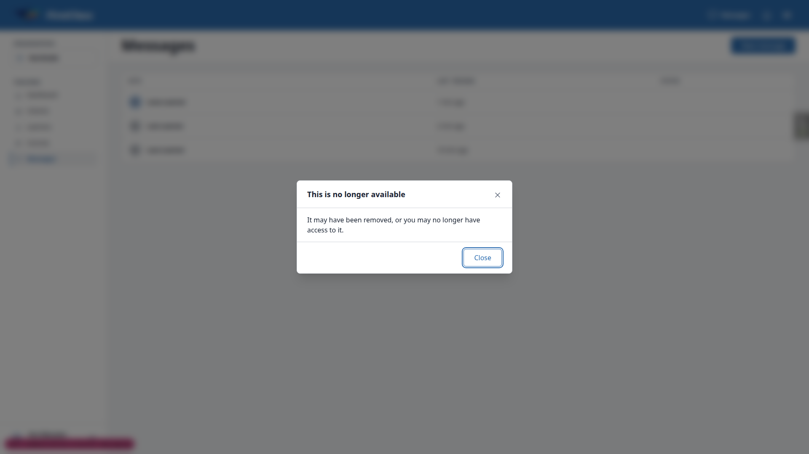

### §10 Quick-view message box

| test id | viewport | status | notes |
|---|---|---|---|
| 10.1-10.3 | desktop | pass | Lena's quick view: details then a Messages box with the last 3 messages, composer and an Open conversation link. Sending 'From the quick view' kept the drawer open, showed it among the latest 3 with an empty composer; header badge and sidebar count unchanged. Open conversation led to the section's Lena page with the message. |
| 10.4 | desktop | pass | Bea (no conversation with Eve): box shows no messages, the composer and no Open conversation link. Sending 'Starting from the quick view' showed the message and the Open conversation link without a page load. |
| 10.5 | desktop | skip | Gus Gone is not listed in Learners even with the Removed status included (he is in no cohort), so his quick view cannot be reached; the plan allows a skip here. |
| 10.6 | desktop | pass | Draft guard: clicking Luis with 'unsent' in Lena's box shows 'Discard your message?' with Keep editing / Discard; Keep editing kept Lena and the draft; Escape showed the same prompt; Discard closed the drawer. Draft again + Luis + Discard loaded Luis's quick view with an empty box. |
| 10.7 | desktop | pass | The body declares data-refresh-events='learnerChanged' with the learner's entity id. Firing learnerChanged for Lena in Eve's page while the box held a draft made no quick-view request and kept the draft; after clearing and closing, reopening refetched (one new request). Control: a reopen with no event reuses the content. A cohort change made in Oscar's browser does not reach Eve's page (events are client-side), so the drawer was unchanged in that case. |
| 10.8 | desktop | pass | Offline Send in the box: inline alert 'Not sent. Check your connection and try again.' with Retry inside the box, text kept; online + Retry sent once and emptied the box. |

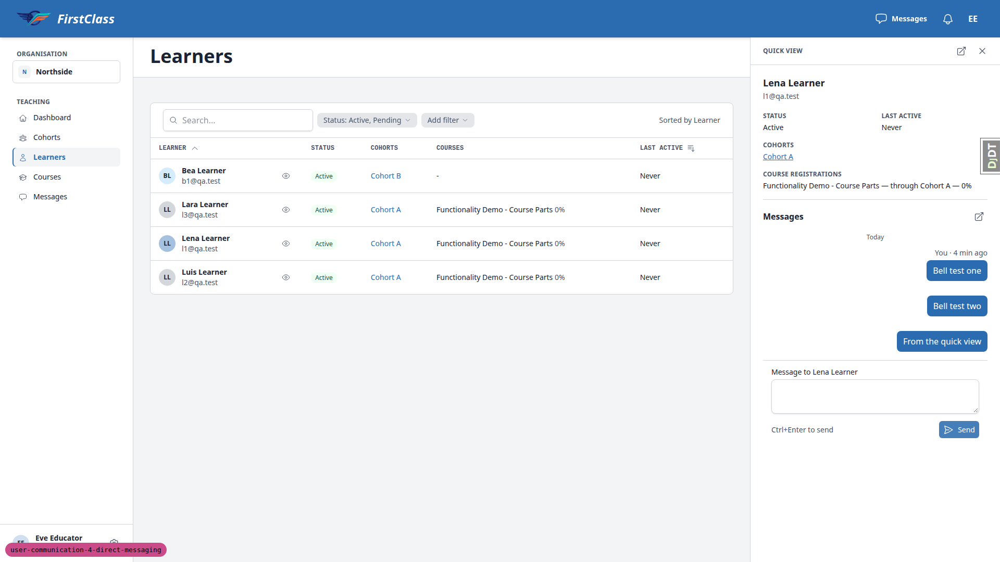
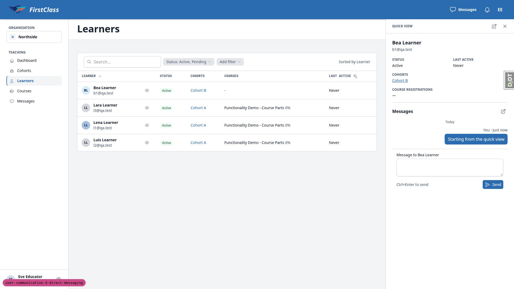
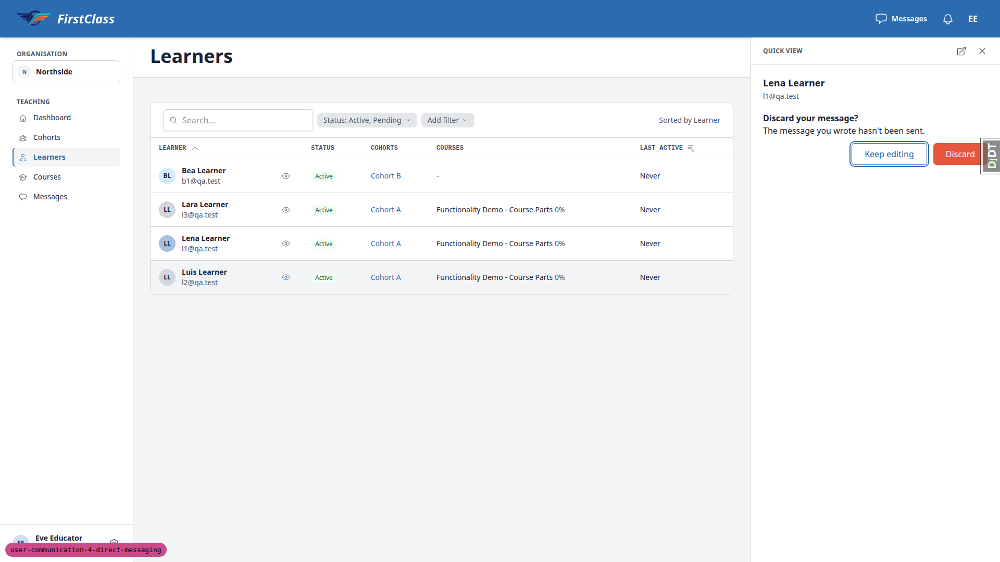
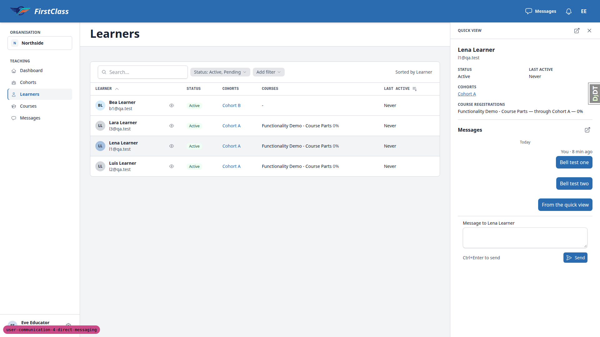

### §11 Role changes made in Members

| test id | viewport | status | notes |
|---|---|---|---|
| 11.1 | desktop | pass | Remove dialog names Vic, Cohort viewer, Cohort A, what is lost and that the account is kept; Cancel changed nothing; Confirm dropped Vic from Members and from Cohort A's Educators panel. Vic's thread kept the draft through a poll; Send gave 422 with the Lena refusal alert and nothing reached Lena; cleared box swapped to the closed note; /messages/ shows Lena Read only, no New message; northside/messages and the org root 404. Lena's open Vic thread became the closed note by poll and her inbox row gained Read only on the next inbox poll. Re-adding Vic from the Educators panel restored both composers and Vic's section. |
| 11.2 | desktop | pass | Bea replied; Eve's sidebar count 1 and header badge 1 agreed. Change cohorts (untick B) confirmed 'Removes: Cohort B'; scope 'Cohort A'. Section lost the Bea row, section/<pk> 404, sidebar count cleared while the header badge stayed 1 (expected disagreement). Shared inbox: Bea with Read only + Unread; opening showed 'You can no longer message Bea from here.' and the badge dropped to none. Modal and /messages/new/ lost the Cohort B group and 'bea' matched no one; Learners list had no Bea; Bea's thread showed the closed note by poll. Re-ticking B ('Adds: Cohort B') restored the row, composer, picker entry and Bea's composer. |
| 11.3 | desktop | pass | Suspend dialog: 'They keep their roles but can do nothing in Northside until reactivated.' Eli's row shows Suspended + Reactivate. Eli's next Northside navigation 404s; /messages/ lists Lena and Eve with Read only; Lena thread closed. Eve's colleague thread showed 'You can no longer message Eli from here.' by poll and Eli left her Colleagues group; Lena's picker listed Eve only, 'eli' matched no one, her Eli thread closed. Reactivate dialog: 'These roles take effect again: Cohort admin on Cohort A.'; afterwards Eli's section, both composers and Lena's picker entry returned. Vic added as Cohort admin (two entries): Lena's picker listed Eve, Eli, Vic; removing the Cohort admin entry ('They keep their account and Cohort viewer on Cohort A') dropped Vic from the picker while the Lena<->Vic thread kept its composer. Flag closed again. |
| 11.4 | desktop | pass | Quick-view draft to Luis, then Eve narrowed to Cohort B only: Send gave 422 with 'Not sent. Luis can't receive messages from you here. Your text is still in the box.', draft kept, no traceback; Luis received nothing and his bell showed nothing new. Learners then listed Bea only and the section only Bea. Restoring A+B brought Lena/Luis back with composers. |
| 11.5 | desktop | pass | Sid's Southside Members: only Sid with 'You' and no actions; northside/members 404. Sid's picker: Cohort S with Sam South only; 'eve' and 'lena' match no one. Eve at southside/messages: 404. |

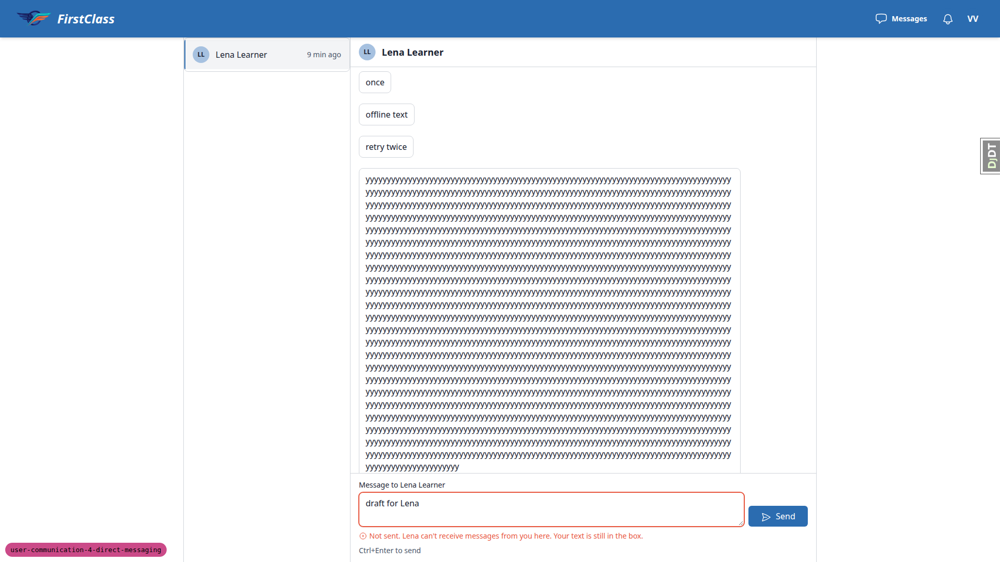
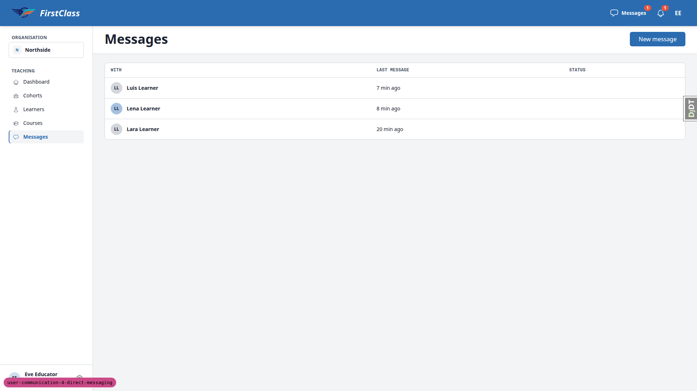
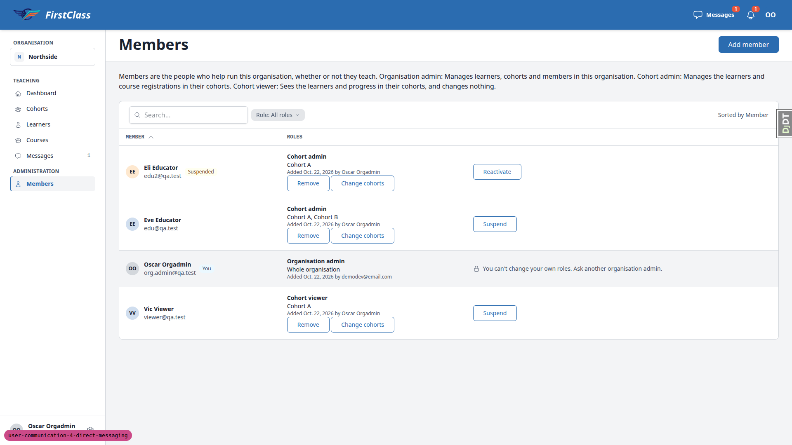
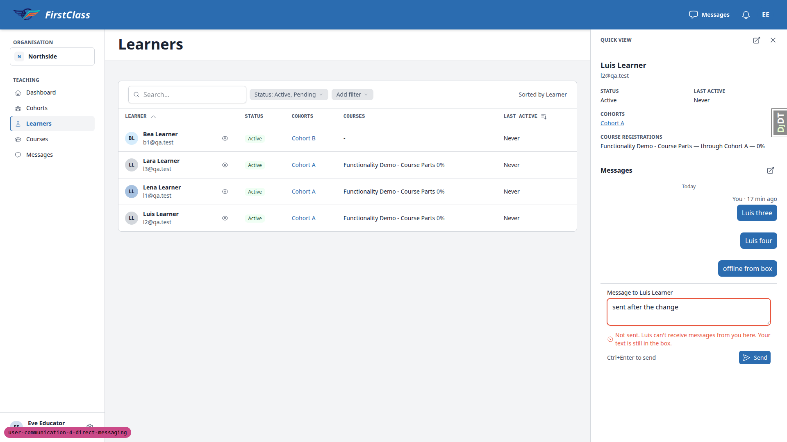

### §12 375px flows and accessibility

| test id | viewport | status | notes |
|---|---|---|---|
| 12.1 | mobile | pass | /messages/ at 375: no horizontal overflow; rows 56-68px tall with name, time and Unread/Read only markers; header shows the Messages icon with the count badge and no visible label (status text 'Messages, 1 unread'). Thread shows only the thread with a 'Back to messages' arrow before the name; composer visible at the bottom (y 706-772 of 812) and unchanged on focus; the log scrolls independently; a 100-character word wrapped inside its bubble. Back returned to the inbox list. |
| 12.2.1 | mobile | pass | Section at 375 renders cards with name, 'Last message' time and 'Status: Unread' marker; New message button in the top bar; no overflow. Observation: a read conversation's card shows the 'Status' label with an empty value (page-2026-10-22T17-41-31-106Z.png). |
| 12.2.2 | mobile | pass | Lena's thread at 375: back controls before the name ('← Messages' page link and the panel's 'Back to messages' arrow); bubbles wrap, the long word breaks, no overflow; composer at the bottom (y 640-706) stays put on focus; icon-only Send has aria-label 'Send' and a 76x40 target. Observation: two back controls stack on the mobile thread page. |
| 12.2.3 | mobile | pass | New message opens as a bottom sheet spanning the full width (x 0-375, from y 266), with a Close control, 'To', the search field and grouped rows 60px tall. |
| 12.2.4 | mobile | pass | Lena's quick view at 375 is a bottom sheet (lower half) holding the message box; sending 'mobile quick view' kept the sheet open and showed the message. |
| 12.3 | mobile | pass | Tabbing the inbox lands on one link per row named by the person (unread rows carry a leading 'Unread.' text). role=log is labelled 'Messages with Eve Educator'; #thread-status is role=status; refusal/network alerts are role=alert; the closed note is role=status. Under a grayscale filter the Unread marker (dot + text) and Read only tag (lock + text) stay distinguishable. Header Messages button name 'Messages, none unread', icon-only Send 'Send'; all 9 icons on the page carry width/height. |
| 12.1 | tablet | pass | 768x1024 learner: inbox with no overflow, header shows the Messages label (page-2026-10-22T17-44-49-719Z.png); the thread keeps the two-pane layout (list left, thread right, no back arrow), composer at the bottom with a labelled Send button, long word wraps. |
| 12.2 | tablet | pass | 768x1024 educator: sidebar collapses behind a hamburger; the section keeps its table (With / Last message / Status) with no overflow; Lena's thread shows '← Messages', the panel header, log and composer at full width (page-2026-10-22T17-44-55-163Z.png); New message modal is centred at 512px wide (page-2026-10-22T17-44-58-371Z.png); Lena's quick view is a 480px side drawer over the list, the message box works and the drawer stays open after a send (page-2026-10-22T17-45-04-387Z.png); Members table fits with no overflow (page-2026-10-22T17-45-06-769Z.png). |

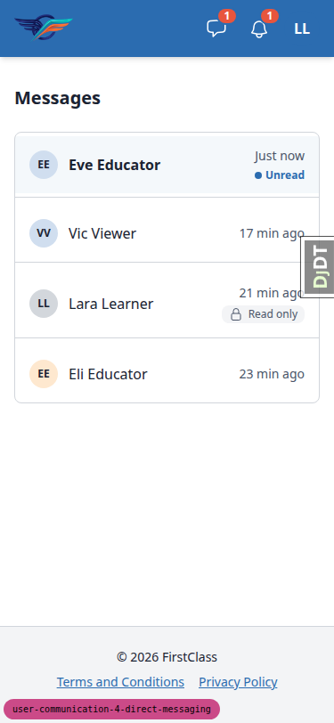
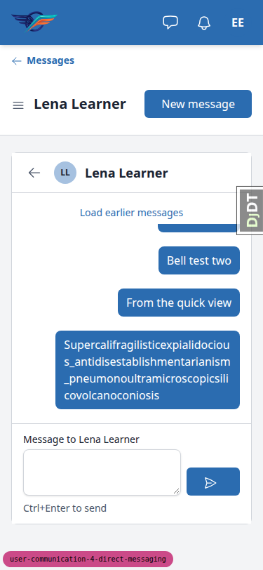
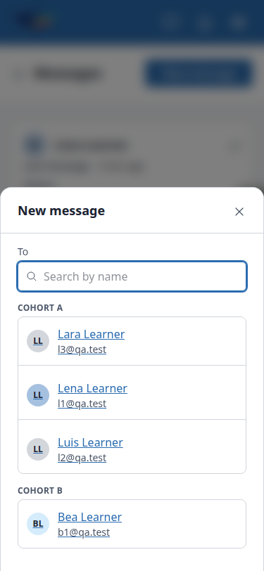
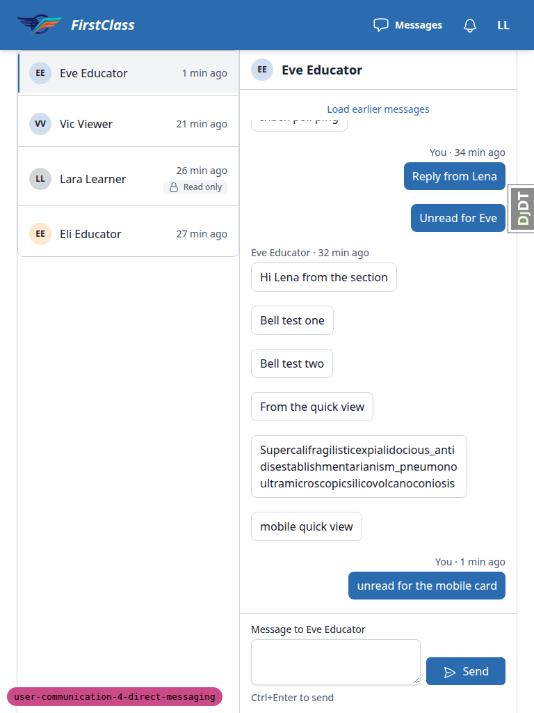

## Design check

| test id | viewport | this run's screenshot | design screenshot | result |
|---|---|---|---|---|
| 2.3-design | desktop | [page-2026-10-22T17-05-31-427Z.png](screenshots/page-2026-10-22T17-05-31-427Z.png) | [direct-messages__1280.png](design_screenshots/direct-messages__1280.png) | pass |
| 5.6-design | desktop | [page-2026-10-22T17-12-34-512Z.png](screenshots/page-2026-10-22T17-12-34-512Z.png) | [educator-messages__01-inbox-and-thread.png](design_screenshots/educator-messages__01-inbox-and-thread.png) | pass |
| 6.4-design | desktop | [page-2026-10-22T17-13-25-194Z.png](screenshots/page-2026-10-22T17-13-25-194Z.png) | [educator-messages__02-new-message.png](design_screenshots/educator-messages__02-new-message.png) | pass |
| 12.1.4-design | mobile | [page-2026-10-22T17-40-18-465Z.png](screenshots/page-2026-10-22T17-40-18-465Z.png) | [direct-messages__375.png](design_screenshots/direct-messages__375.png) | pass |
| 12.2.1-design | mobile | [page-2026-10-22T17-43-45-402Z.png](screenshots/page-2026-10-22T17-43-45-402Z.png) | [educator-messages__04-mobile.png](design_screenshots/educator-messages__04-mobile.png) | pass |
| 12.2.2-design | mobile | [page-2026-10-22T17-42-49-069Z.png](screenshots/page-2026-10-22T17-42-49-069Z.png) | [educator-messages__04-mobile-2.png](design_screenshots/educator-messages__04-mobile-2.png) | pass |
| 12.2.3-design | mobile | [page-2026-10-22T17-42-52-512Z.png](screenshots/page-2026-10-22T17-42-52-512Z.png) | [educator-messages__04-mobile-3.png](design_screenshots/educator-messages__04-mobile-3.png) | pass |

## Bugs

No bugs found this run.

## Bug status

No bugs to report.

## General notes

Skipped tests:

- 9.10: optional step needing a settings edit and server restart (messaging-off restart); not run.
- 10.5: Gus Gone is not reachable in the Learners list, even with the Removed status included (he is in no cohort), so his quick view could not be opened; the plan allows a skip here.

Observations (no action attached):

- The set-password email's link uses the Site domain (127.0.0.1:8000), not the request port; the port was substituted by hand.
- Sender lines on older days show the date ('You · 19 Oct') rather than a clock time, repeating the day separator.
- On mobile the educator section cards show a 'Status' label with an empty value for read conversations.
- On mobile the educator thread page stacks two back controls ('← Messages' and the panel's 'Back to messages' arrow).
- A quick view refetches only on a client-side `learnerChanged` event, so a change made in another person's browser is not reflected until the drawer is reopened after such an event (by design; tested by dispatching the event).
- 9.12: a stale pick is refused at the choose step with the interface's 'This is no longer available' dialog, and at the send step with a 422 and the draft kept.
- `/educator/organisations/northside/` (trailing slash, no section) renders the shell with an empty main area for an educator; `/educator/` redirects to the dashboard. Pre-existing, outside this feature.
- Eve's bell held three read 'New message from Lena Learner' rows, one per unread episode: consistent with the rollup rule.

status: ok · reason: report rendered, 0 bugs documented, 89 screenshots collected
