# Frontend QA report: direct messaging

## Methodology

- Playwright MCP driven by hand. Desktop at 1920x1080 (plus 1280 and 1442 for the design states), mobile at 375x812 and tablet at 768x1024.
- Several browser contexts were used for the two-person polling tests (for example Eve and Lena at the same time).
- Screenshots were collected into `screenshots/` beside this report, and every image referenced here exists. `screenshots/` also received Playwright snapshot `.yml` files and console logs. These are not committed.
- The dev data was rebuilt from section 0 of the test plan: DB wiped, demo data, `content_save`, then `qa_create_direct_messaging_scenario`. The qa-data-helper then reshaped it, because the seed command builds a different conversation set from the plan's section 0 (see test 1.2 notes and General notes).
- For 8.10 a second server ran with `MESSAGING_ENABLED=False`, using a scratchpad settings module that imports `settings_dev` (no repo edit).

## Diff scoping

Class: **FULL**. Files that triggered it:

- `freedom_ls/base/templates/partials/header_bar.html`
- `freedom_ls/comms/static/comms/js/alpine-components.js`
- `freedom_ls/comms/templates/comms/*.html`
- `freedom_ls/educator_interface/templates/educator_interface/**`
- `freedom_ls/panel_framework/static/panel_framework/js/alpine-components.js`
- `freedom_ls/panel_framework/templates/**`
- plus 100+ `.py`, migrations, tests and spec files

Nothing was skipped: everything ran (desktop, mobile, tablet).

## Smoke gate

Outcome: **pass**. Pages checked: `http://127.0.0.1:8528/` and `http://127.0.0.1:8528/messages/`.

## Test results

| Test | Viewport | Status | Note |
|---|---|---|---|
| 1.1 | desktop | pass | Header Messages button beside the bell, name 'Messages, 1 unread', badge 1. |
| 1.2 | desktop | pass | Inbox order and markers correct. Seed command differs from plan section 0; data reshaped. |
| 1.4 | desktop | pass | l3 inbox: empty state, no New message button. |
| 2.1 | desktop | pass | Two-pane layout, badge and Unread marker cleared. Composer below the fold at 1280x800 (see B4). |
| 2.2 | desktop | pass | Ctrl+Enter sends; bubble, empty focused textarea, Vic row first. |
| 2.3 | desktop | pass | Line break kept, URL linked with nofollow, email is mailto. |
| 2.4 | desktop | pass | Script, img and template syntax render literally. |
| 2.5 | desktop | pass | Counter at 1850 chars, maxlength 2000, hides when cleared. |
| 2.6 | desktop | pass | Empty send: 422 with alert, focus kept. |
| 2.7 | desktop | **fail** | Load earlier works, but the view jumps at scrollTop 0 (B1). |
| 3.1-3.2 | desktop | pass | Polled message appears in about 1.5s; status text has no message text; badge unchanged. |
| 3.3 | desktop | pass | Scrolled-up log stays put; 'New messages' button works. |
| 3.4 | desktop | pass | Draft, caret and focus survive a poll. |
| 3.5 | desktop | pass | Unrelated conversation changes nothing; badge and row update within 70s. |
| 3.6 | desktop | pass | Reading clears Lena's badge only; Eve's count unaffected. |
| 4.1 | desktop | pass | Sidebar count 1, header badge 2 (consistent: sidebar counts learner conversations only). |
| 4.2 | desktop | pass | Gus Gone and Deleted user absent from the educator section, by spec (plan stale). |
| 4.3 | desktop | pass | Count stable across navigation, no unread-count requests. |
| 4.4 | desktop | pass | Per-organisation sidebar count ids. |
| 4.5 | desktop | pass | Instance page works; breadcrumb is the framework back link (plan stale). |
| 4.7 | desktop | pass | Gus: section 404; shared inbox shows closed note, Read only. |
| 4.8 | desktop | pass | Deleted user: section 404; shared inbox read-only with generic labels. |
| 4.9 | desktop | pass | Header button from educator interface opens /messages/ with all five rows. |
| 5.1.1 | desktop | **fail** | Modal and list correct, but focus lands on the heading, not the To field (B5). |
| 5.1.2 | desktop | pass | Search filters; no-match copy identical for 'zzz' and 'sam'. |
| 5.1.3 | desktop | pass | Choose Lara, send, modal closes, navigates to new conversation. |
| 5.1.5 | desktop | pass | Second message lands on the same conversation. |
| 5.2 | desktop | pass | Open config adds New message for l1; educators only, no emails. Admin Save click needed requestSubmit. |
| 6.1-6.2 | desktop | pass | Draft survives; send returns 422 with alert and kept text, no Retry. |
| 6.3 | desktop | pass | Composer replaced by closed note on next poll; history readable. |
| 6.4 | desktop | pass | Composer back after restore. |
| 6.5 | desktop | pass | Thread stays open: can_reply is symmetric, so closed note unreachable (plan stale). |
| 7.1 | desktop | pass | One bell row 'New message from Eve Educator', no excerpt. |
| 7.2 | desktop | pass | Further messages: still one row, badge 1. |
| 7.3-7.4 | desktop | pass | Row opens the thread, bell clears; new send creates a new row. |
| 7.5 | desktop | pass | Notification read toggles do not change inbox state. |
| 7.6 | desktop | pass | No self-notification. |
| 7.7 | desktop | pass | Opening the thread clears bell and badge; polled message while open raises no bell. |
| 8.1 | desktop | **fail** | One POST only, but Send is never disabled in flight (B2). |
| 8.2 | desktop | pass | Offline alert with Retry; retry (even twice) sends once. |
| 8.3 | desktop | pass | 2001 chars gives 422 with text kept; 2000 accepted. |
| 8.4 | desktop | pass | Other people's thread, poll, older, send: all 404. |
| 8.5 | desktop | pass | Other-site conversation 404. |
| 8.6 | desktop | pass | Cross-organisation conversations 404. |
| 8.7 | desktop | pass | Viewer sees only own row; other threads 404. |
| 8.8-8.9 | desktop | pass | Educator-to-educator and deleted-user conversations 404 in the section; shared inbox correct. |
| 8.10 | desktop | pass | With MESSAGING_ENABLED=False: no button, no item, /messages/ 404, no quick-view box. |
| 8.11 | desktop | pass | Bad cursor gives 400, no traceback. |
| 8.12 | desktop | **fail** | Send to a now-unmessageable recipient gives 404 and loses the draft (B3). |
| 9.1-9.2 | desktop | pass | Quick view message box shows last 3, send keeps drawer open. |
| 9.3 | desktop | pass | Open conversation goes to the educator section thread. |
| 9.4 | desktop | pass | No-conversation learner: box, first send, link appears. |
| 9.5 | desktop | skip | Inactive learners are not listed, so no quick view to open. |
| 9.6 | desktop | pass | Draft guard prompt, Keep editing, Escape, Discard all behave. |
| 9.7 | desktop | pass | Driven by dispatching `learnerChanged`; draft kept, refetch when empty or stale. |
| 9.8 | desktop | pass | Offline send in drawer: inline alert, Retry sends once. |
| 9.extra-stale | desktop | pass | Deactivated recipient in quick view: 422, text kept. |
| 10.3.1-10.3.2-10.3.4 | desktop | pass | Roles, labels and accessible names correct; icons sized correctly. |
| 10.layout-desktop | desktop | **fail** | Page scrolls and the composer is partly below the fold (B4). |
| 10.1.1-10.1.3 | mobile | **fail** | Inbox and back navigation fine; composer cut off by page scroll (B4). |
| 10.2.4 | mobile | pass | Quick view is a full-width bottom sheet; send keeps it open. |
| 10.tablet-inbox | tablet | pass | No overflow; Read only and Unread markers distinguishable in grayscale (10.3.3). |
| 10.tablet-thread | tablet | **fail** | Composer clipped at the bottom edge (B4). |
| 10.tablet-section | tablet | pass | Table layout, nav dialog works, composer in view, modal 512px. |

## Design check

| Test | Viewport | This run | Design | Result |
|---|---|---|---|---|
| 1.3-design | desktop | 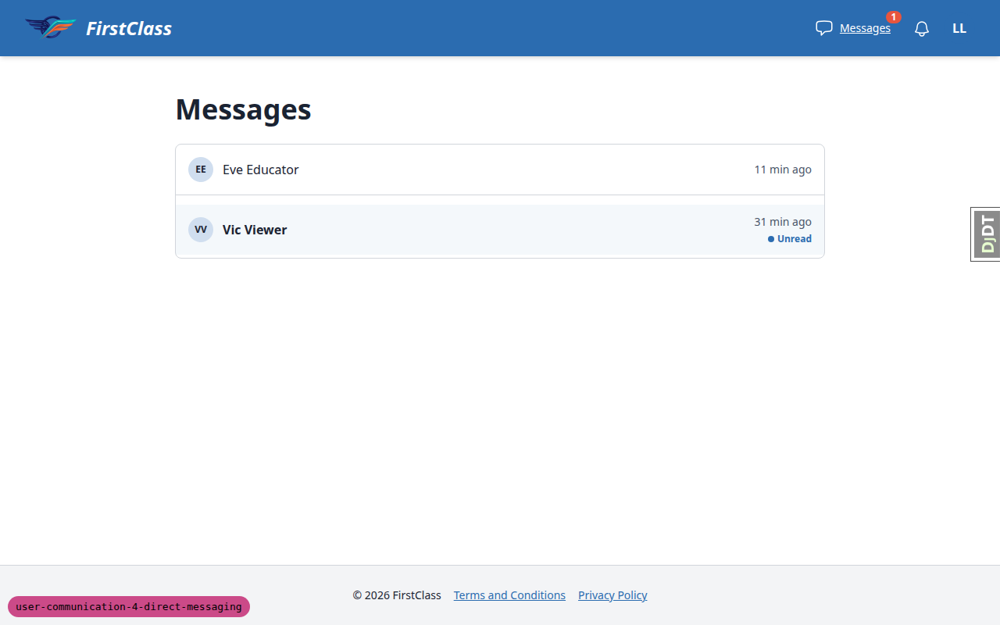 | 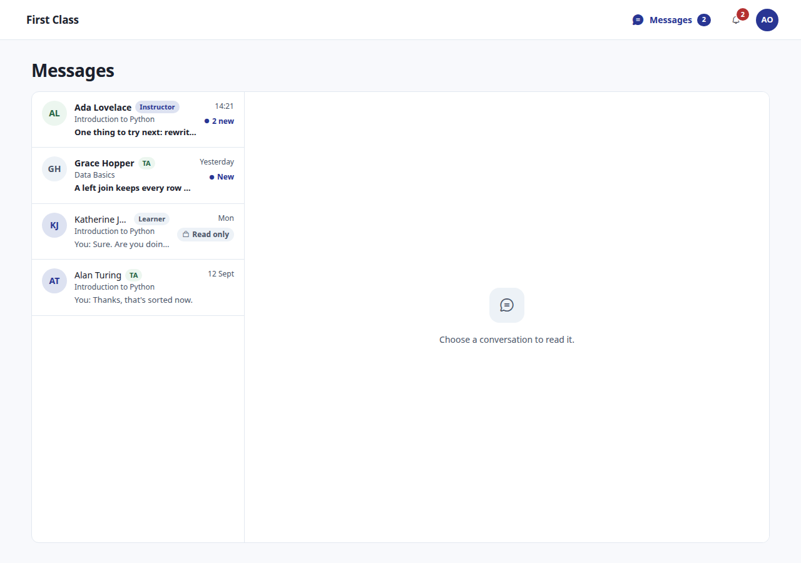 | pass |
| 4.6-design | desktop | 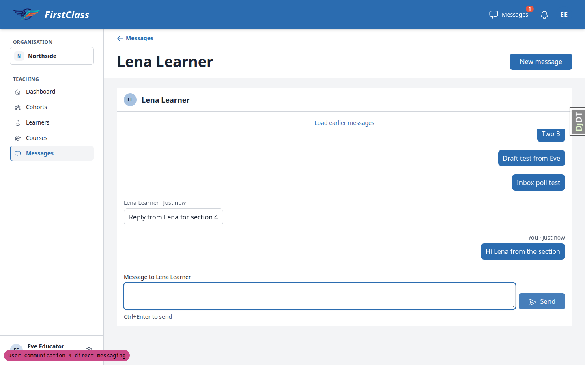 | 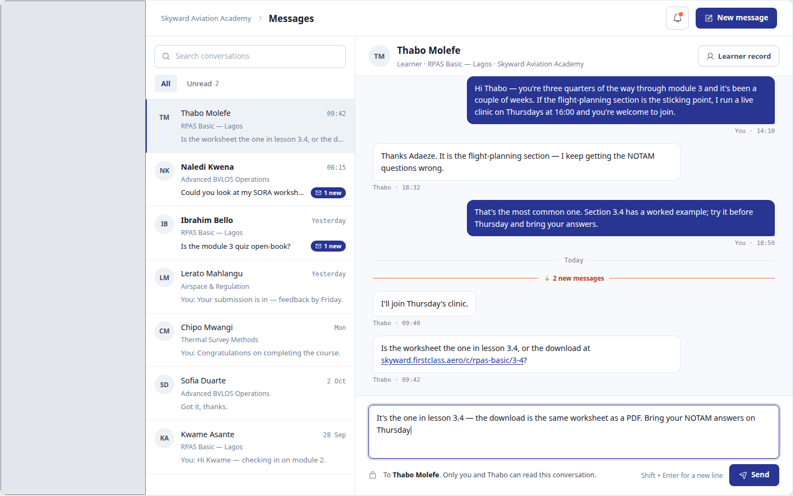 | pass |
| 5.1.4-design | desktop | 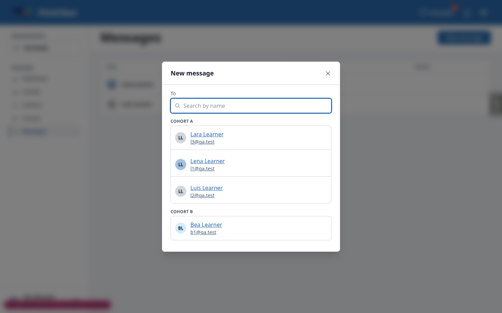 | 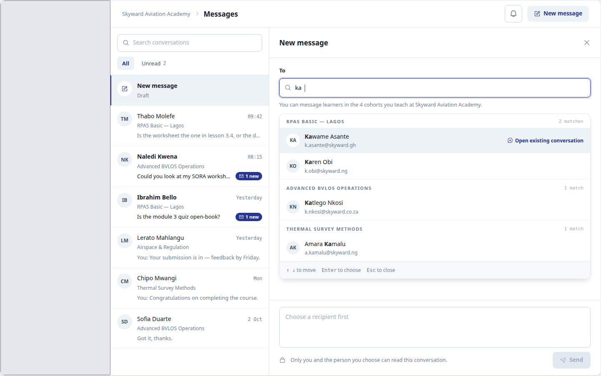 | pass |
| 10.1.4-design | mobile | 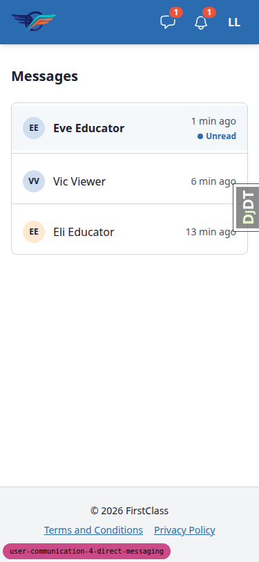 | 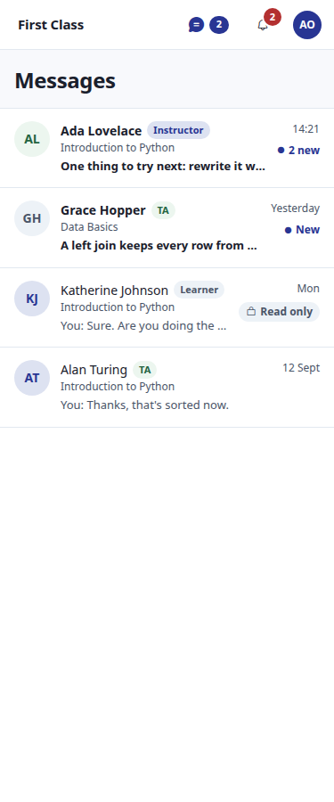 | pass |
| 10.2.1-design | mobile | 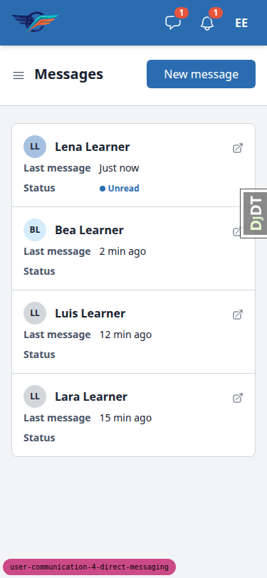 | 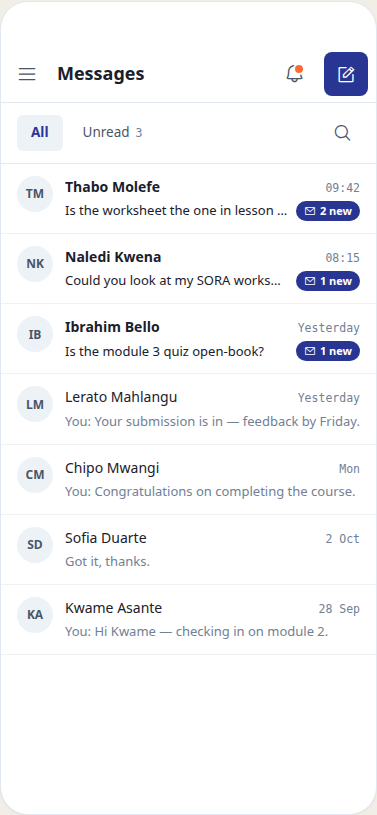 | pass |
| 10.2.2-design | mobile | 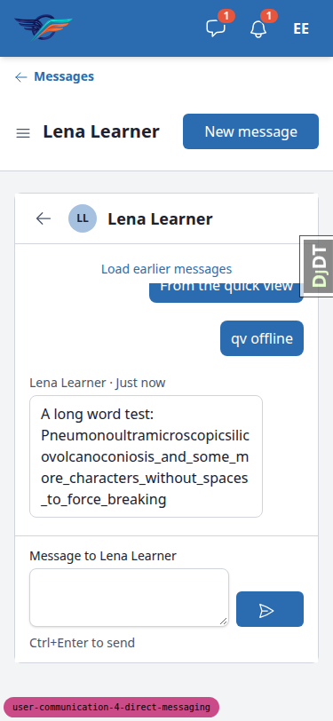 | 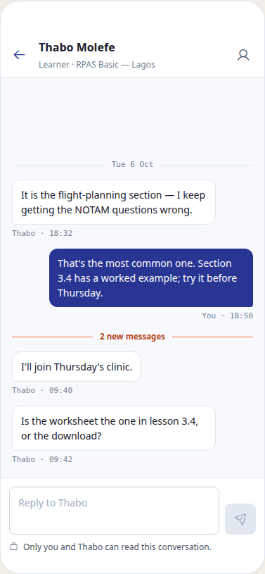 | pass |
| 10.2.3-design | mobile | 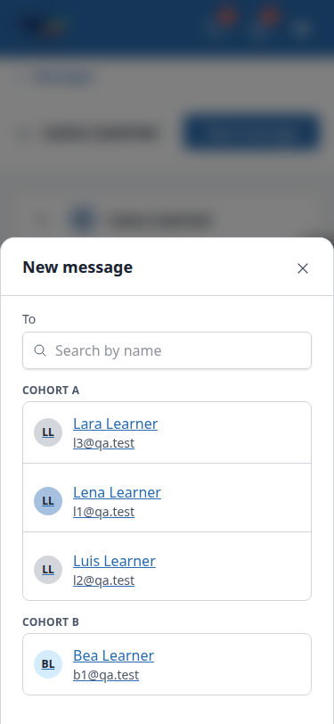 | 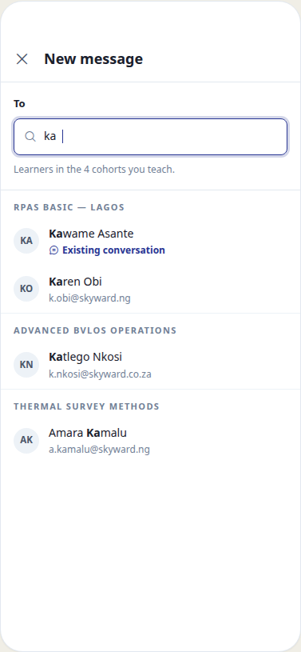 | pass |

## B1: Load earlier messages jumps the view when the log is scrolled to the top

Manifestations: 2.7 (desktop).

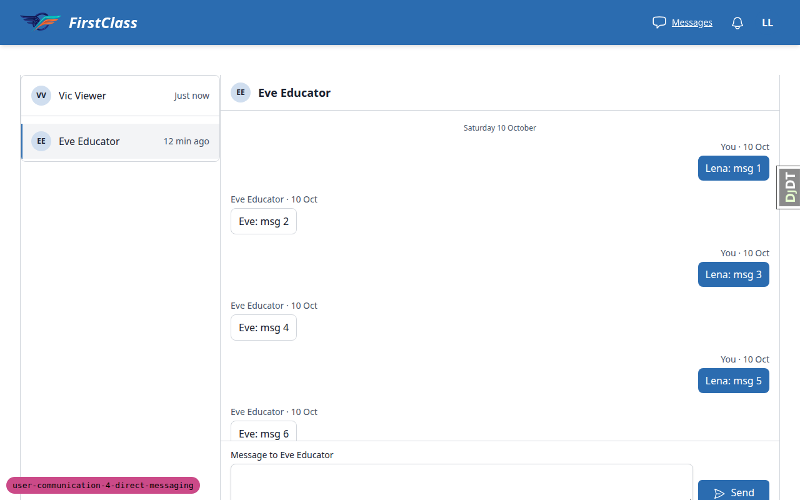

- **Expected:** prepending older messages keeps the message the reader was looking at in place (scrollTop grows by the prepended height).
- **Actual:** with the log at scrollTop 0 (where the control is), clicking Load earlier messages leaves scrollTop at 0, so the view jumps to the oldest message (msg 6 moved from y=293 to y=673). `conversationThread.rememberScroll` tests `event.detail.elt.closest('#thread-older')` in `htmx:before-swap`, but in htmx 2 `detail.elt` is `#thread-log`, so `beforePrepend` is never set and `keepScrollAfterPrepend` never runs. Mid-scroll it only looks right because of native scroll anchoring.

## B2: Send button is not disabled while a send is in flight

Manifestations: 8.1 (desktop). No screenshot.

- **Expected:** the Send button is disabled during the send request (spec: Send button with `hx-disabled-elt`).
- **Actual:** with the request delayed 1.5s the button stays enabled. `hx-disabled-elt="this"` sits on the button, but the form issues the request, so htmx never disables it. Duplicates are still prevented by `hx-sync="this:drop"` on the form.

## B3: New message modal loses the typed draft when the recipient stops being messageable

Manifestations: 8.12 (desktop).

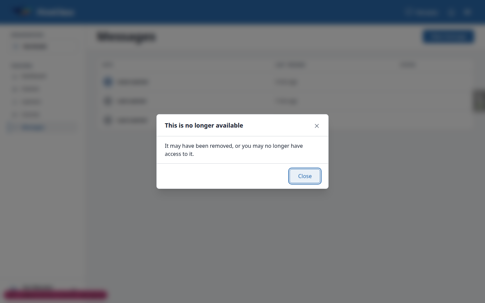

- **Expected:** Send returns 422 with the refusal alert ('Not sent. Bea can't receive messages from you here. Your text is still in the box.') and the text stays in the box (spec decision 4).
- **Actual:** POST `__actions/new_message` returns 404; the modal is replaced by the generic 'This is no longer available' and the typed text is lost. `NewMessageAction.handle_submit` resolves the recipient with `get_object_or_404` over the current candidate set before `send_message`, so the refusal path is unreachable. Nothing is created.

## B4: Shared thread page scrolls and pushes the composer below the fold

Manifestations: 10.layout-desktop (desktop), 10.1.1-10.1.3 (mobile), 10.tablet-thread (tablet).

Desktop:

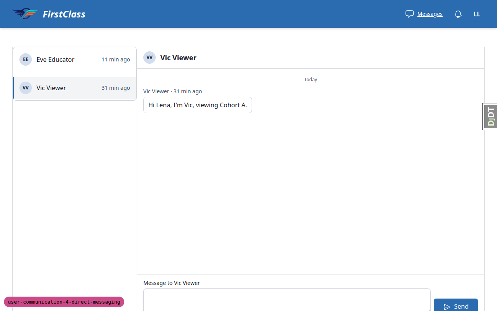

Mobile:

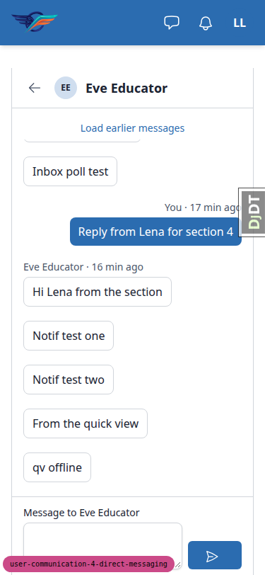

Tablet:

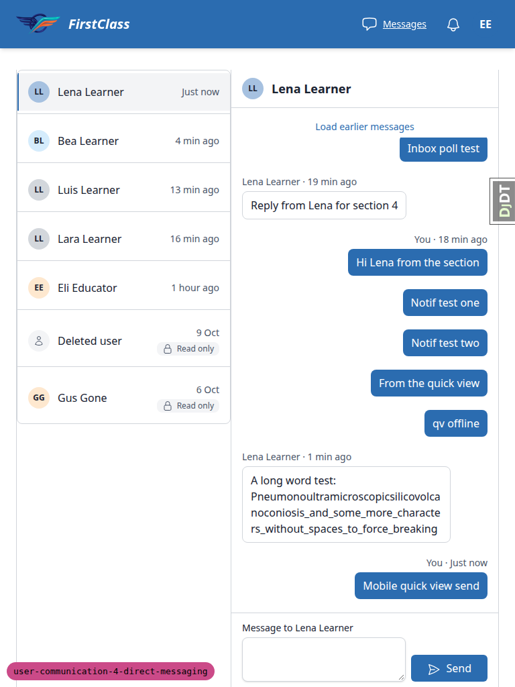

- **Expected:** on `/messages/<pk>/` the thread pane fills the viewport below the header, so the composer is fully in view and the log is the only scrolling part (conversationThread comment; plan 10.1.2 and the 10.2 checklist 'Composer stays visible at the bottom').
- **Actual:** the document scrolls too (scrollHeight 1253 at 1080, 985 at 812, 1165 at 1024) and the composer is clipped: textarea bottom 1088/804/1016, the 'Ctrl+Enter to send' hint below the fold, Send clipped at tablet. The pane is 100dvh minus the header, but the page's top spacing and footer are added on top. The educator-section thread is not affected.

## B5: New message modal focuses the heading, not the To search field

Manifestations: 5.1.1 (desktop).

- **Expected:** test plan 5.1.1: the 'To' search field has focus when the modal opens.
- **Actual:** focus lands on the 'New message' heading; `new_message.html` deliberately uses `<c-modal-header focus_title="true">`. The spec is silent, so this may be a plan or spec decision rather than a code defect.

## Bug status

- **FIXED** (commit: 1de64980) — B1 Load earlier messages jumps the view when the log is scrolled to the top. Re-verified: from scrollTop 0 the anchored message stays in place (only the removed button's 44px shift).
- **FIXED** (commit: b0996f99) — B2 Send button is not disabled while a send is in flight. Re-verified on the shared thread and the quick-view box: disabled mid-flight, enabled after.
- **UNRESOLVED** — B3 New message modal loses the typed draft when the recipient stops being messageable (reason: security-adjacent. Returning a 422 that names the recipient for a pk outside the sender's candidate set would let pk enumeration reveal names, so a human has to decide how to keep the draft without that leak).
- **FIXED** (commit: 518f5a71) — B4 Shared thread page scrolls and pushes the composer below the fold. Re-verified at 1920x1080, 1280x800, 768x1024 and 375x812: the document no longer scrolls and the composer and hint are fully in view. Note that the fix removes the site footer (Terms and Privacy links) from the thread page. After the fix: 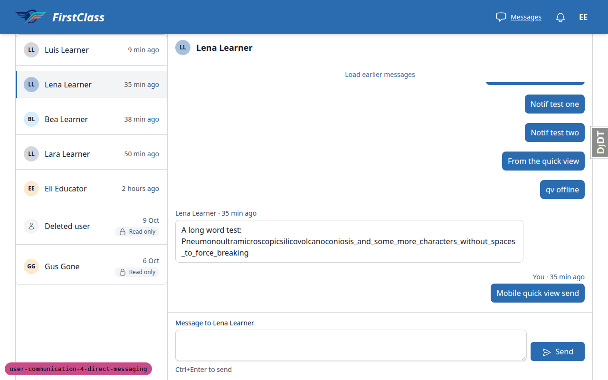 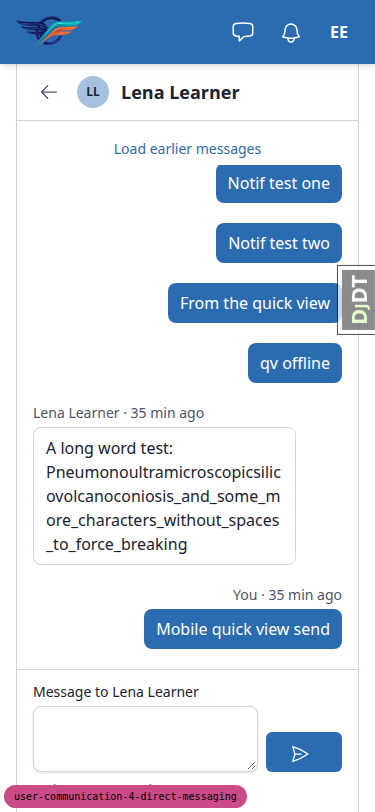
- **FIXED** — B5 New message modal focuses the heading, not the To search field. Decision: focus the To field, since the modal header's `focus_title` is meant for fragments with no field to focus. The modal now focuses `#recipient-q` when it opens and the message box once a recipient is chosen.

## General notes

Test plan items that are stale against the spec or code:

- **4.2:** the Gus Gone and Deleted user rows are absent from the educator section by spec (only conversations whose other participant has an active Learner row are listed). The code matches the spec, and the plan contradicts its own 8.9.
- **4.5:** the breadcrumb renders as the panel framework's back link ('<- Messages'), not the 'Northside > Messages > Lena Learner' trail the plan describes.
- **6.5:** the closed-by-configuration note is unreachable, because `MessagingPolicy.can_reply` is symmetric: whichever direction may start now keeps the conversation open.
- **8.12(a):** choosing a no-longer-messageable recipient gives a 404 'no longer available' modal rather than a send-time 422.

Other observations:

- **9.5** was skipped because inactive learners are not listed.
- **9.7** was driven by dispatching `learnerChanged`, because another browser context cannot fire it.
- The Django admin Save button did not respond to a Playwright click (`form.requestSubmit` worked). This is not product code.
- Avatar initials inside picker links pick up the link underline.
- Each conversation-row avatar renders its own inline `<style>` block (repeated `@layer components` rules).
- `qa_create_direct_messaging_scenario` does not match the plan's section 0 conversation table. Fix one or the other.
- The debug toolbar overlaps controls and had to be hidden.

status: ok · reason: 5 bugs — 3 fixed, 2 unresolved; report rendered, screenshots verified
