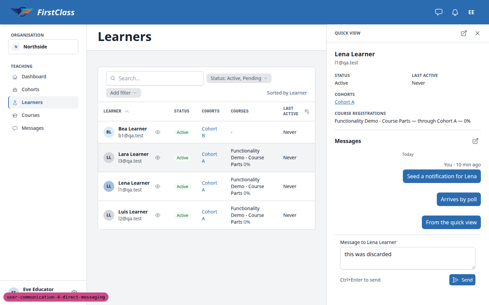
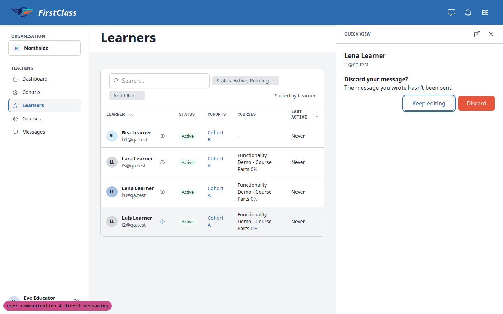
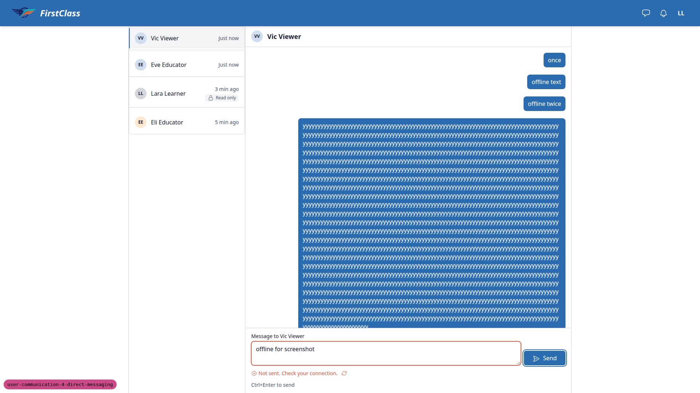
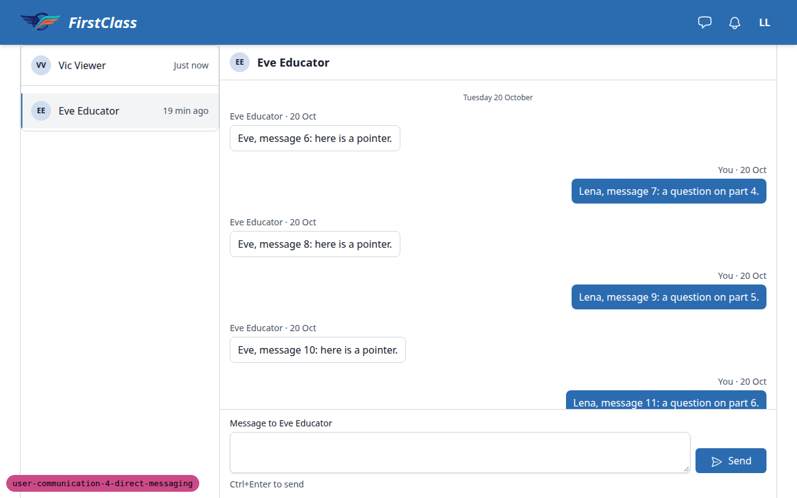

# Frontend QA report: direct messaging

Run date 2026-10-22. Dev server on port 8859. Branch `user-communication-4-direct-messaging`.

33 test records ran: 28 pass, 3 fail, 2 skip. The 3 failures are the 3 bugs below (B1, B2, B3). The smoke gate passed and all 7 design comparisons passed.

## Methodology

- Playwright MCP, driven by hand. Desktop at 1920x1080, with design states compared at 1280 and 1442 as the plan asks. Mobile at 375x812. Tablet at 768x1024.
- Several browser contexts were open at once, one per persona, so that two people's views of the same conversation could be watched together.
- The scenario was seeded first with `qa_create_direct_messaging_scenario`.
- Removing and restoring a learner for section 7 and step 9.12 was done with a small ORM script. The site messaging config was set through the Django admin.
- Screenshots are in `screenshots/` beside this report. Every image linked below exists there.

## Diff scoping

Class: FULL. Changed files include `freedom_ls/base/templates/partials/header_bar.html`, `freedom_ls/comms/static/comms/js/alpine-components.js`, `freedom_ls/comms/templates/comms/inbox.html`, `freedom_ls/comms/templates/comms/partials/composer.html`, `freedom_ls/comms/templates/comms/partials/thread.html`, `freedom_ls/comms/templates/comms/partials/recipient_picker.html` and others (128 files in total). Nothing was skipped: everything ran at desktop, mobile and tablet.

## Smoke gate

Pass. Pages checked: `/`, `/messages/`, `/educator/organisations/northside/messages`.

## Design check

| Test | Viewport | This run | Design | Result |
|---|---|---|---|---|
| 2-design | desktop (1280) | [screenshot](screenshots/page-2026-10-22T14-00-21-636Z.png) | [direct-messages__1280.png](design_screenshots/direct-messages__1280.png) | pass |
| 5-design | desktop | [screenshot](screenshots/page-2026-10-22T14-05-35-235Z.png) | [educator-messages__01-inbox-and-thread.png](design_screenshots/educator-messages__01-inbox-and-thread.png) | pass |
| 6.1-design | desktop | [screenshot](screenshots/page-2026-10-22T14-06-18-881Z.png) | [educator-messages__02-new-message.png](design_screenshots/educator-messages__02-new-message.png) | pass |
| 12.1-design | mobile (375) | [screenshot](screenshots/page-2026-10-22T14-29-37-129Z.png) | [direct-messages__375.png](design_screenshots/direct-messages__375.png) | pass |
| 12.2-design | mobile | [screenshot](screenshots/page-2026-10-22T14-30-14-436Z.png) | [educator-messages__04-mobile.png](design_screenshots/educator-messages__04-mobile.png) | pass |
| 12.2-design-2 | mobile | [screenshot](screenshots/page-2026-10-22T14-30-27-883Z.png) | [educator-messages__04-mobile-2.png](design_screenshots/educator-messages__04-mobile-2.png) | pass |
| 12.2-design-3 | mobile | [screenshot](screenshots/page-2026-10-22T14-30-42-180Z.png) | [educator-messages__04-mobile-3.png](design_screenshots/educator-messages__04-mobile-3.png) | pass |

## Results by section

| Test | Viewport | Status | Note |
|---|---|---|---|
| 1.1 | desktop | pass | Eve with no role: educator pages 404; inbox is all Read only with no New message; closed-note wording as expected. [shot](screenshots/page-2026-10-22T13-54-47-958Z.png) |
| 1.2 | desktop | pass | Org admin added by email for a new and an existing account; one setup email sent (link domain: see General notes). [shot](screenshots/page-2026-10-22T13-55-52-445Z.png) |
| 1.3 | desktop | pass | Cohort roles added, Educators panel refreshed in place, Members list sorted with self protected. [shot](screenshots/page-2026-10-22T13-59-23-124Z.png) |
| 1.4 | desktop | pass | Eve's inbox and Oscar's picker reflect the new roles; Oscar to Bea thread works. [shot](screenshots/page-2026-10-22T13-59-24-336Z.png) |
| 2 | desktop | pass | Header Messages button, badge and inbox as specified; empty state for Lara. [shot](screenshots/page-2026-10-22T14-00-21-636Z.png), [empty state](screenshots/page-2026-10-22T14-00-32-099Z.png) |
| 3.1-3.6 | desktop | pass | Two-pane layout, Ctrl+Enter send, link and HTML handling, counter, empty-send alert. [shot](screenshots/page-2026-10-22T14-02-07-520Z.png) |
| 3.7 | desktop | fail | Load earlier messages shifts the view by 44px. See B3. [shot](screenshots/page-2026-10-22T14-02-02-304Z.png) |
| 4 | desktop | pass | Thread poll, status announcement, new-messages button, draft and caret kept, inbox poll. [shot](screenshots/page-2026-10-22T14-02-53-749Z.png) |
| 5 | desktop | pass | Sidebar count, section list, instance page, shared inbox, closed notes for Gus and Deleted user. [shot](screenshots/page-2026-10-22T14-05-35-235Z.png), [deleted user](screenshots/page-2026-10-22T14-05-53-903Z.png) |
| 6.1 | desktop | pass | New message modal, search, choose step, send lands on the conversation; second send reuses it. [shot](screenshots/page-2026-10-22T14-06-18-881Z.png), [choose step](screenshots/page-2026-10-22T14-06-26-789Z.png) |
| 6.2 | desktop | pass | Learner-to-educator config gives Lena a New message picker; reverting removes it. [shot](screenshots/page-2026-10-22T14-08-06-153Z.png) |
| 7 | desktop | pass | Removed and closed-flag cases keep the draft, give a 422 alert, then swap to the closed note. [shot](screenshots/page-2026-10-22T14-09-21-069Z.png), [peer closed note](screenshots/page-2026-10-22T14-10-26-051Z.png) |
| 8 | desktop | pass | Bell rollup to one row, badge counts, notification toggle does not change inbox read state. [shot](screenshots/page-2026-10-22T14-11-10-222Z.png) |
| 9.1 | desktop | pass | Double-click Send makes one POST and one bubble. |
| 9.2 | desktop | fail | Alert wording lacks "and try again". See B2. [shot](screenshots/page-2026-10-22T14-13-40-181Z.png) |
| 9.3 | desktop | pass | 2,001 characters gives 422 with text kept; exactly 2,000 sends. |
| 9.4-9.9, 9.11 | desktop | pass | Cross-user, cross-site and cross-organisation access all 404; `older?before=garbage` gives 400 with no traceback. |
| 9.10 | desktop | skip | Messaging-off step; see General notes. |
| 9.12 | desktop | pass | Recipient removed after the modal listed them: refused at the choose step, and the send-time 422 path also works. [shot](screenshots/page-2026-10-22T14-15-09-818Z.png) |
| 10.1-10.4 | desktop | pass | Quick-view messages box, send keeps the drawer open, Open conversation link, start from an empty box. [shot](screenshots/page-2026-10-22T14-22-03-938Z.png) |
| 10.5 | desktop | skip | Removed learners are not in the learner list, so there is no quick-view trigger. |
| 10.6 | desktop | fail | Discard prompt appears but Discard keeps the draft. See B1. [shot](screenshots/page-2026-10-22T14-23-14-611Z.png), [prompt](screenshots/page-2026-10-22T14-22-30-850Z.png) |
| 10.7 | desktop | pass | Draft survives a learnerChanged event; renamed learner shows after the draft is cleared. |
| 10.8 | desktop | pass | Offline send in the quick view keeps the text and offers Retry (wording is part of B2). |
| 11.1 | desktop | pass | Removing and re-adding an educator closes and reopens threads on both sides. [shot](screenshots/page-2026-10-22T14-25-09-795Z.png) |
| 11.2 | desktop | pass | Cohort scope change updates section, picker and closed threads; sidebar and header counts disagree briefly as expected. |
| 11.3 | desktop | pass | Suspend, reactivate and role-entry removal behave as specified. |
| 11.4 | desktop | pass | Send after a scope change gets a 422 with text kept. [shot](screenshots/page-2026-10-22T14-28-28-319Z.png) |
| 11.5 | desktop | pass | Southside admin sees only Southside; Northside pages 404. |
| 12.3 | desktop | pass | Roles, names and non-colour markers for accessibility checked. |
| 12.1 | mobile | pass | 375px inbox and thread, no overflow, back link, long word wraps. [shot](screenshots/page-2026-10-22T14-29-37-129Z.png), [thread](screenshots/page-2026-10-22T14-29-49-016Z.png) |
| 12.2 | mobile | pass | Educator list, thread, New message sheet and quick view at 375px. [list](screenshots/page-2026-10-22T14-30-14-436Z.png), [thread](screenshots/page-2026-10-22T14-30-27-883Z.png), [new message](screenshots/page-2026-10-22T14-30-42-180Z.png), [quick view](screenshots/page-2026-10-22T14-30-57-203Z.png) |
| 12-tablet | tablet | pass | 768px layouts: hamburger nav, full-width thread, centred modal, 480px side sheet, two-pane learner inbox. [shot](screenshots/page-2026-10-22T14-31-41-442Z.png), [list](screenshots/page-2026-10-22T14-31-19-179Z.png), [thread](screenshots/page-2026-10-22T14-31-21-421Z.png), [modal](screenshots/page-2026-10-22T14-31-22-536Z.png), [quick view](screenshots/page-2026-10-22T14-31-26-308Z.png) |

## B1: Quick-view Discard does not discard the draft

Manifestations: 10.6 (desktop).

Expected: choosing Discard in the "Discard your message?" prompt throws the draft away. Reopening the same learner's quick view shows an empty message box.

Actual: Discard closes the drawer but leaves the text in the textarea. Reopening the same learner's quick view (a fresh `__quick-view` request is made) shows the discarded text again. Reproduced three times. Only a full page reload clears it. Moving to a different learner after Discard is unaffected.

## B2: Network-failure alert omits "and try again"

Manifestations: 9.2 (desktop), 10.8 (desktop).

Expected: the alert reads "Not sent. Check your connection and try again." with Retry.

Actual: it reads "Not sent. Check your connection." with Retry (`freedom_ls/comms/templates/comms/partials/composer.html:101`), in the thread composer and the quick-view box alike. Retry itself works and sends exactly once.

## B3: Loading the last page of earlier messages shifts the view by 44px

Manifestations: 3.7 (desktop).

Expected: Load earlier messages prepends the older messages and the message the user was looking at stays in place, including on the final page when the control disappears.

Actual: the control (44px tall) sits outside the scrolling log. When the last page loads and the control is removed, the log grows by its height and the anchored message moves up 44px (245px to 201px from the viewport top).

## Bug status

| Bug | Status |
|---|---|
| B1 | **FIXED** (commit: 1e5039ff) — Quick-view Discard does not discard the draft |
| B2 | **FIXED** (commit: 0cff971e) — Network-failure alert omits 'and try again' |
| B3 | **FIXED** (commit: 264215a0) — Loading the last page of earlier messages shifts the view by 44px |

Re-verified in the browser after each fix. B1: after Discard (on close and when moving to Luis), reopening Lena's quick view shows an empty box, and Keep editing still keeps the text. Spot checks: the app-modal "Discard changes?" prompt and closing the quick view without a draft are unchanged. B2: both the thread composer and the quick-view box read "Not sent. Check your connection and try again.", and Retry sends once. B3: the anchored message stays at the same position (245px to 245px on the learner thread, 391px to 391px on the educator section thread) when the final page loads and the control disappears. Polling still appends.

## General notes

- Skipped 9.10 (messaging off): it is an optional step that edits `config/settings_dev.py` and restarts the server. It was skipped so the shared dev settings file was not edited mid-run while other processes may share the worktree.
- Skipped 10.5: the learner list (Status: Active, Pending) does not show removed learners, so Gus Gone has no quick-view trigger. The plan allows skipping it.
- The set-password email link points at 127.0.0.1:8000, the DemoDev Site domain, not the run's port 8859. This is an environment artefact. Rewritten by hand to the right port, the link set the password.
- Test plan wording that differs from the build, not defects:
  - The header Messages button has no visible label. The spec asks only for an icon plus an aria-label ("Messages, 1 unread").
  - The educator instance page shows a "← Messages" back link, not a "Northside › Messages › Lena Learner" breadcrumb. This is the panel framework's instance-page pattern, also used on the cohort page.
  - 9.12 refuses at the choose step with "This is no longer available" when the recipient is already gone. The send-time 422 path was also verified.
- Cosmetic, not logged as bugs:
  - Read cards in the 375px educator list show an empty "Status" label.
  - At 375px the educator section thread page shows the learner name and a back control twice (page heading plus thread header).
  - Picker rows render name and email as two separately underlined links.
  - The "too long" alert says "2000" without a thousands separator.

status: ok · reason: 3 bugs — 3 fixed, 0 unresolved; report rendered, screenshots verified
