# Frontend QA report: user-communication-ux-improve

## Summary

| Viewport | Pass | Fail | Skip |
|----------|------|------|------|
| Desktop (1920x1080) | 52 | 0 | 2 |
| Mobile (375x812) | 6 | 0 | 0 |
| Tablet (768x1024) | 6 | 0 | 0 |
| Total | 64 | 0 | 2 |

Overall outcome: pass. No test failed and no bug was found. The two skips are §8 (needs a server restart with MESSAGING_ENABLED=False) and §11 (optional).

## Methodology

- Every test was walked by hand with Playwright MCP at desktop 1920x1080, mobile 375x812 and tablet 768x1024.
- Screenshots were collected into `screenshots/` beside this report. Every image referenced below exists there.
- Before QA the branch was rebased onto origin/main. 26 commits were replayed and one roadmap conflict was resolved by combining both sides.
- The full test tier ran after the rebase: 10439 passed.
- Pre-commit was clean and the branch was pushed.
- The upstream-change review found `direction: unchanged`.
- Seed: `qa_create_direct_messaging_scenario`, run on the existing branch database.
- The dev server ran on port 8637 and the branch badge was confirmed.

## Diff scoping

Class: FULL. The diff touched 183 files, including the comms templates and static JS (`freedom_ls/comms/...`) and the educator interface data-table cells, modals and panels (`freedom_ls/educator_interface/...`). Nothing was skipped by scoping.

## Smoke gate

Outcome: pass. Pages checked: `/` and `/messages/`.

## Results

### §1 Header messages button and panel

| Test | Viewport | Status | Notes |
|------|----------|--------|-------|
| 1.1 | desktop | pass | Icon-only messages button, accessible name "Messages, 1 unread", red badge 1. 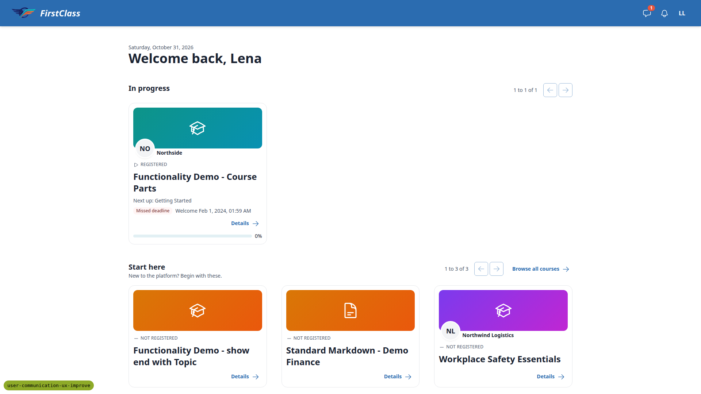 |
| 1.2 | desktop | pass | Panel headed Messages with New message and See all messages. Eve row (not bold, excerpt, 11 min ago), then Vic row (bold, Unread marker). 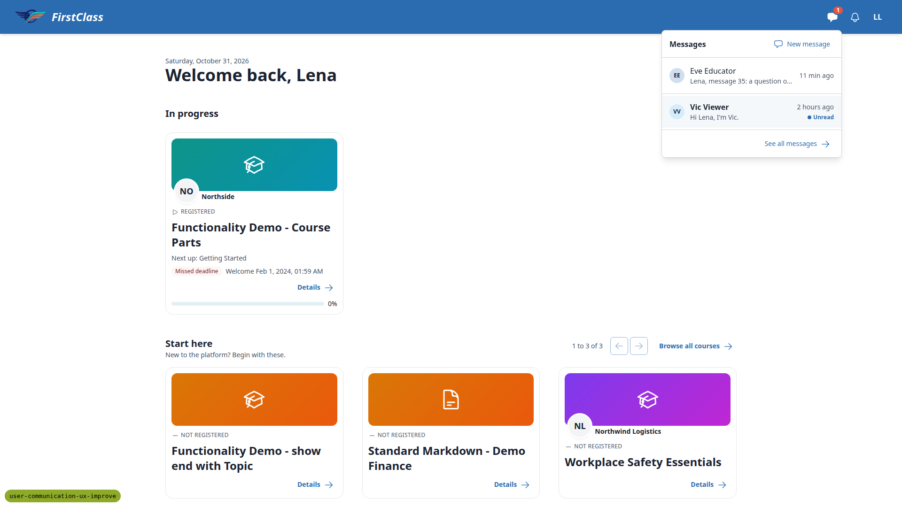 |
| 1.2 | mobile | pass | Button 40x40. Panel opens as a full-width sheet with a close button, New message and See all messages. No horizontal scroll. 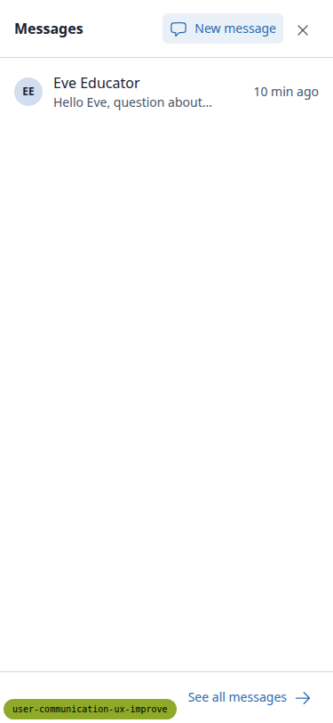 |
| 1.2 | tablet | pass | Panel is a 382px dropdown anchored under the header button. No overflow. 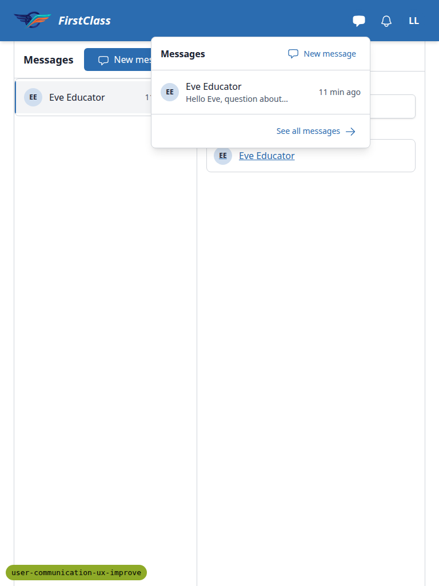 |
| 1.3 | desktop | pass | Escape closes and returns focus to `#messages-button`. Outside click closes. |
| 1.4 | desktop | pass | Opening the bell closes the messages panel and vice versa. Only one panel open. |
| 1.5 | desktop | pass | Vic row opens the thread. Back on the dashboard the Vic row lost its Unread marker and the badge reads "Messages, none unread". |
| 1.6 | desktop | pass | See all messages goes to `/messages/`. |

### §2 Messages page

| Test | Viewport | Status | Notes |
|------|----------|--------|-------|
| 2.1 | desktop | pass | Two panes. List with New message and two rows. Placeholder "Select a conversation to read it." with New message. No thread, no aria-current. 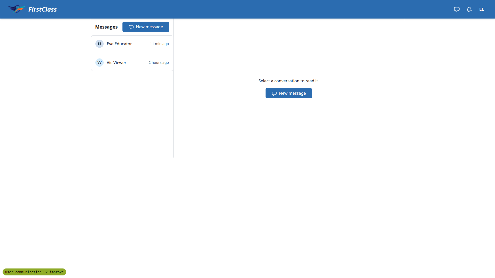 |
| 2.1 | tablet | pass | Two-pane layout kept with the placeholder. No horizontal scroll. 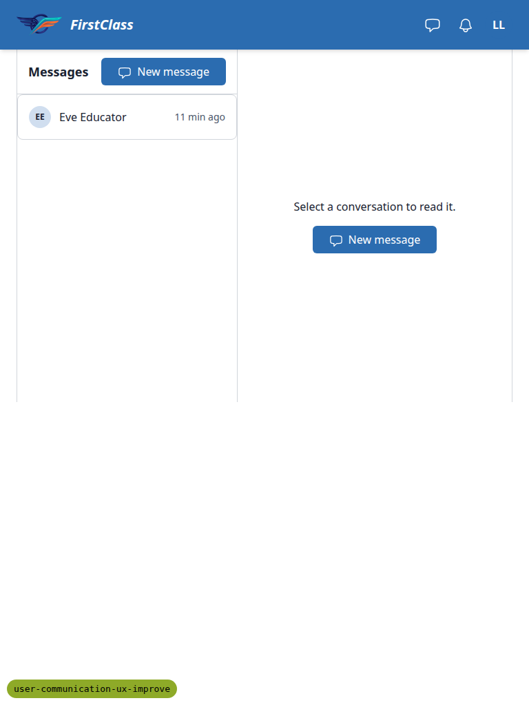 |
| 2.2 | desktop | pass | Thread on the right, Eve row aria-current=true, composer with "Ctrl+Enter to send" and the disclosure line. 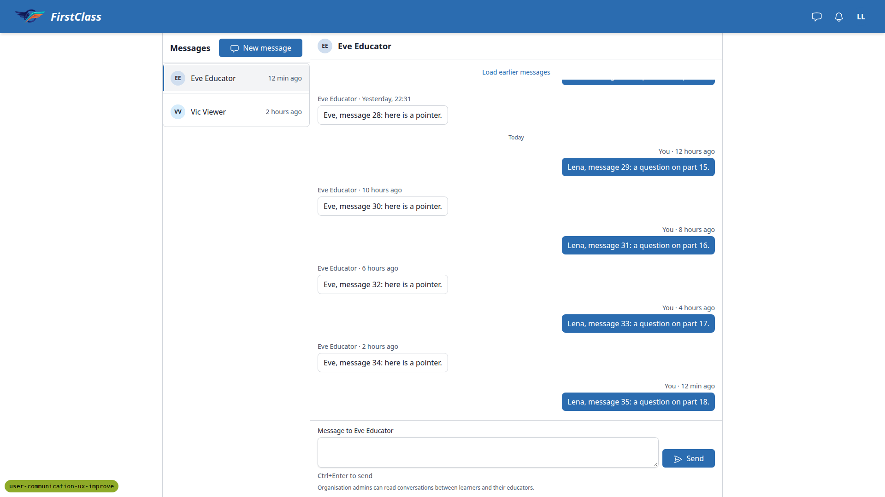 |
| 2.2 | tablet | pass | Thread beside the list. Composer and disclosure fit the pane width. 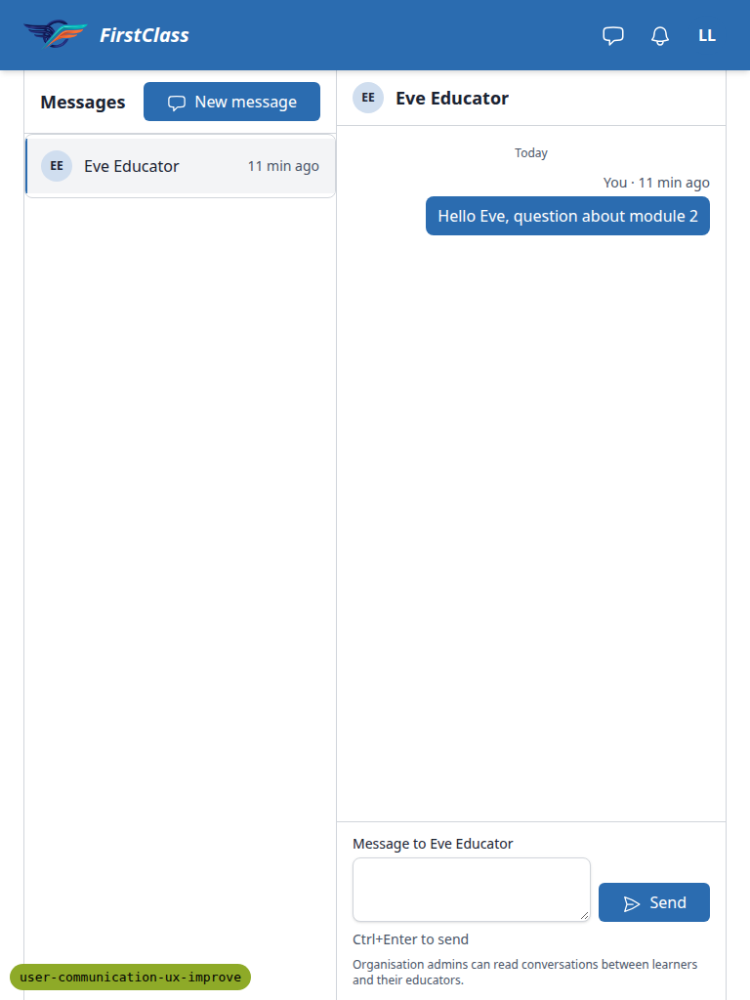 |
| 2.3 | desktop | pass | Reload keeps the thread. Back returns to `/messages/` with the placeholder and no current row. |
| 2.4 | desktop | pass | Bea: "No conversations yet." in the placeholder with New message, plus the list's own empty state. 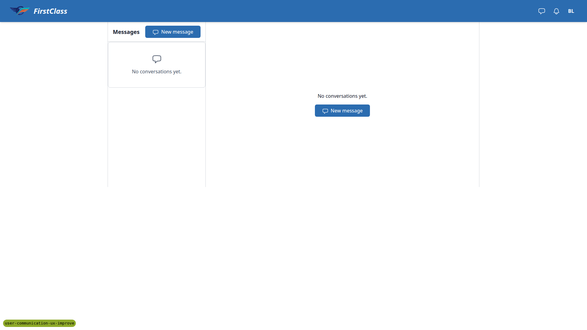 |
| 2.5 | desktop | pass | Sam: Sid row (unread), placeholder, no New message button anywhere. 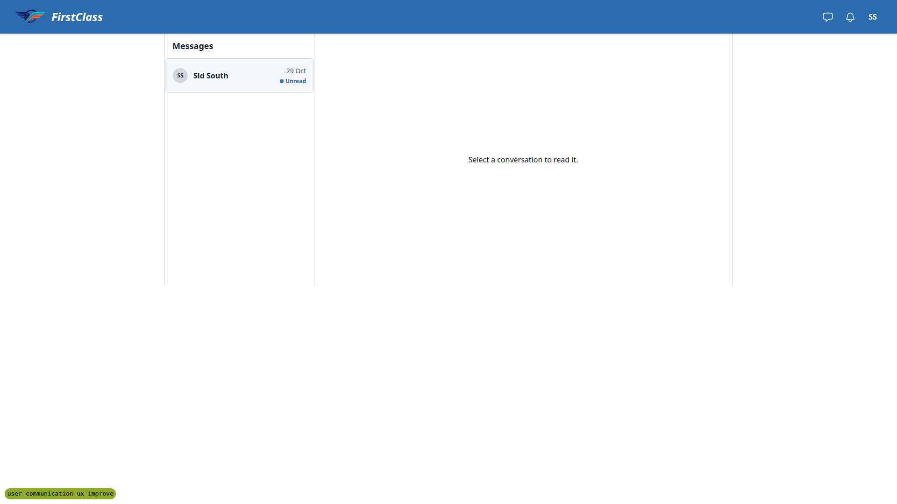 |

### §3 Starting a conversation

| Test | Viewport | Status | Notes |
|------|----------|--------|-------|
| 3.1 | desktop | pass | Lara: "No conversations yet." with New message in the list header and the placeholder. |
| 3.2 | desktop | pass | Right pane swaps to the picker with no page load. List pane stays, URL `/messages/new/`. Eve Educator listed under a "Cohort admin" group heading with no search typed. Vic not listed. 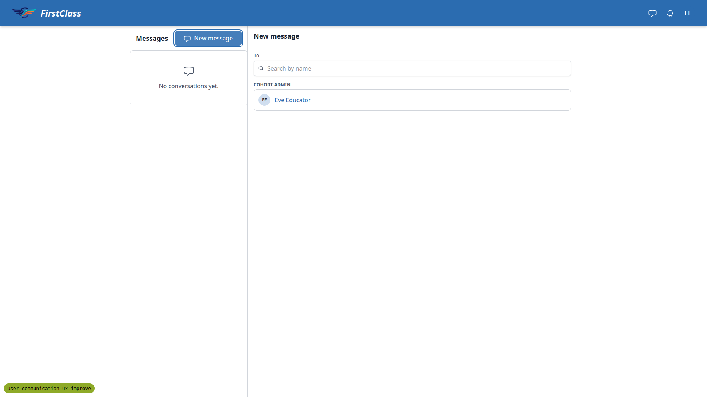 |
| 3.3 | desktop | pass | "zz" shows "No one you can message matches 'zz'". Clearing brings Eve back. |
| 3.4 | desktop | pass | "To Eve Educator" with Change link, textarea labelled "Message to Eve Educator", disclosure line. URL `/messages/new/?recipient=89`. 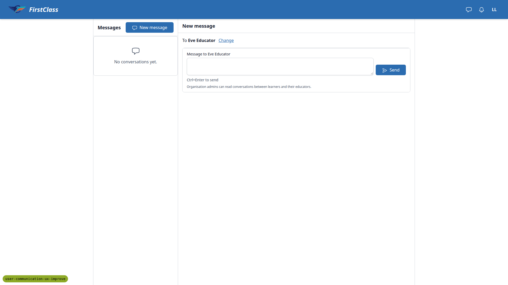 |
| 3.4 | mobile | pass | Picking Eve from the mobile picker lands on the existing thread. No horizontal scroll. 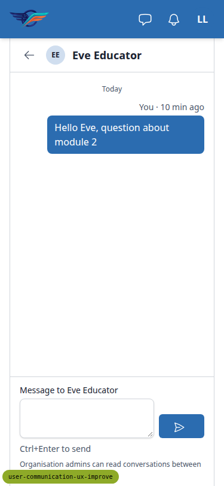 |
| 3.5 | desktop | pass | Ctrl+Enter navigates to the new thread with the message in the log. Lara's new Eve row is at the top with aria-current. 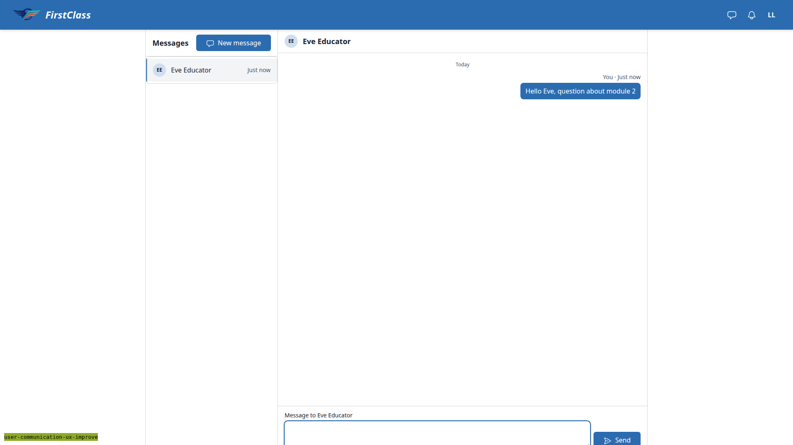 |
| 3.6 | desktop | pass | New message then the picker's Eve row lands on the same thread. |
| 3.7 | desktop | pass | Direct `/messages/new/` is the full-page picker in a narrow column. "Back to messages" goes to `/messages/`. 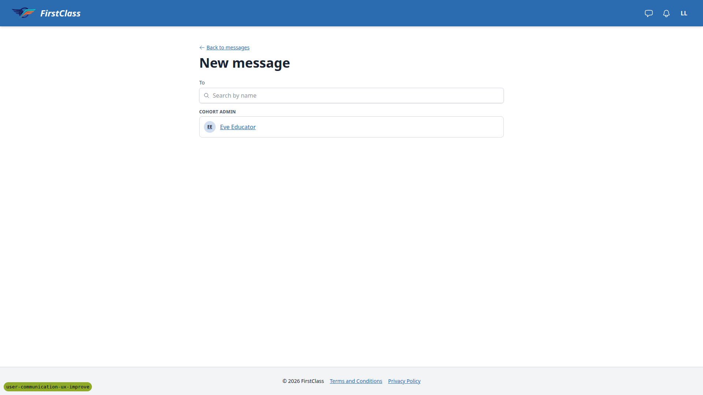 |
| 3.8 | mobile | pass | As Lara: list fills the screen. Tapping Eve opens a full-screen thread with a "Back to messages" arrow. Back returns to the list. New message opens the full-page picker with the back link. No horizontal scroll.  |
| 3.8 | tablet | pass | New message swaps the right pane to the picker at `/messages/new/`. No horizontal scroll. 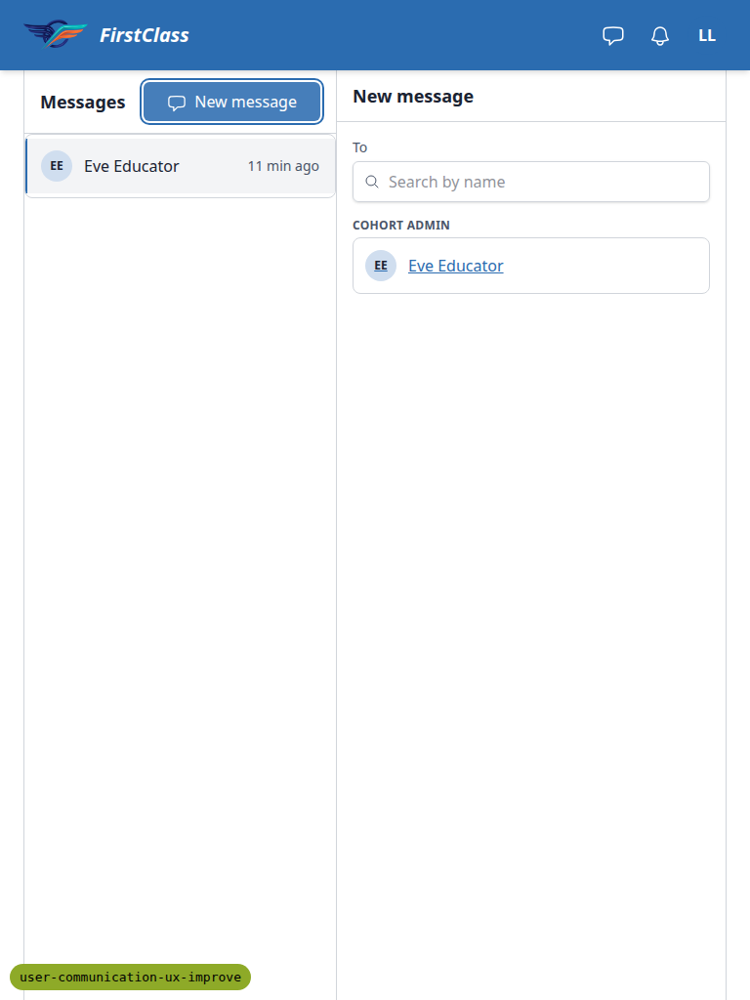 |

### §4 Refusals and closed conversations

| Test | Viewport | Status | Notes |
|------|----------|--------|-------|
| 4.1 | desktop | pass | As Lara, `/messages/new/?recipient=` with Vic's id, 999999 and abc all return 404. 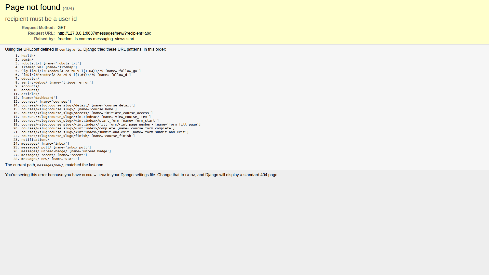 |
| 4.2 | desktop | pass | Bea picks Eli Educator and types "Are replies closed?" without sending. |
| 4.3 | desktop | pass | Second context as demodev added an Organisation messaging config for Northside with learner_to_educator=closed. 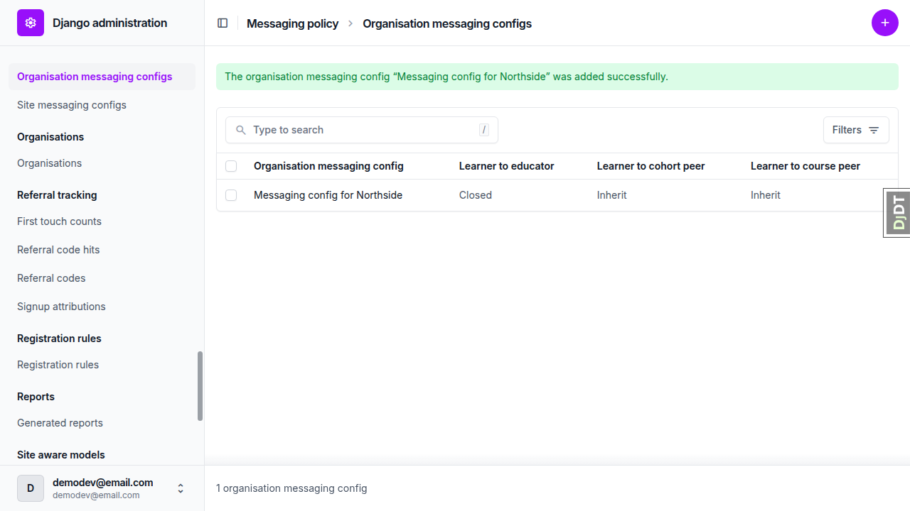 |
| 4.4 | desktop | pass | POST returned 422. Composer re-rendered in place with "Not sent. This person can't receive messages from you here. Your text is still in the box." Text kept. Bea's `/messages/` still "No conversations yet." 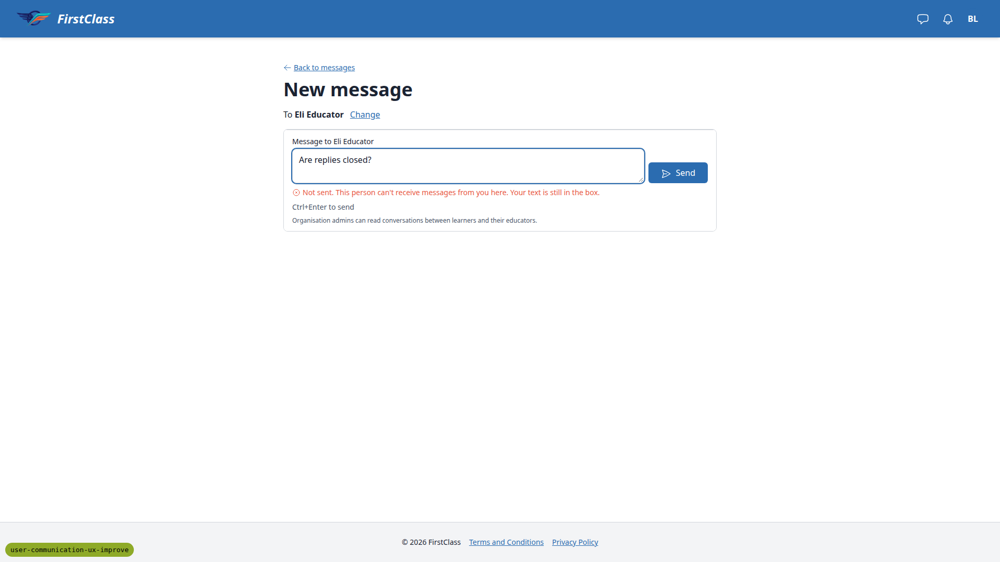 |
| 4.5 | desktop | pass | Eve's Gus Gone thread shows the "Replies are closed" note with the disclosure line and no textarea. 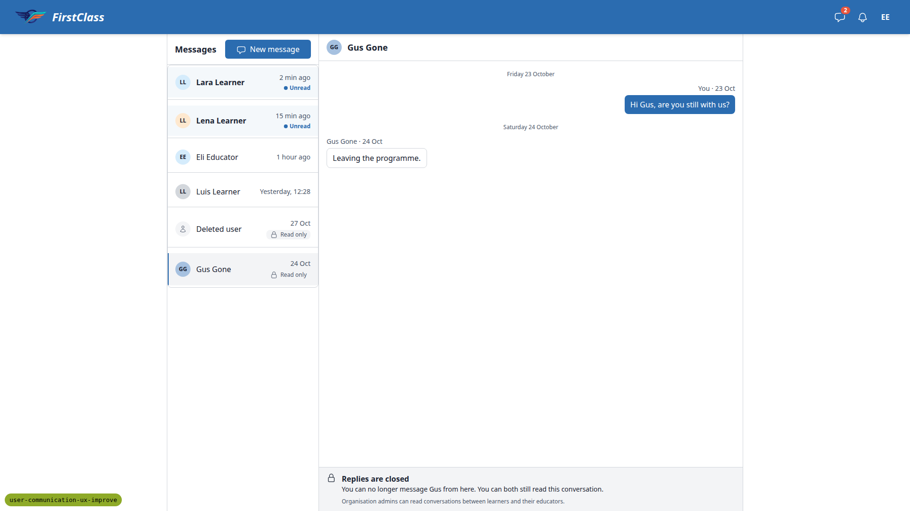 |
| 4.6 | desktop | pass | Config row deleted in admin. Bea's picker link shows the composer again. |

### §5 Unread counts and the bell

| Test | Viewport | Status | Notes |
|------|----------|--------|-------|
| 5.1 | desktop | pass | Eve's badge "Messages, 2 unread" (Lena and Lara), bell "none new". Sent "Checking in" to Luis.  |
| 5.2 | desktop | pass | Luis: messages badge 1, bell "none new" and its panel "Nothing yet." Messages panel lists Eve unread with excerpt "Checking in". 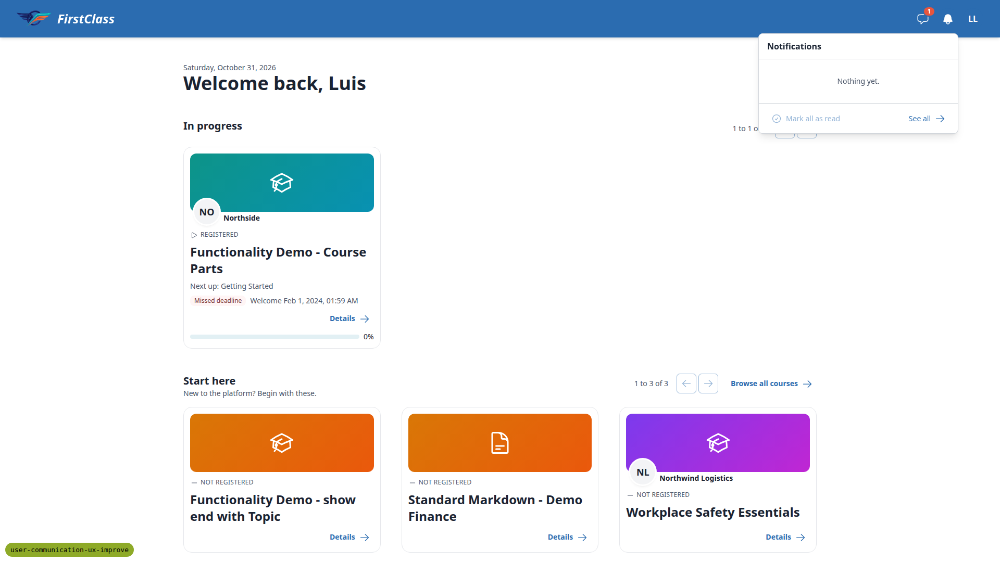 |

### §6 Educator sidebar and removed routes

| Test | Viewport | Status | Notes |
|------|----------|--------|-------|
| 6.1 | desktop | pass | Sidebar Teaching group: Dashboard, Cohorts, Learners, Courses. No Messages. 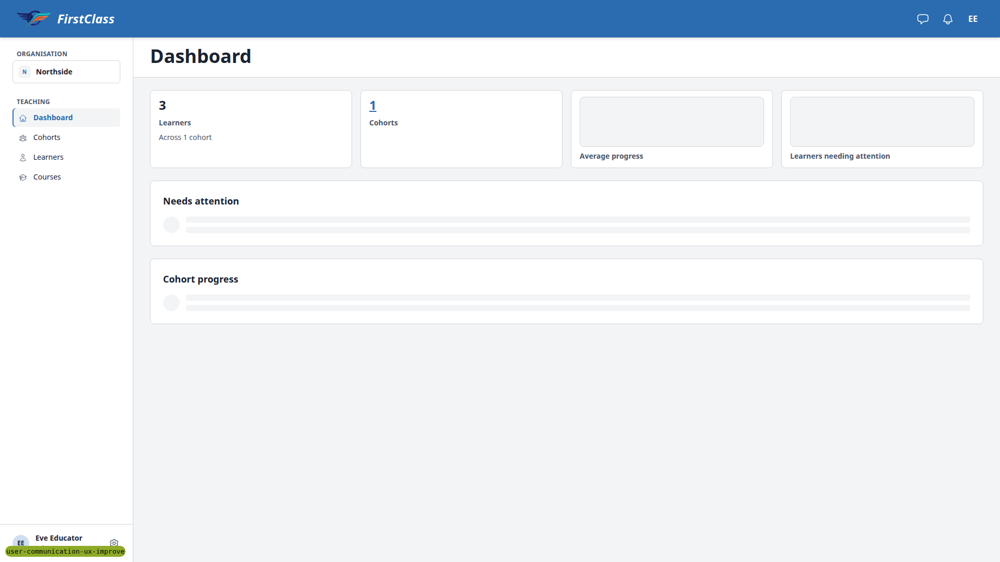 |
| 6.2 | desktop | pass | The old educator messages routes and `/messages/unread-count/` all 404. |
| 6.3 | desktop | pass | Header messages panel works on educator pages and lists Eve's conversations. 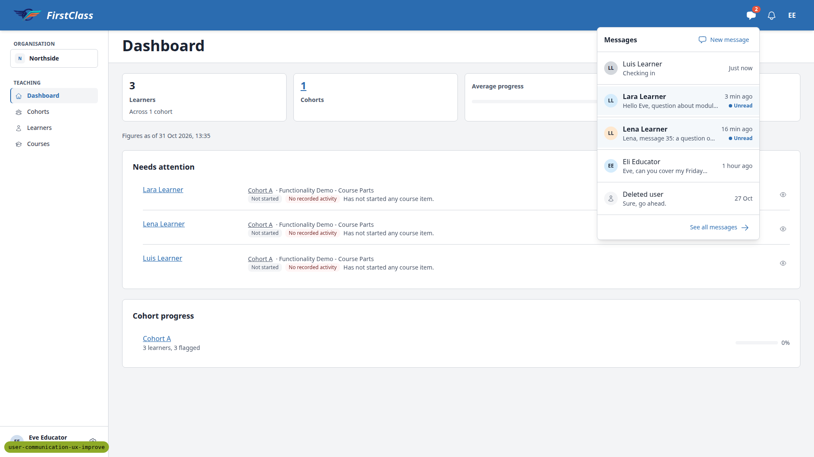 |

### §7 Learner page Messages tab

| Test | Viewport | Status | Notes |
|------|----------|--------|-------|
| 7.1 | desktop | pass | Eve on Lena's page: tabs Overview, Courses, Messages. No History. |
| 7.2 | desktop | pass | Heading Lena Learner, Load earlier messages, log, composer with disclosure. No Other educator conversations. Header badge dropped 2 to 1. 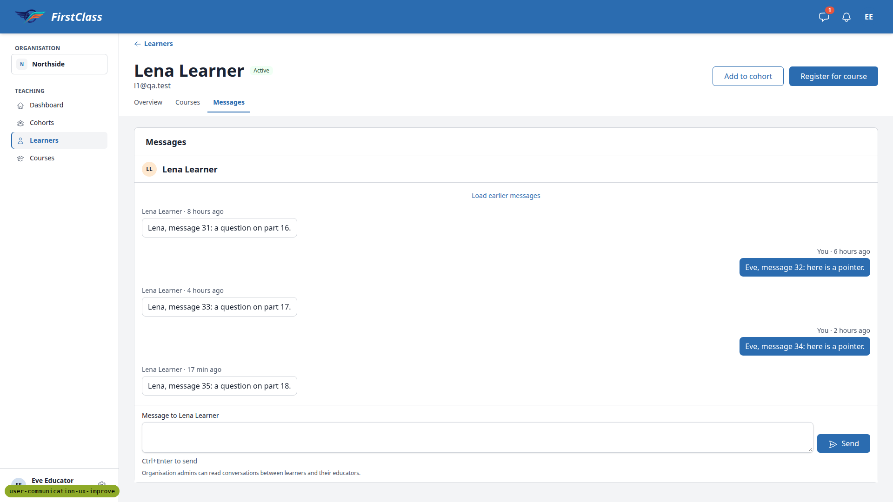 |
| 7.3 | desktop | pass | Ctrl+Enter POSTs to the send action (200). Message appended, URL stays on the learner page. 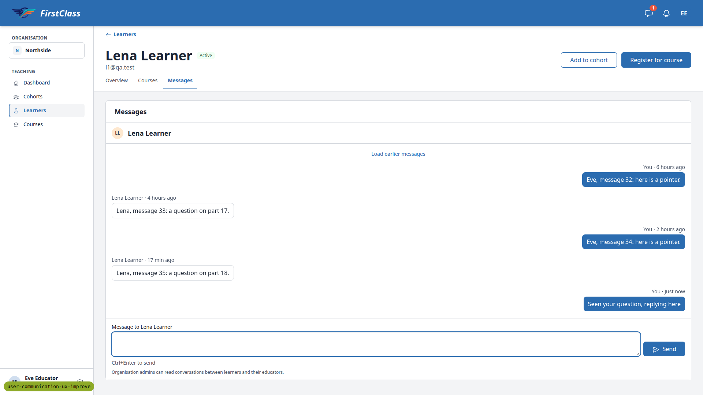 |
| 7.4 | desktop | pass | Lara's tab shows only the Eve-Lara thread. Luis's shows only Eve-Luis. |
| 7.5 | desktop | pass | Bea is not in Eve's learner list and her page is a 404 for Eve. |
| 7.6 | desktop | pass | Eli: "No messages with Bea Learner yet." with composer. Sending "Welcome to Cohort B" re-renders the tab with the thread, still on the learner page. Eli's badge stays "none unread". 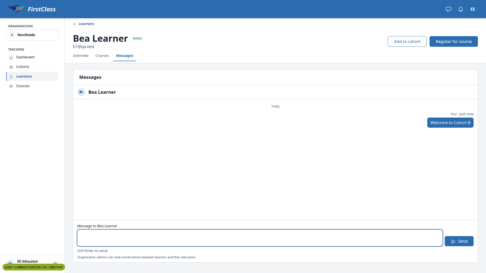 |
| 7.7 | desktop | pass | Vic sees only his own conversation with Lena, a composer, no oversight section. 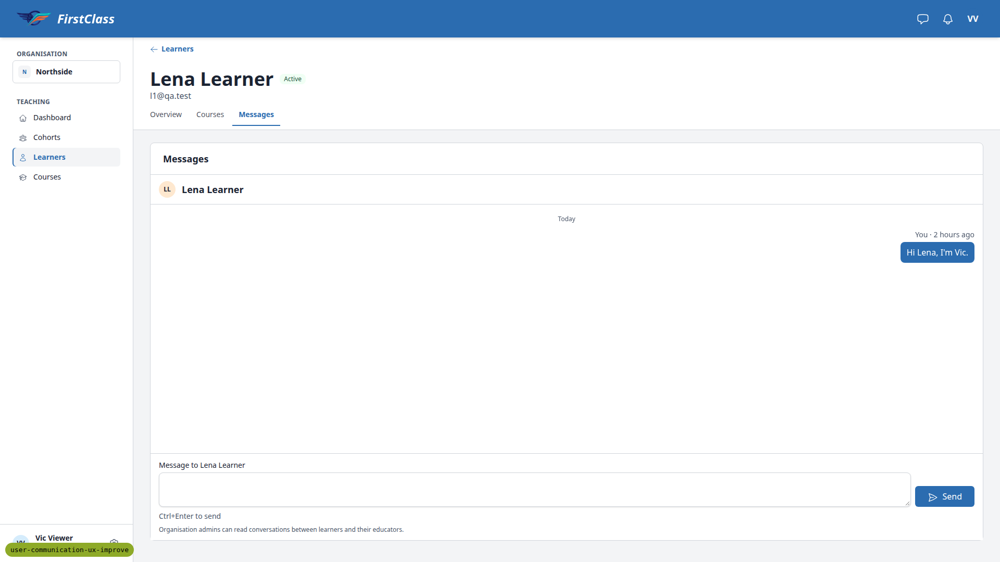 |
| 7.8 | desktop | pass | Quick-view drawer Messages box has an "Open conversation" icon link to the learner page's Messages tab. 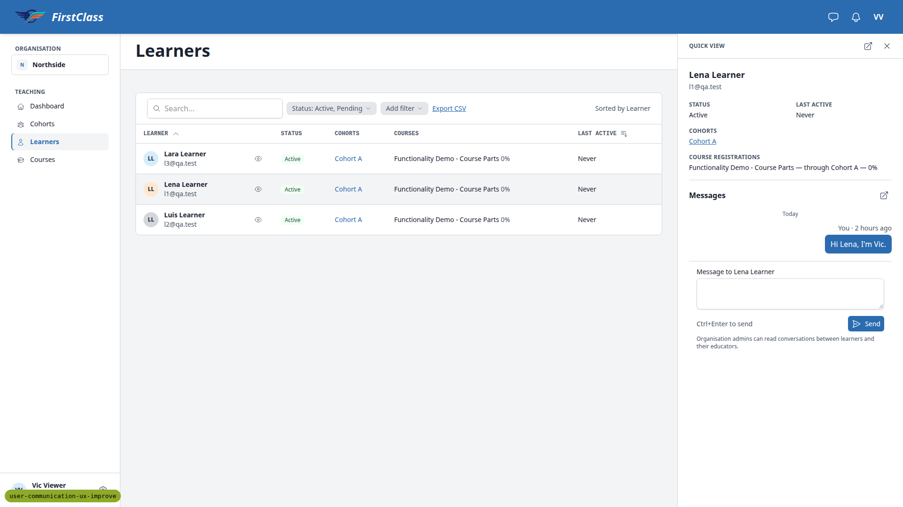 |

### §8 Messaging disabled

| Test | Viewport | Status | Notes |
|------|----------|--------|-------|
| 8 | desktop | skip | Needs a server restart with MESSAGING_ENABLED=False, which is outside this run. Covered by the parametrised sidebar and view tests. |

### §9 Educator oversight

| Test | Viewport | Status | Notes |
|------|----------|--------|-------|
| 9.1 | desktop | pass | Orla: own area "No messages with Lena Learner yet." with composer. Other educator conversations lists Eve Educator and Vic Viewer with excerpt and relative time.  |
| 9.1 | mobile | pass | Own thread, composer and Other educator conversations stack. No horizontal scroll. Tab row fits. 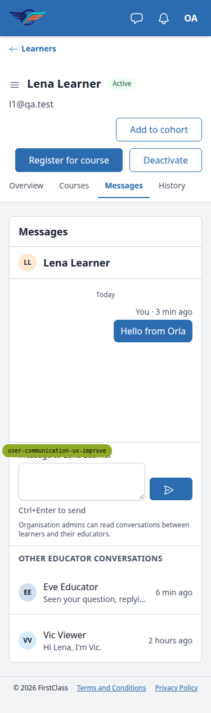 |
| 9.1 | tablet | pass | Educator sidebar collapses behind the menu button. Messages tab card spans the content width. No horizontal scroll. 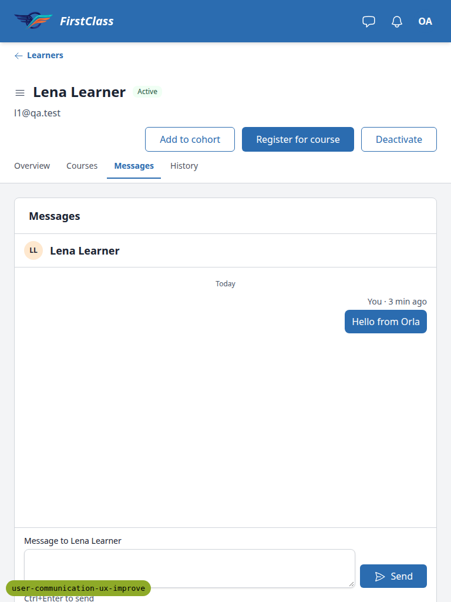 |
| 9.2 | desktop | pass | Second context as Eve: badge "Messages, none unread", Lena row read. |
| 9.3 | desktop | pass | Modal "Conversation with Eve Educator" with Load earlier messages. Banner "Read only. You are viewing this conversation as an organisation admin." plus disclosure. No textarea or Send. 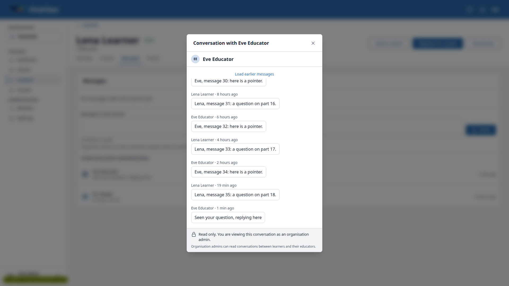 |
| 9.3 | mobile | pass | Modal opens as a full-width bottom sheet with the read-only banner and no composer.  |
| 9.3 | tablet | pass | Modal centred at 512px wide. 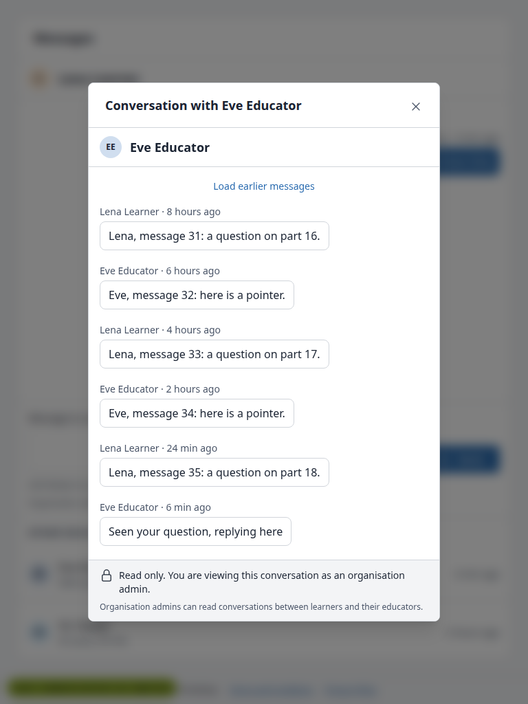 |
| 9.4 | desktop | pass | Load earlier messages GETs the `older/` URL with a cursor (200). Older entries prepended. Control gone once message 1 shows. |
| 9.5 | desktop | pass | History shows today, Orla Admin, Conversation viewed. Organisation audit log Target reads "Conversation with Eve Educator". 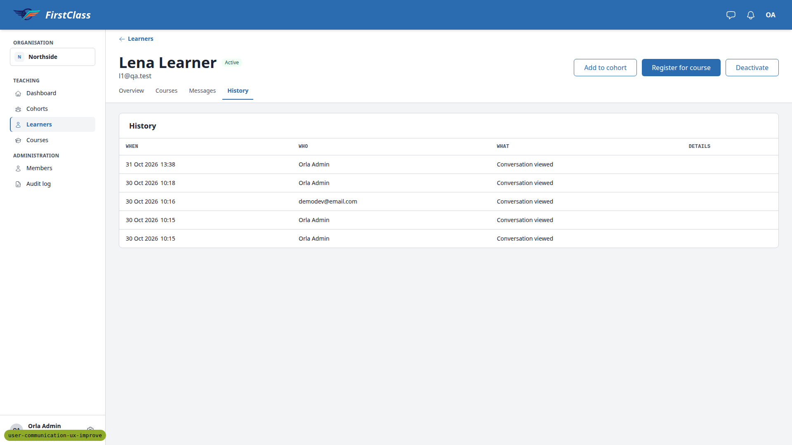 |
| 9.5 | mobile | pass | History table sits in a horizontally scrollable wrapper. The page itself does not scroll sideways. 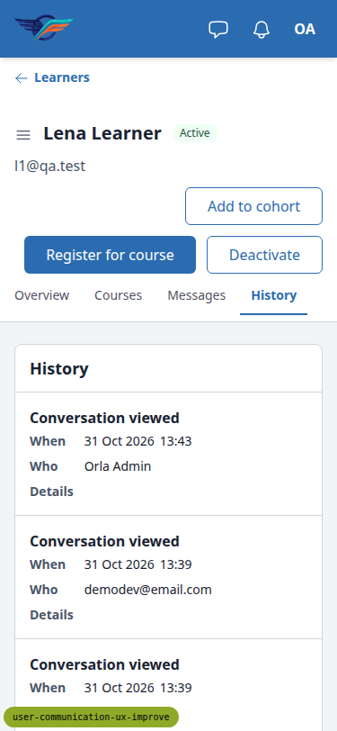 |
| 9.6 | desktop | pass | A second open adds a second "Conversation viewed" row today. |
| 9.7 | desktop | pass | Eve's badge and Lena row unchanged after Orla's opens. Lena's Eve row is still unread (Eve's 7.3 reply), so no marker moved. |
| 9.8 | desktop | pass | Gus Gone (Inactive): no own composer. Oversight reads "No other educator conversations." 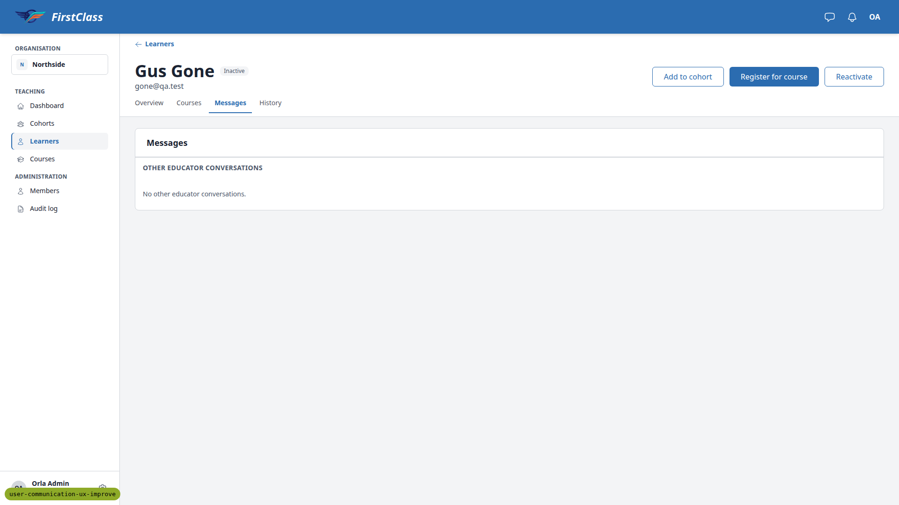 |
| 9.9 | desktop | pass | Orla's "Hello from Orla" stays on the page. After reload it is in the own area and not listed under Other educator conversations.  |
| 9.10 | desktop | pass | Superuser banner "Read only. You are viewing this conversation as a site admin." New History row by demodev@email.com. 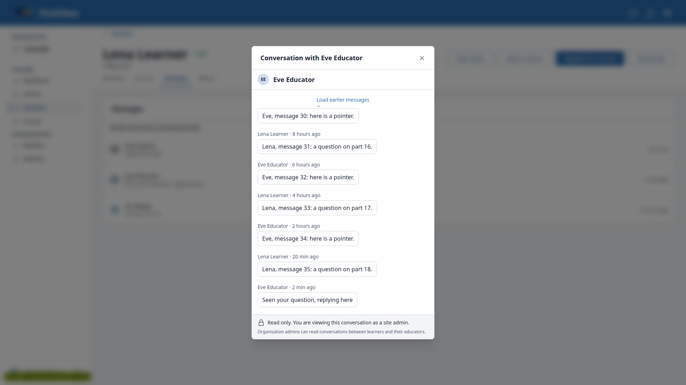 |

### §10 Access and tenancy

| Test | Viewport | Status | Notes |
|------|----------|--------|-------|
| 10.1 | desktop | pass | Sid (Southside) on Northside Lena's messages tab: 404. |
| 10.2 | desktop | pass | Sam's Messages tab: Sid's own conversation plus "No other educator conversations." 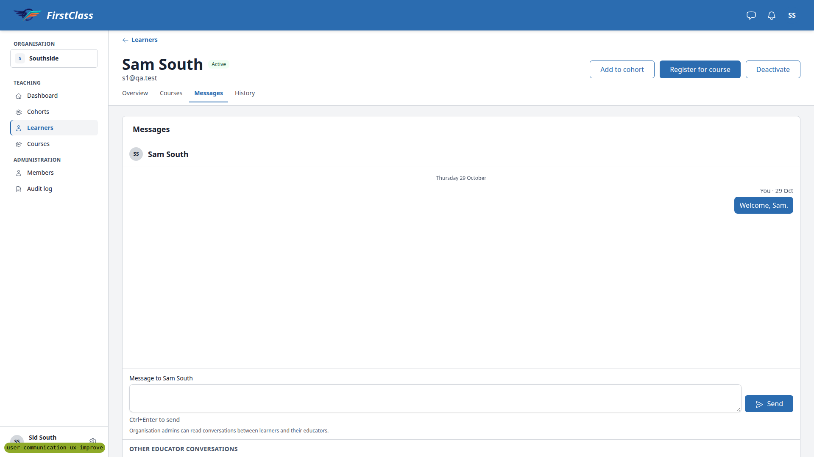 |
| 10.3 | desktop | pass | Eve on the view_conversation action URL: 403 Forbidden page, no thread. Lena's History row count unchanged. |
| 10.4 | desktop | pass | Orla: another learner's conversation uuid on Luis's path is 404. `conversation=not-a-uuid` is 404. History unchanged. |
| 10.5 | desktop | pass | `older/` with `before=garbage` is 400, without `before` is 400, with a valid cursor from 9.4 is 200 with entries. History unchanged. |

### §11 Course-registration notification rollup

| Test | Viewport | Status | Notes |
|------|----------|--------|-------|
| 11 | desktop | skip | Optional per plan; not run. The rollup is untouched by this diff and covered by the full test run. |

## Design check

no design states tested

## Bug status

No bugs found in this run.

## General notes

- §8 was skipped because it needs a server restart with MESSAGING_ENABLED=False.
- §11 is optional and was not run.

Observations without action:

- The "Load earlier messages" control sits over a partly scrolled bubble at the top of the thread log on desktop. This is cosmetic.
- The DEBUG-only branch badge covers the bottom line of the composer disclosure on mobile.
- The Lena learner History tab carries audit rows from earlier QA runs, because the seed command does not clear audit entries.
- The superuser shows as their email in the History Who column because it has no name.
- §3.2's "cohort group heading" reads "Cohort admin", which is a role heading.

status: ok · reason: report rendered, 0 bugs documented
