# Frontend QA report: user-communication-ux-improve

## Methodology

- Manual walk with Playwright MCP.
- Viewports: desktop 1920x1080, mobile 375x812 (with 390 spot checks), tablet 768x1024.
- Screenshots are collected in `screenshots/` beside this report. Every referenced image exists there.
- Compression ran and found nothing over 1MB.
- Test plan: `3. frontend_qa.md`.

## Diff scoping

- Class: FULL.
- Trigger: changes to templates (`comms/*.html`, `educator_interface/**/*.html`) and static JS (`comms/static/comms/js/alpine-components.js`), plus Python in comms, educator_interface, audit_log, messaging_policy, learner_management, role_based_permissions and qa_helpers.
- Nothing was skipped by scoping.

## Smoke gate

- Outcome: pass.
- Pages loaded: `/`, `/messages/`.

## Results

| Test | Viewport | Status | Notes | Screenshot |
|---|---|---|---|---|
| 1.1 | desktop | pass | Icon-only messages button, name "Messages, 1 unread", red badge 1. |  |
| 1.2 | desktop | pass | Panel has New message and See all messages. Vic row bold with Unread marker. Order is Eve then Vic (newest first, correct for the seed). |  |
| 1.3 | desktop | pass | Escape closes the panel and returns focus; outside click closes it. | |
| 1.4 | desktop | pass | Bell and messages panels are mutually exclusive. | |
| 1.5 | desktop | pass | Vic row opens the thread; badge gone and row no longer unread. | |
| 1.6 | desktop | pass | See all messages goes to `/messages/`. | |
| 2.1 | desktop | pass | Two-pane page, two rows, placeholder with New message, no current row. | 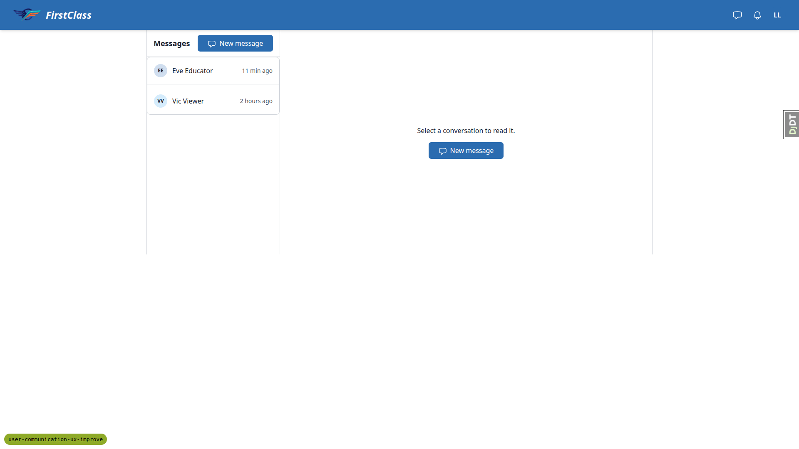 |
| 2.2 | desktop | pass | Eve row opens thread, `aria-current` set, composer with Ctrl+Enter hint and disclosure. | 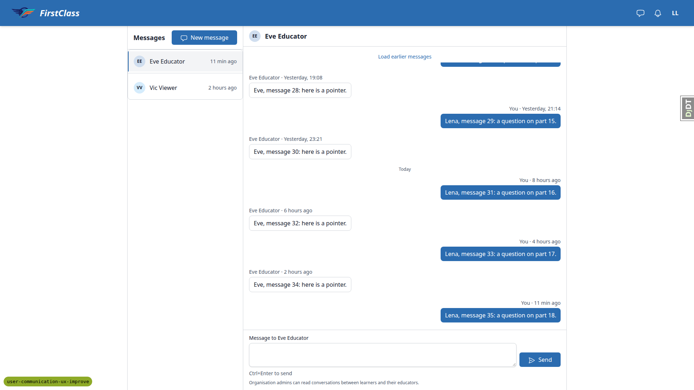 |
| 2.3 | desktop | pass | Reload keeps the conversation; Back returns to the placeholder. | |
| 2.4 | desktop | pass | Bea: "No conversations yet." in list and placeholder, New message in both. | |
| 2.5 | desktop | pass | Sam: Sid row listed, placeholder, no New message anywhere. | |
| 3.1 | desktop | pass | Lara: "No conversations yet." with New message. | |
| 3.2 | desktop | pass | New message swaps the right pane without a page load. URL `/messages/new/`. Eve under "Cohort admin", Vic not listed. | 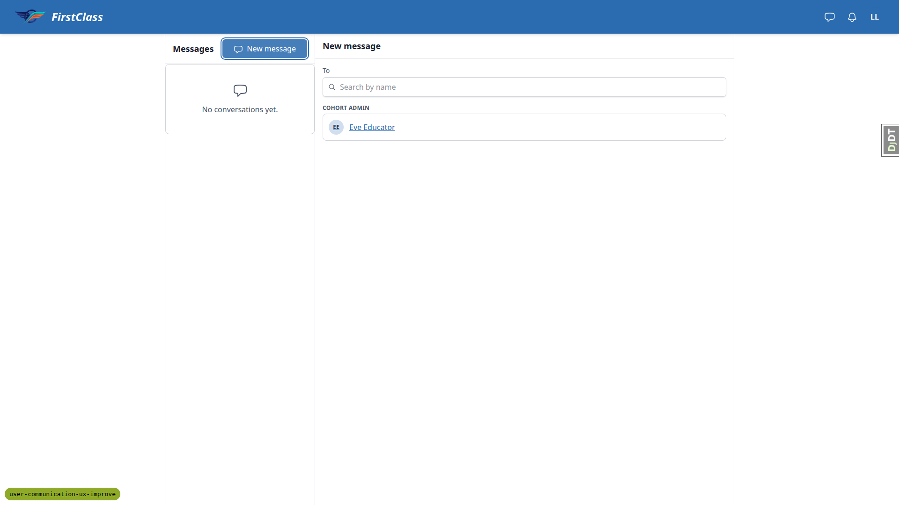 |
| 3.3 | desktop | pass | "zz" shows the no-match message; clearing brings Eve back. | |
| 3.4 | desktop | **fail** | Picking Eve from the initial list works. After searching, result links lose hx attributes and cause a full page load (see B1). | 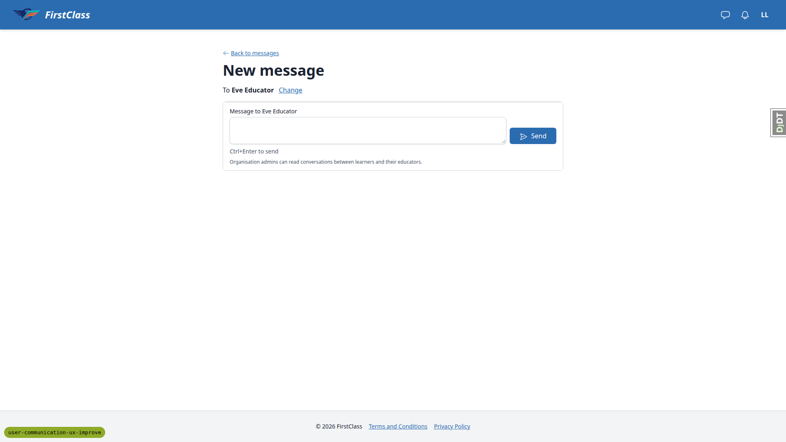 |
| 3.5 | desktop | pass | Ctrl+Enter sent and opened the thread; Lara's new Eve row at top, current. | 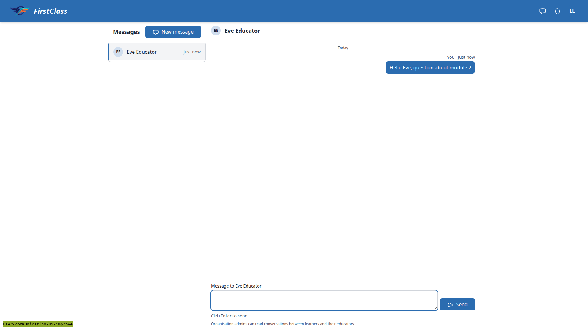 |
| 3.6 | desktop | pass | New message then Eve again lands on the same thread. | |
| 3.7 | desktop | pass | Direct `/messages/new/` shows the full-page picker with Back to messages. | |
| 4.1 | desktop | pass | `?recipient=91` (Vic), `999999`, `abc` all 404. | |
| 4.2-4.4 | desktop | pass | Plan sequence unreachable as written (see General notes). Re-run with Bea to Eli: 422, composer re-rendered, text kept, nothing sent, alert names nobody. | |
| 4.5 | desktop | skip | Closed note cannot appear for a learner-educator conversation while educator-to-learner is open. | |
| 4.5-alt | desktop | pass | Eve's thread with deactivated Gus: "Replies are closed" note and disclosure, no textarea. | |
| 4.6 | desktop | pass | Deleting the config row restores the composer on reload. | |
| 4.x-extra | desktop | **fail** | Lara with nobody to message sees "No one you can message matches ''" (see B2). | |
| 5.1 | desktop | pass | Eve's badge is 2 (Lena plus Lara's new thread). Badge fills in after about 1-2s. Sent "Checking in" to Luis. | |
| 5.2 | desktop | pass | Luis: messages badge 1, bell "none new", messages panel shows Eve unread with excerpt. | |
| 6.1 | desktop | pass | Teaching group: Dashboard, Cohorts, Learners, Courses; no Messages. | |
| 6.2 | desktop | pass | `/messages`, `/messages/<uuid>`, `/messages/unread-count/` under the educator org all 404. | |
| 7.1 | desktop | pass | Eve sees Overview, Courses, Messages. No History tab (needs audit-log view permission). | |
| 7.2 | desktop | pass | Eve's own conversation with Lena, Load earlier messages, composer, disclosure, no oversight section. Badge 2 to 1, also on another tab without reload. | 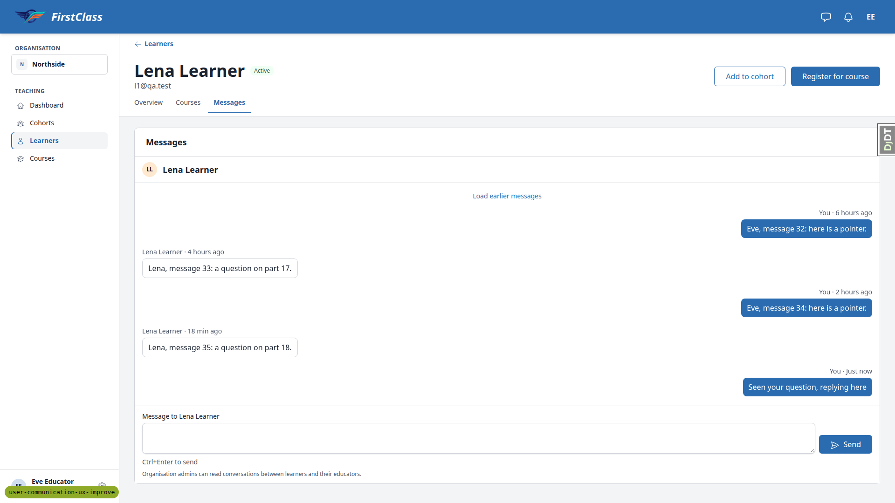 |
| 7.3 | desktop | pass | Ctrl+Enter re-rendered the card in place; no page load. |  |
| 7.4 | desktop | pass | Lara and Luis tabs each show only Eve's own conversation. | |
| 7.5 | desktop | pass | Eve gets 404 for Bea's learner page and Messages tab. | |
| 7.6 | desktop | pass | Eli on Bea's tab: empty state, composer, disclosure. Send re-rendered the tab; Eli's badge unchanged. | |
| 7.7 | desktop | pass | Vic on Lena's tab: own conversation and composer, no oversight section. | |
| 7.8 | desktop | pass | Quick view drawer Open conversation lands on the Messages tab. | |
| 8 | desktop | skip | Needs a restart with MESSAGING_ENABLED=False; covered by pytest. | |
| 9.1 | desktop | pass | Orla: empty own area with composer; Other educator conversations lists Eve and Vic with excerpt and time. | 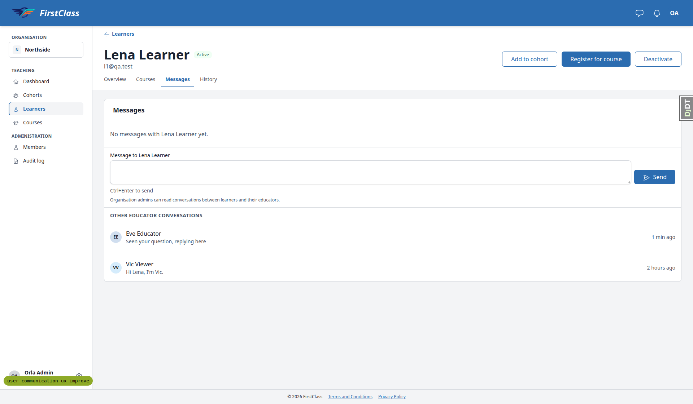 |
| 9.3 | desktop | pass | Modal "Conversation with Eve Educator", Load earlier messages, read-only banner and disclosure, no textarea or Send. |  |
| 9.4 | desktop | pass | Load earlier messages prepended entries (29 to 35); control removed at the first message. | |
| 9.5 | desktop | pass | History row "Conversation viewed" by Orla; org audit log shows the target. | |
| 9.6 | desktop | pass | Second open adds a second History row. | |
| 9.7 | desktop | pass | Admin reading moved no read marker. | |
| 9.8 | desktop | pass | Gus (inactive): no own composer, "No other educator conversations." | |
| 9.9 | desktop | pass | Orla's send stays on the page; after reload it is in her own area. | |
| 9.10 | desktop | pass | Superuser sees the site-admin read-only banner and a History row. | |
| 10.1 | desktop | pass | Southside admin gets 404 on a Northside Messages tab. | |
| 10.2 | desktop | pass | Sid on Sam's tab: own conversation plus "No other educator conversations." | |
| 10.3 | desktop | pass | Eve calling `view_conversation` directly gets 403, no History row. | |
| 10.4 | desktop | pass | Mismatched conversation path and `not-a-uuid` 404; History unchanged. | |
| 10.5 | desktop | pass | `older/` with garbage or no `before` returns 400; valid cursor 200; no History row added. | |
| 11 | desktop | pass | Seeded notifications appear; bell "3 new" and panel entries shown. | |
| 3.8 | mobile | pass | At 375 and 390 list fills the screen; tapping Eve shows the thread with a 32x32 back arrow; New message opens the full-page picker. No overflow. Send button 76x40. | 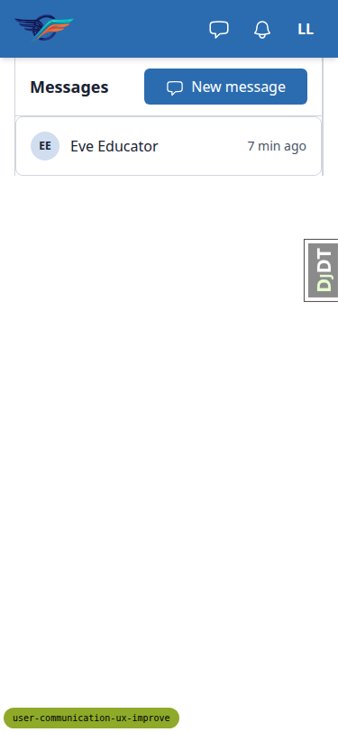 |
| 3.8-thread | mobile | pass | Thread at 375: header, back arrow, log, composer, hint and disclosure fit. | 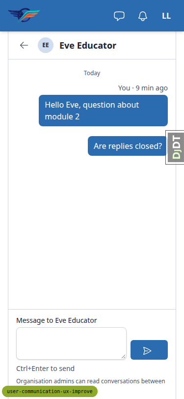 |
| 1.2 | mobile | pass | Messages panel is a full-screen sheet with New message, close and See all messages; header button 40x40; no overflow. | 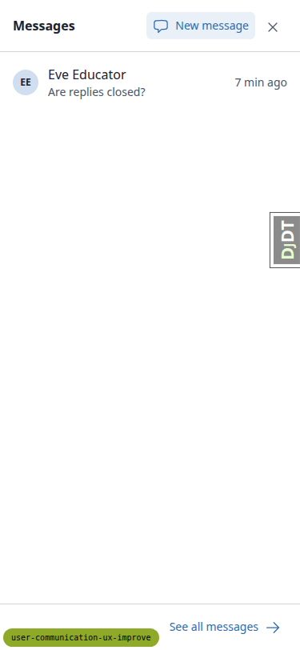 |
| 9.1 | mobile | pass | Learner Messages tab at 375: tabs fit, sections stack, no overflow. | 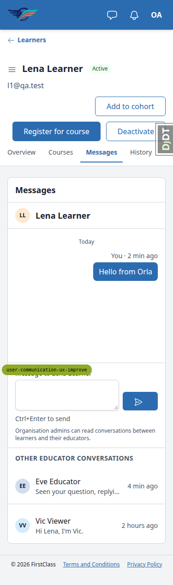 |
| 9.3 | mobile | pass | Oversight modal is a full-width bottom sheet; banner and disclosure visible; no overflow. | 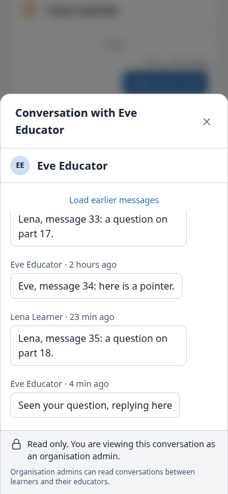 |
| 3.8 | tablet | pass | Two-pane layout at 768, no back arrow, no overflow. | 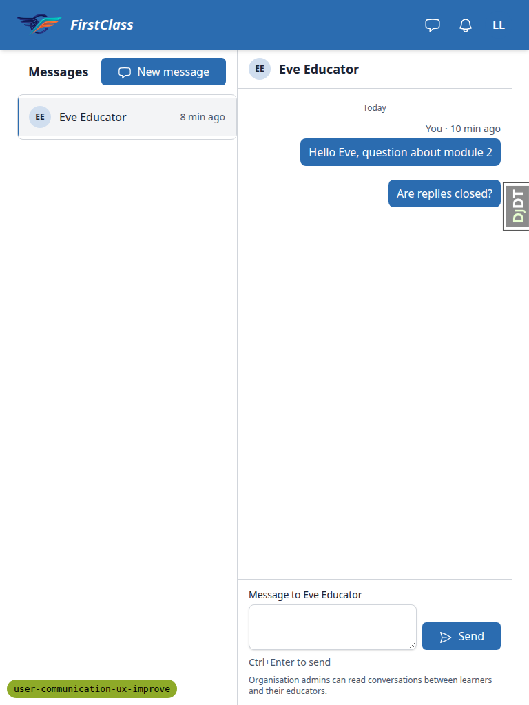 |
| 1.2 | tablet | pass | Messages panel is a dropdown under the button; no overflow. | 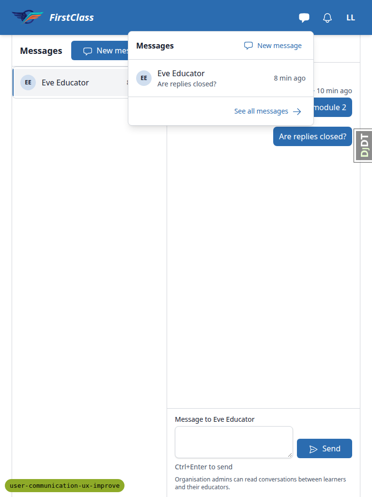 |
| 9.1 | tablet | pass | Learner Messages tab at 768 with sidebar collapsed to a menu button; no overflow. | 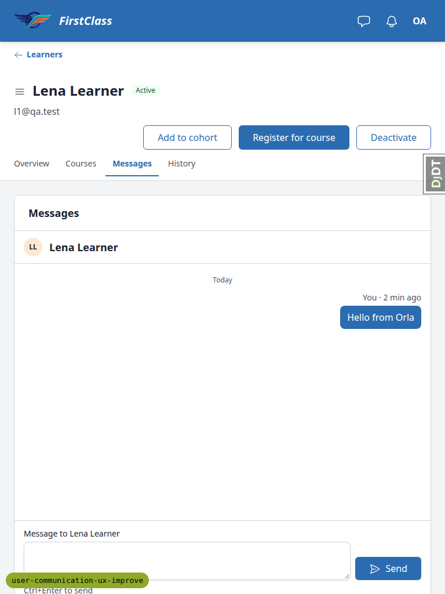 |

## Design check

No design states tested.

## B1: Picking a recipient after searching leaves the messages page

- Manifestations: 3.4 (desktop).
- Screenshot:

- Expected: on `/messages/` at desktop width, after New message swaps the picker into the right pane, typing in the search field and clicking a result loads the "To <name>" composer into `#thread-pane` without a page load. The conversation list stays.
- Actual: the search response re-renders `#recipient-results` without `hx-get`, `hx-target` or `hx-push-url` on the result links (the `recipient_search` view builds the picker context without `in_pane`). Clicking a result does a full navigation to the standalone `/messages/new/?recipient=<pk>` page and the conversation list disappears. Picking without searching works.

## B2: Picker with nobody to offer says "No one you can message matches ''"

- Manifestations: 4.x-extra (desktop).
- Screenshots: none.
- Expected: a sender with no offered recipients who reaches `/messages/new/` directly (no New message button is shown, but the URL is reachable) sees an empty state that does not quote a search term.
- Actual: with an empty term the picker renders "No one you can message matches ''" and "0 people found".

## Bug status

| Bug | Status |
|---|---|
| B1 | **FIXED** (commit: 4f906e60d) — Picking a recipient after searching leaves the messages page |
| B2 | **UNRESOLVED** — Picker with nobody to offer says "No one you can message matches ''" (reason: needs a copy decision for the empty state of a sender with nobody to message) |

## General notes

Observations that are not bugs. The plan should be corrected for the plan-wording items.

- 1.2: the plan says Vic first, but its own seed gives Eve (10 min ago) then Vic (2 hours ago). Newest first is correct.
- 5.1: Eve's badge is 2, not 1. Lena's thread plus Lara's new thread from 3.5 are both unread.
- 7.1: the History tab needs the audit-log view capability, which a cohort admin lacks. Eve correctly sees no History tab.
- 4.2-4.4: after 3.5 Lara already has a conversation with Eve. Reply rights are symmetric by design, so Lara can still reply when learner_to_educator is closed, and the plan's refused-send sequence is unreachable. The refused first send was verified with Bea to Eli. The alert deliberately names nobody ("This person can't receive messages from you here"), unlike the plan's "Eve can't receive...".
- 4.5: the closed note cannot show on a learner-educator conversation while the other direction is open. It was checked on Eve's thread with deactivated Gus instead.
- 8: skipped. It needs a restart with MESSAGING_ENABLED=False and is covered by pytest.
- The header messages badge fills in about 1-2s after page load (lazy request). First paint reads "Messages".
- Gus (inactive) is not listed under `?status=inactive` on the learners list. His page was opened by URL.
- Dev-only: the django-debug-toolbar handle overlaps the admin Save button in a fresh browser context.

status: ok · reason: 2 bugs — 1 fixed, 1 unresolved; report rendered, screenshots verified
