# Frontend QA report: user-communication-ux-improve

## Methodology

The plan in `3. frontend_qa.md` was driven by hand with Playwright MCP at three viewports: desktop 1920x1080, mobile 375x812 and tablet 768x1024. Screenshots were collected into `screenshots/` beside this report, and every image referenced here exists there. The run started with a rebase onto main (2 spec-only commits) and the scenario seed `qa_create_direct_messaging_scenario`.

## Diff scoping

Class: **FULL**. 35 changed front-end files triggered it, for example `freedom_ls/comms/templates/comms/inbox.html`, `freedom_ls/comms/templates/comms/partials/composer.html`, `freedom_ls/comms/static/comms/js/alpine-components.js`, `freedom_ls/educator_interface/templates/educator_interface/modal/conversation_oversight.html`, `freedom_ls/base/templates/cotton/button.html` and `tailwind.components.css`. Nothing was skipped by scoping.

## Smoke gate

Outcome: **pass**. Pages checked: `/` and `/messages/`.

## Results

### §1 The header button and the messages panel

| Test | Viewport | Status | Notes | Screenshot |
|---|---|---|---|---|
| 1.1 | desktop | pass | Icon-only button, accessible name 'Messages, 1 unread', badge 1 | |
| 1.2 | desktop | pass | Panel headed Messages, New message, See all messages; Eve row (not bold, Lena's newest excerpt, 10 min ago), Vic row bold with Unread marker | 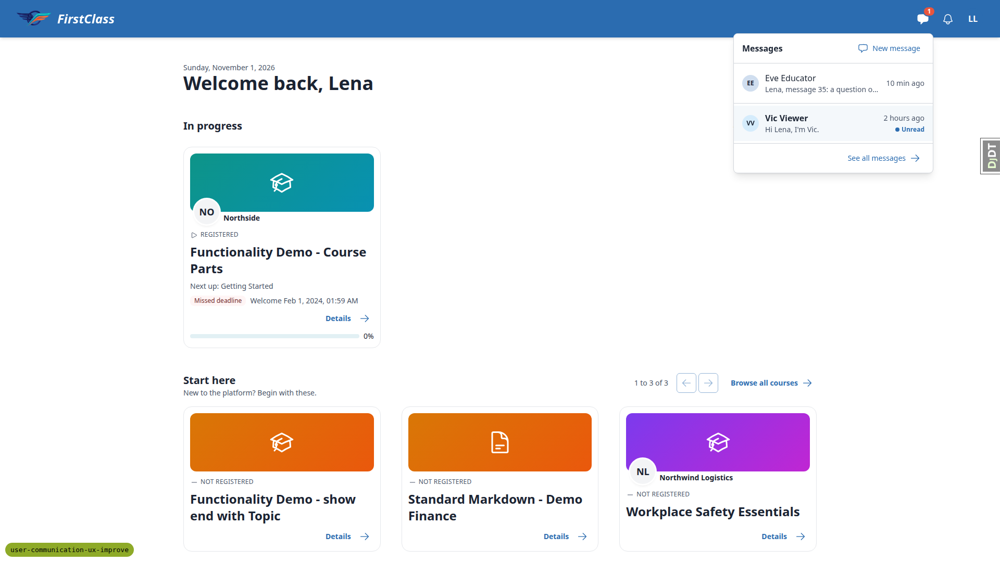 |
| 1.2 | mobile | pass | Messages panel opens as full-width sheet (0-375) with close button; header button 40x40 | 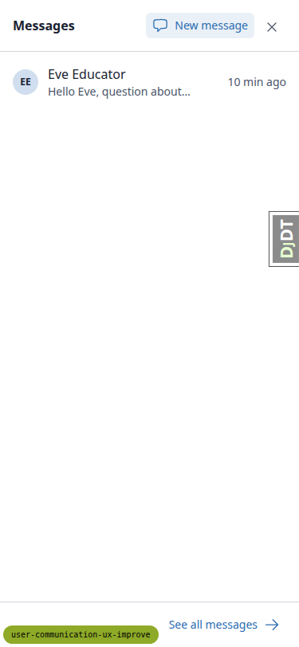 |
| 1.2 | tablet | pass | Messages panel within viewport (x 265-647) | |
| 1.3 | desktop | pass | Escape closes and returns focus to #messages-button; outside click closes | |
| 1.4 | desktop | pass | Opening bell closes messages panel and vice versa | |
| 1.5 | desktop | pass | Vic row goes to /messages/<uuid>/; afterwards row not bold, badge gone, name 'Messages, none unread' | 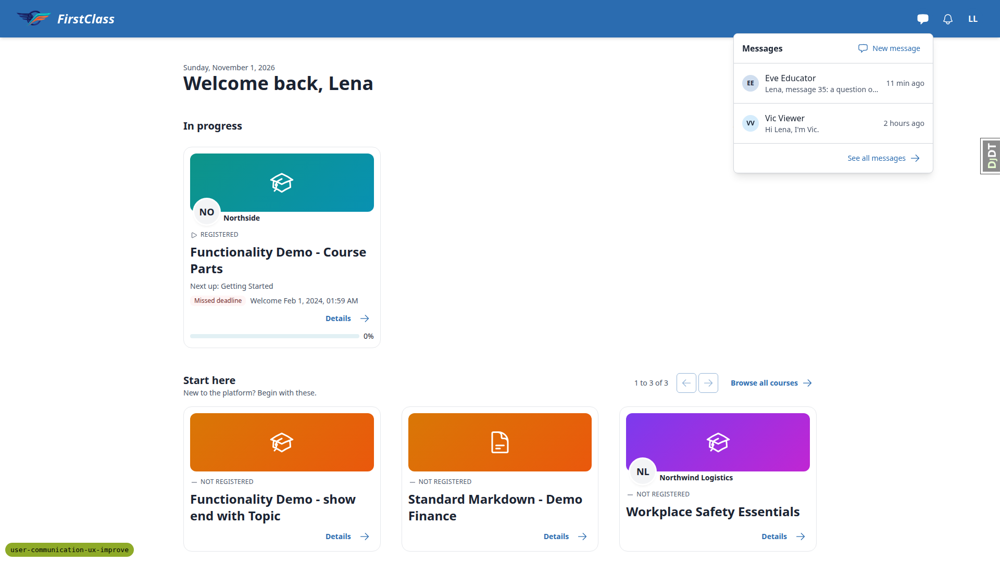 |
| 1.6 | desktop | pass | See all messages -> /messages/ | |

### §2 The messages page

| Test | Viewport | Status | Notes | Screenshot |
|---|---|---|---|---|
| 2.1 | desktop | pass | Two panes, placeholder 'Select a conversation to read it.' + New message, no composer, nothing current | 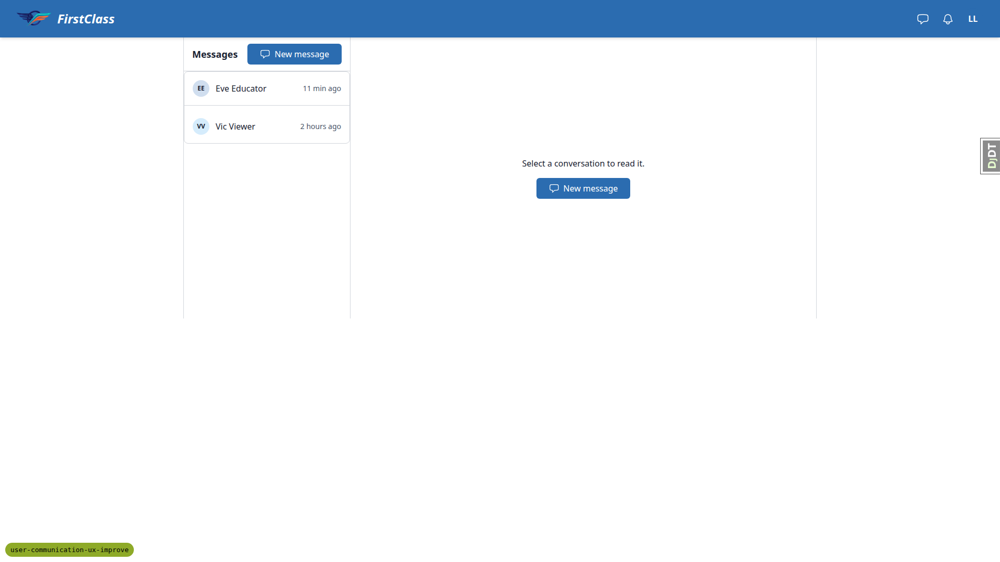 |
| 2.2 | desktop | pass | Thread on right, Eve row aria-current=true, composer with 'Ctrl+Enter to send' and disclosure line | 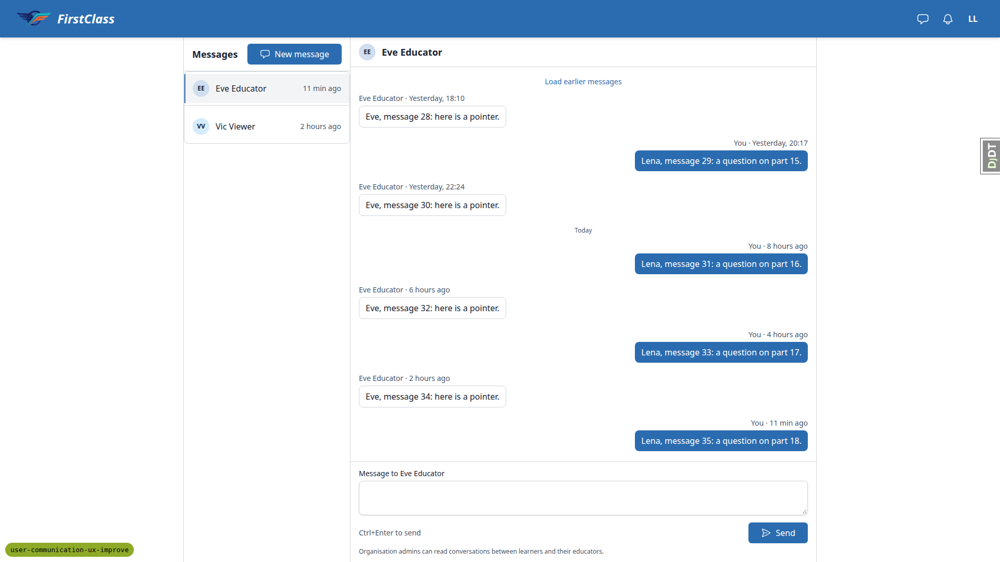 |
| 2.3 | desktop | pass | Reload keeps thread; back returns to /messages/ placeholder | |
| 2.4 | desktop | pass | Bea: 'No conversations yet.' in both panes, New message in list header and placeholder | 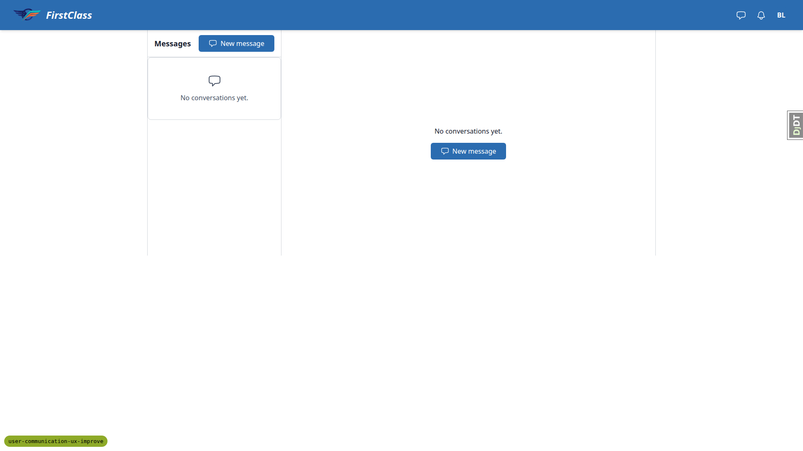 |
| 2.5 | desktop | pass | Sam: Sid row, placeholder, no New message anywhere | 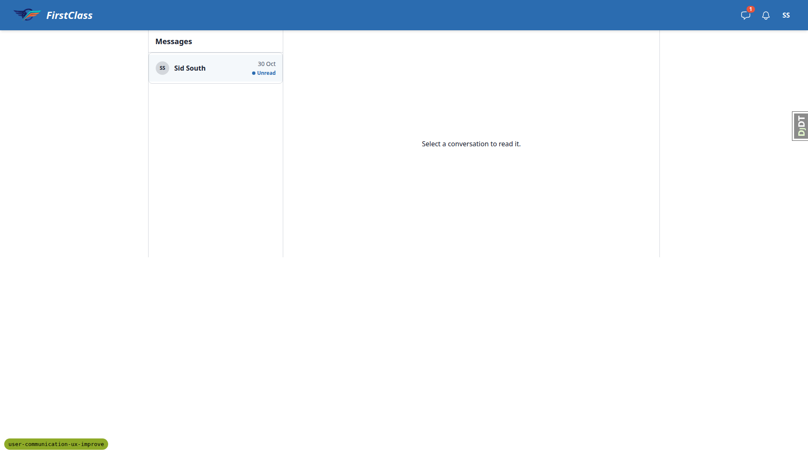 |

### §3 Starting a conversation from the messages page

| Test | Viewport | Status | Notes | Screenshot |
|---|---|---|---|---|
| 3.1 | desktop | pass | Lara: No conversations yet., New message in both places | |
| 3.2 | desktop | pass | Picker swapped in pane without full load (window marker survived), URL /messages/new/, Eve listed under COHORT ADMIN heading, no Vic | 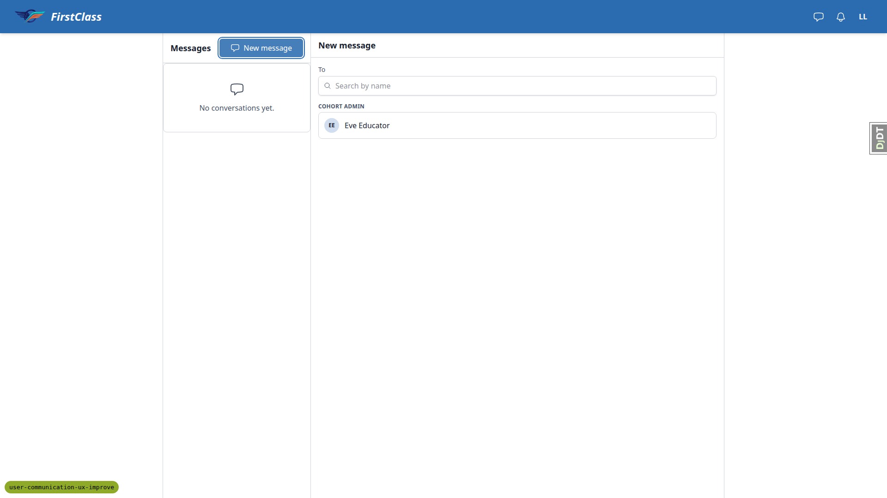 |
| 3.3 | desktop | pass | 'No one you can message matches 'zz''; clearing restores Eve | |
| 3.4 | desktop | pass | To Eve Educator + Change, textarea label 'Message to Eve Educator', disclosure line, URL ?recipient=89 | 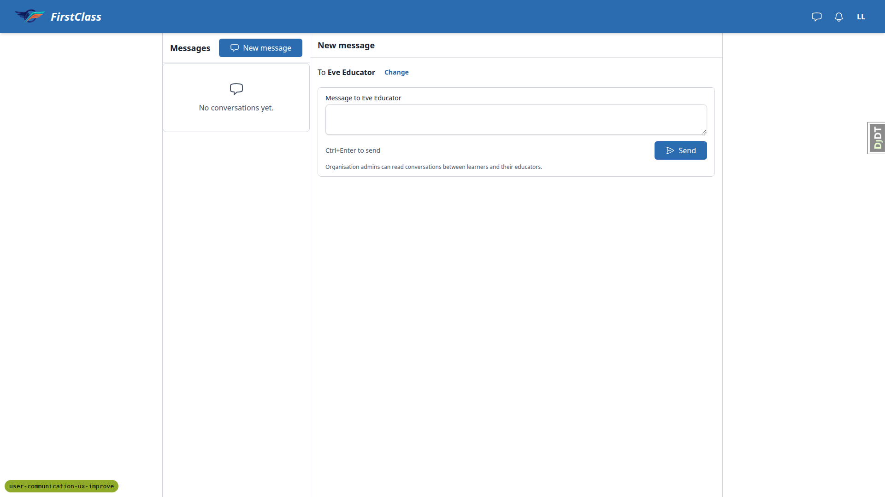 |
| 3.5 | desktop | **fail** | Functionally correct (lands on /messages/<uuid>/, message in log, row current) but the HX-Location swap leaves the page 72px taller than a direct load (docH 1152 vs 1080): Send button, hint and disclosure line pushed below the fold; branch badge loses its border-radius. A reload fixes it. See B1. | 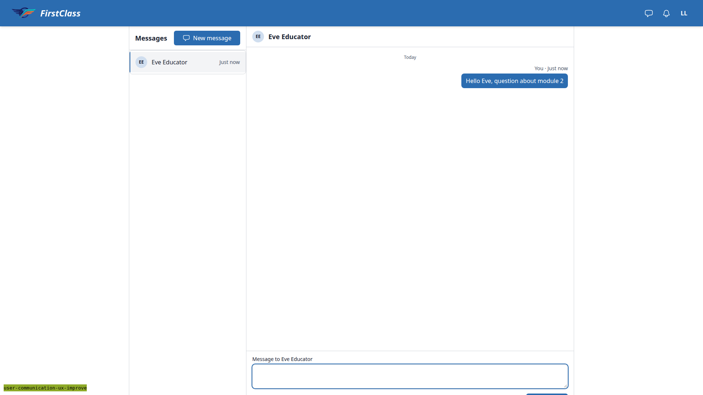 |
| 3.6 | desktop | pass | Picking Eve again lands on same thread. Same post-swap layout defect as 3.5 (Send at y=1116 in 1080 viewport). See B1. | 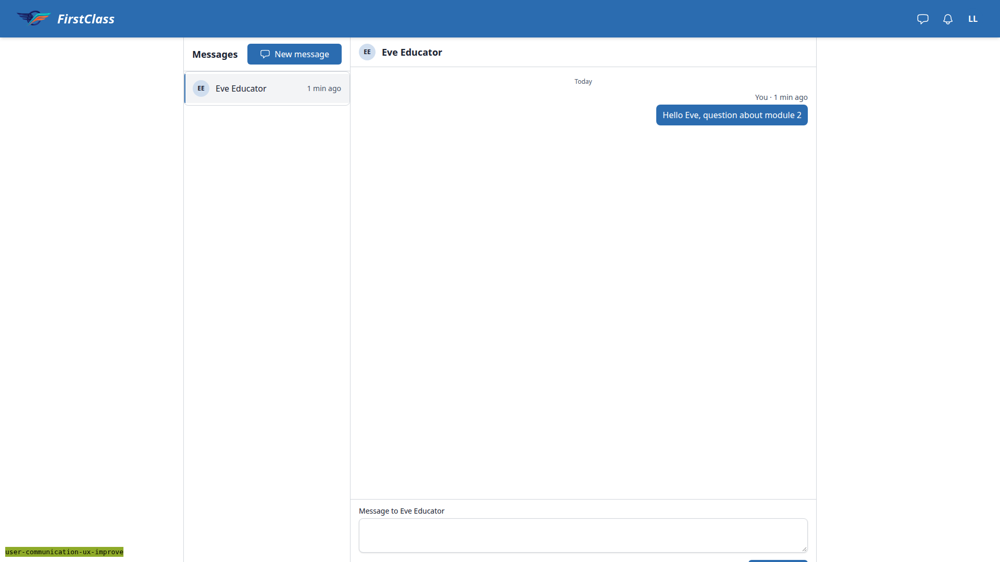 |
| 3.6 | mobile | pass | Picking existing Eve from full-page picker lands on thread; layout matches a direct load (docH 812, Send at 760), so the desktop 3.5 defect does not show at this width | 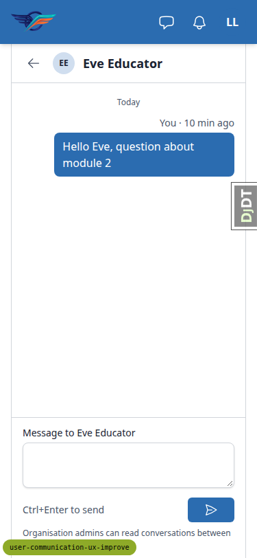 |
| 3.6 | tablet | **fail** | Picking Eve from the in-pane picker lands on the thread via HX-Location; page 72px taller than viewport (docH 1096 vs 1024), Send at y=1044 below the fold, branch badge loses its pill style. Same defect as desktop 3.5. See B1. | 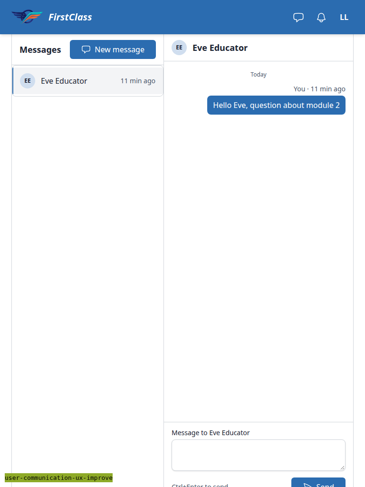 |
| 3.7 | desktop | pass | Full-page New message screen with Back to messages -> /messages/ | 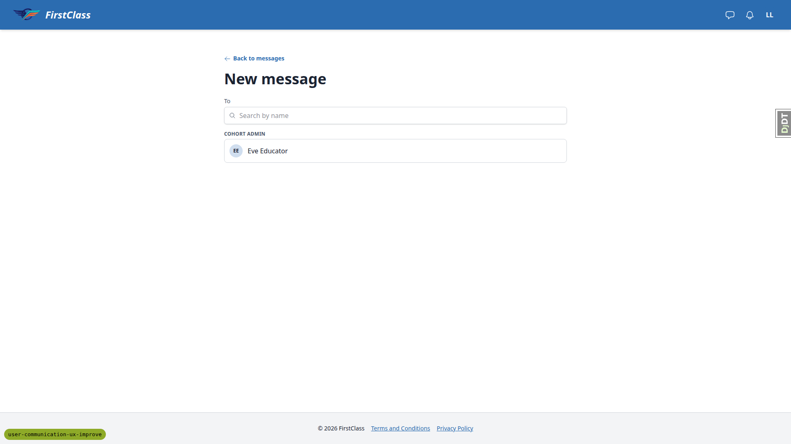 |
| 3.7 | mobile | pass | Full-page picker readable at 375 | 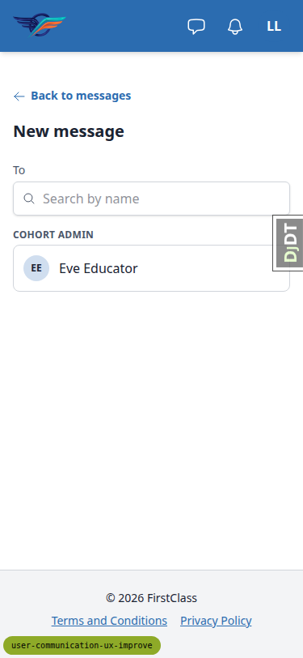 |
| 3.8 | mobile | pass | 375 wide: list fills screen, thread fills screen with 'Back to messages' arrow, back -> list, New message -> full-page picker with back link; scrollWidth 375 throughout |  |
| 3.8 | tablet | pass | 768 wide: two-pane messages page, no horizontal scroll (scrollWidth 768); thread Send in view on direct open | 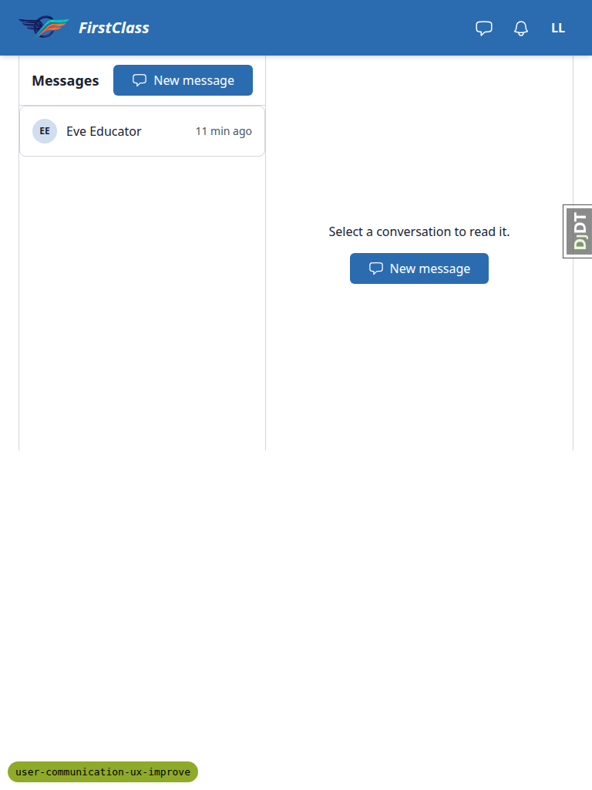 |

### §4 A guessed recipient and a send refused after the composer opened

| Test | Viewport | Status | Notes | Screenshot |
|---|---|---|---|---|
| 4.1 | desktop | pass | recipient=91 (Vic), 999999, abc all 404 | |
| 4.2 | desktop | pass | Bea picked Eli, typed text | |
| 4.3 | desktop | pass | Northside OrganisationMessagingConfig with learner_to_educator=closed added in a second context. Admin Save needed form.requestSubmit; a Playwright mouse click on Save did not submit (outside this feature). | |
| 4.4 | desktop | pass | POST 422, alert 'Not sent. This person can't receive messages from you here. Your text is still in the box.', text kept, Bea's /messages/ still empty | 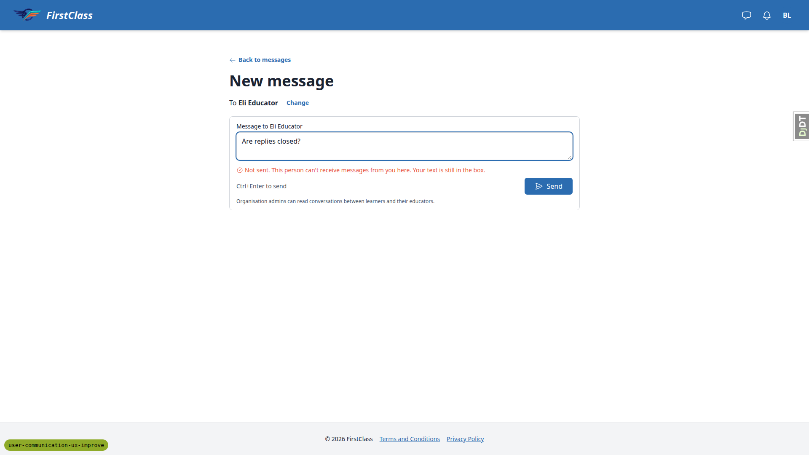 |
| 4.5 | desktop | pass | Eve/Gus: 'Replies are closed' note, disclosure line, no textarea | 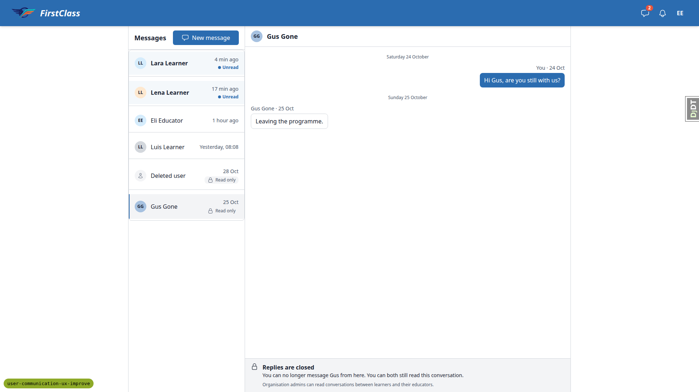 |
| 4.6 | desktop | pass | Config row deleted; Bea's /messages/new/?recipient=90 shows composer again | |

### §5 Messages raise no notification

| Test | Viewport | Status | Notes | Screenshot |
|---|---|---|---|---|
| 5.1 | desktop | pass | Eve badge 'Messages, 2 unread'; bell none new; sent 'Checking in' to Luis | |
| 5.2 | desktop | pass | Luis: messages 1 unread, bell 'none new' and panel 'Nothing yet.', messages panel Eve row unread with 'Checking in' | 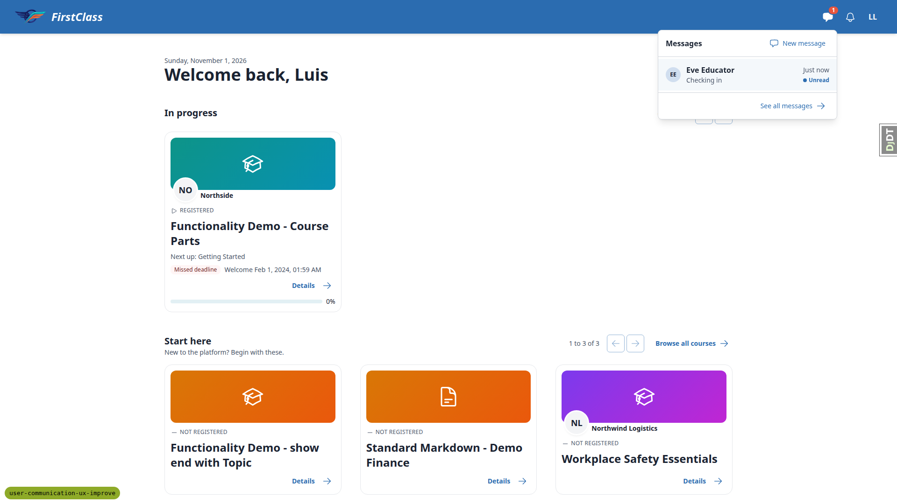 |

### §6 The educator Messages section is gone

| Test | Viewport | Status | Notes | Screenshot |
|---|---|---|---|---|
| 6.1 | desktop | pass | Teaching: Dashboard, Cohorts, Learners, Courses; no Messages | 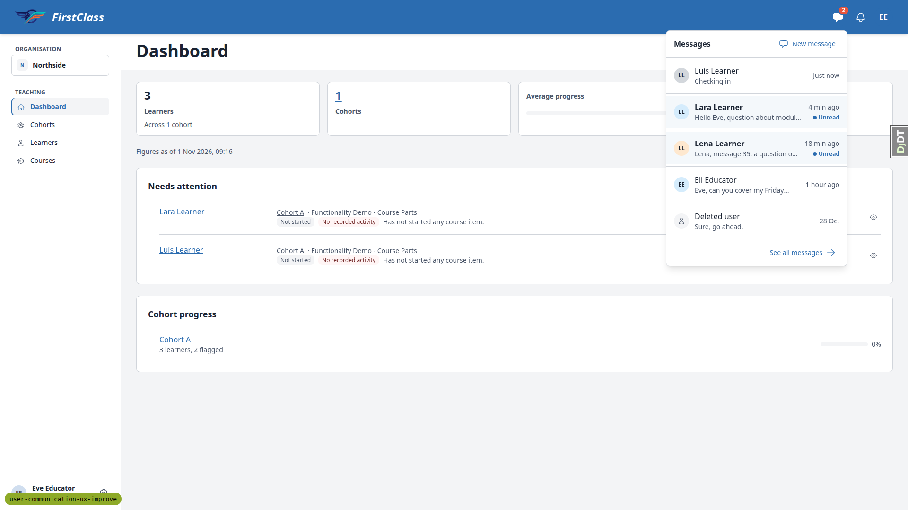 |
| 6.2 | desktop | pass | messages, messages/<uuid>, messages/unread-count/ all 404 | |
| 6.3 | desktop | pass | Header panel lists Eve's conversations on educator pages | |

### §7 The Messages tab on the learner page

| Test | Viewport | Status | Notes | Screenshot |
|---|---|---|---|---|
| 7.1 | desktop | pass | Tabs Overview, Courses, Messages; no History | 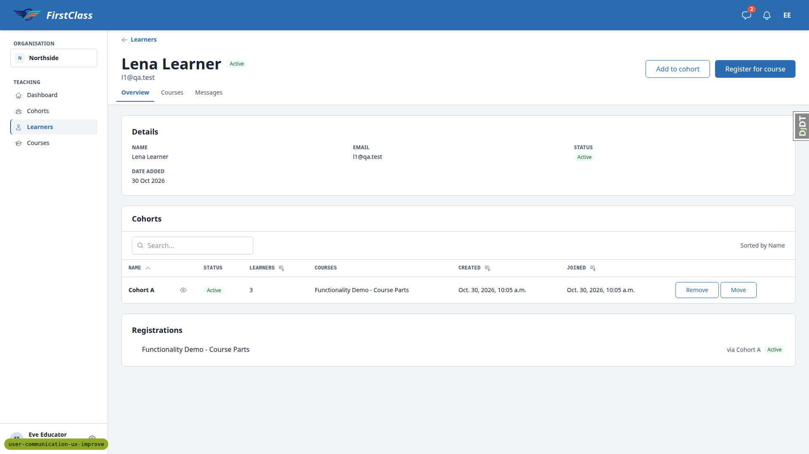 |
| 7.2 | desktop | pass | Heading Lena Learner, Load earlier messages, composer + disclosure, no oversight section; badge 2 -> 1 | 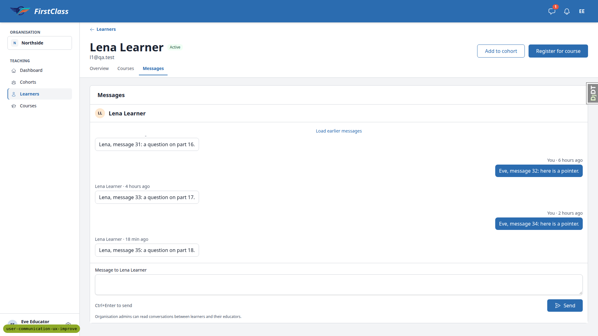 |
| 7.3 | desktop | pass | Sent in place, message appended, URL stays on learner page, no navigation (window marker survived) | |
| 7.4 | desktop | pass | Lara and Luis tabs show only Eve's own conversation with each | |
| 7.5 | desktop | pass | Eve opening Bea's page: 404 | |
| 7.6 | desktop | pass | Eli: 'No messages with Bea Learner yet.', composer 'Message to Bea Learner' + disclosure; send re-renders thread in place; badge unchanged | 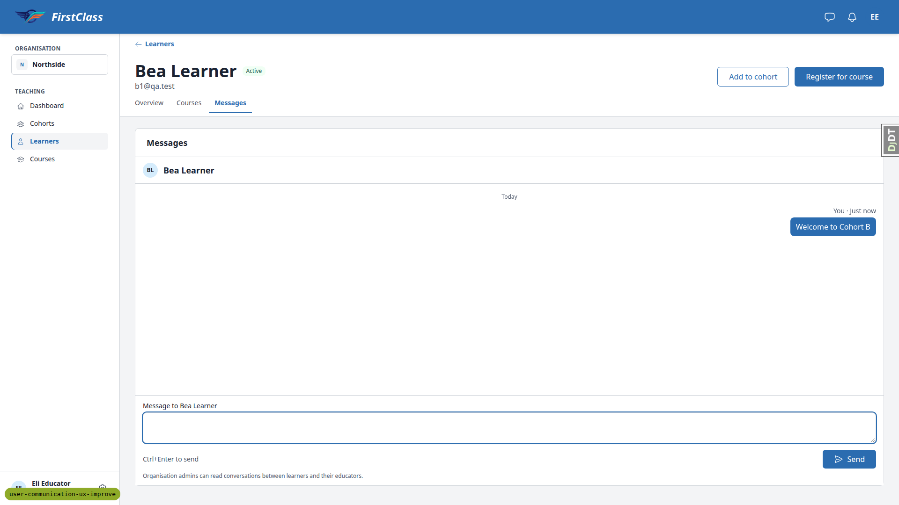 |
| 7.7 | desktop | pass | Vic sees own conversation with Lena, composer, no oversight section | |
| 7.8 | desktop | pass | Quick view drawer Messages box; icon link titled 'Open conversation' -> learner page Messages tab | 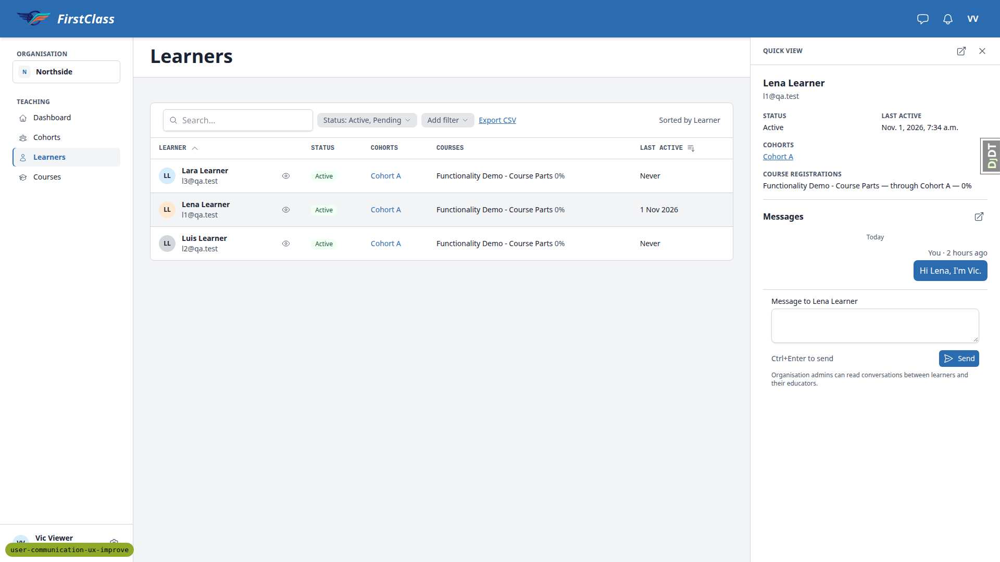 |

### §8 With messaging off the tab is absent

| Test | Viewport | Status | Notes | Screenshot |
|---|---|---|---|---|
| 8 | desktop | skip | Skipped as the plan allows: MESSAGING_ENABLED is hardcoded True in config/settings_dev.py, not read from the environment | |

### §9 Oversight: the list and the read-only open

| Test | Viewport | Status | Notes | Screenshot |
|---|---|---|---|---|
| 9.1 | desktop | pass | Orla: own area 'No messages with Lena Learner yet.' + composer; Other educator conversations: Eve (excerpt, time) and Vic | 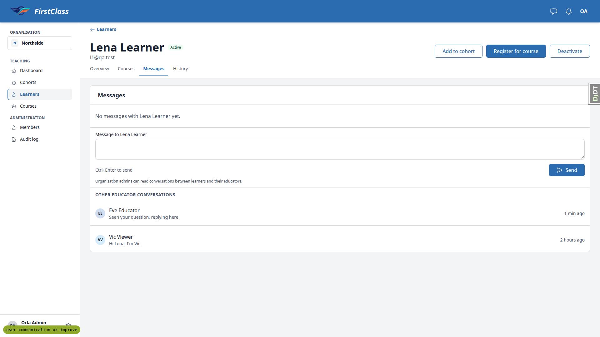 |
| 9.1 | mobile | pass | Learner Messages tab + oversight list fit 375, tabs incl. History visible | 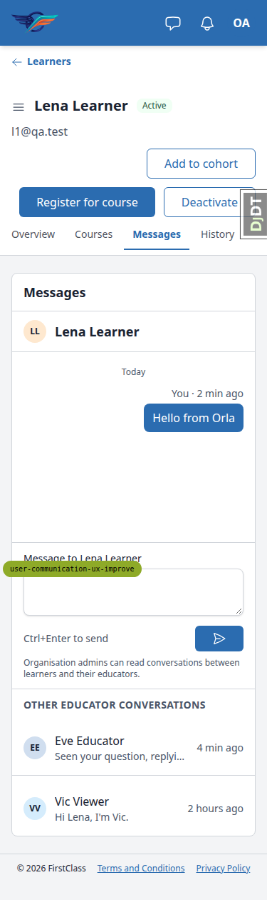 |
| 9.1 | tablet | pass | Learner Messages tab fits 768, no horizontal scroll; oversight list below the fold in normal page scroll | 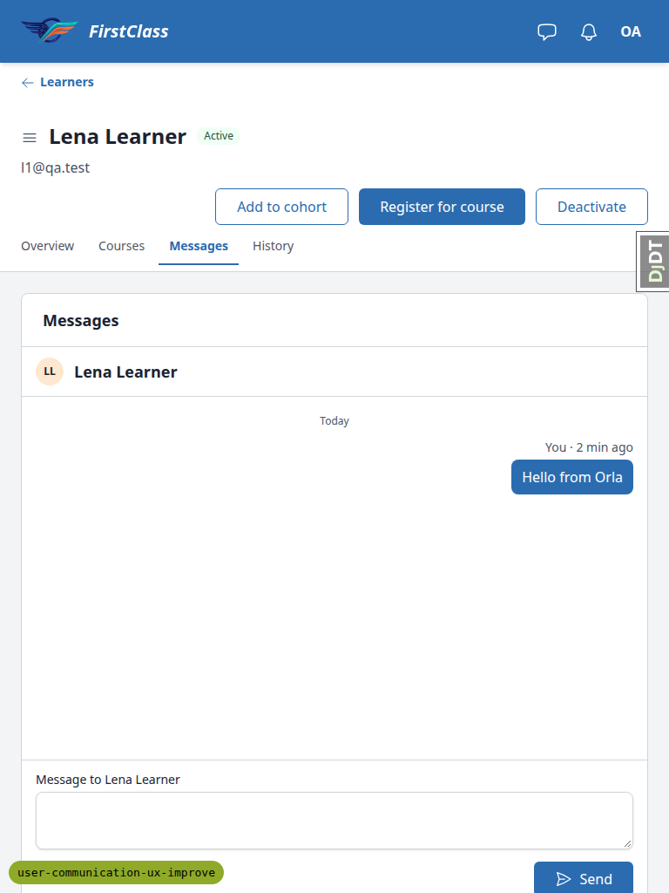 |
| 9.2 | desktop | pass | Eve context: none unread, Lena row read; Lena History had 9 rows from earlier runs | |
| 9.3 | desktop | pass | Modal 'Conversation with Eve Educator', Load earlier messages, read-only org-admin banner + disclosure, no textarea/Send | 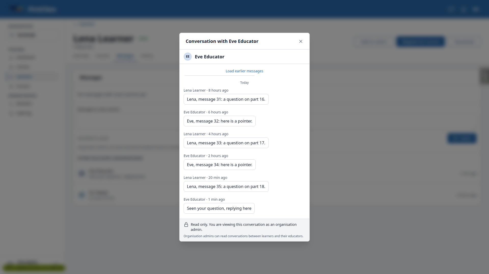 |
| 9.3 | mobile | pass | Oversight modal as bottom sheet full width, read-only banner visible | 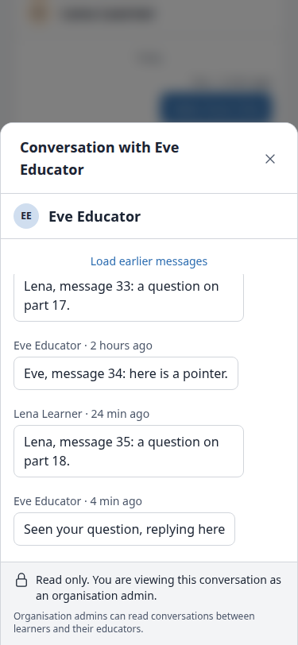 |
| 9.4 | desktop | pass | One GET .../conversations/<uuid>/older/?before=... 200, earlier entries prepended down to message 1, control removed | |
| 9.5 | desktop | pass | History +1: today, Orla Admin, Conversation viewed; org Audit log target 'Conversation with Eve Educator' | |
| 9.6 | desktop | pass | Second open -> two Conversation viewed rows today | |
| 9.7 | desktop | pass | Eve's badge/Lena row unchanged; Lena still sees Eve's reply as unread | |
| 9.8 | desktop | pass | Gus (inactive filter): no own composer, 'No other educator conversations.' | 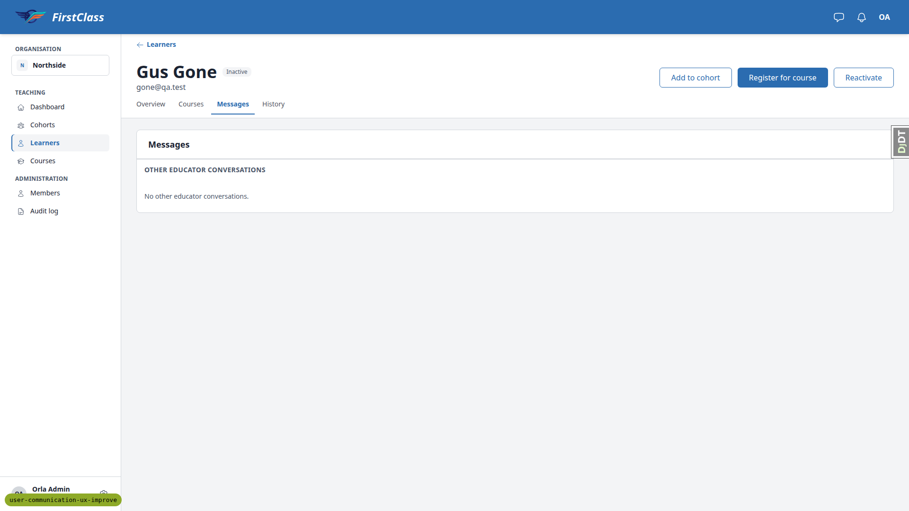 |
| 9.9 | desktop | pass | Orla sends 'Hello from Orla' in place; after reload shown in own area, not in oversight list | |
| 9.10 | desktop | pass | Superuser banner 'as a site admin'; History row by demodev@email.com | 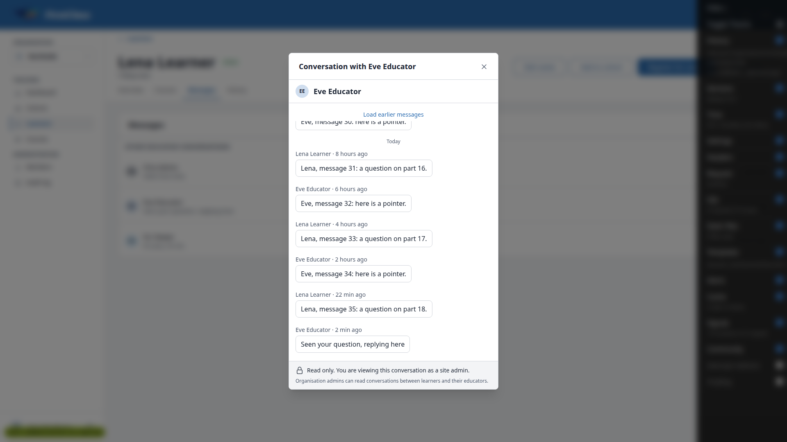 |

### §10 Oversight refused

| Test | Viewport | Status | Notes | Screenshot |
|---|---|---|---|---|
| 10.1 | desktop | pass | Sid on Northside Lena messages tab: 404 | |
| 10.2 | desktop | pass | Sam's tab: Sid's own conversation + 'No other educator conversations.' | |
| 10.3 | desktop | pass | Eve GET view_conversation action: 403 Forbidden page; Lena History unchanged (12) | |
| 10.4 | desktop | pass | Vic-Lena conversation on Luis's path: 404; conversation=not-a-uuid: 404; no History rows | |
| 10.5 | desktop | pass | older/?before=garbage 400, no before 400, valid cursor 200 with entries; History unchanged | |

### §11 Notification rollup still works for other categories

| Test | Viewport | Status | Notes | Screenshot |
|---|---|---|---|---|
| 11 | desktop | pass | qa_create_notification_scenarios run; notify.other sees bell 'Notifications, 2 new' with two course registration rows | 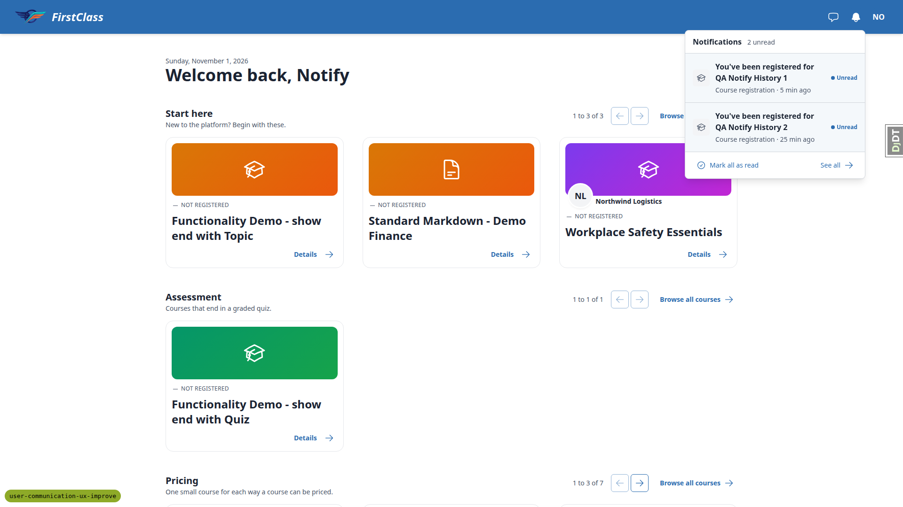 |

## Design check

No design states tested.

## B1: Thread opened by the in-pane picker overflows the viewport until reload

Manifestations:
- 3.5, desktop
- 3.6, desktop
- 3.6, tablet

**Expected:** After a first send or picking someone with an existing conversation from the two-pane picker, /messages/<uuid>/ renders exactly like a direct load: page fits the viewport, composer hint, Send and disclosure line visible.

**Actual:** comms/messaging_views.py `_open_thread_response` answers htmx with a 204 + HX-Location {path}, which swaps the response into <body> over AJAX instead of the full page load its docstring promises. The swapped page is 72px (header height) taller than the viewport (1152 vs 1080 desktop, 1096 vs 1024 tablet), pushing Send/hint/disclosure below the fold; the debug branch badge loses its border-radius. A reload fixes it. Not seen at 375 wide, where New message opens the full-page picker.

## Bug status

- B1: **FIXED** (commit: 5c3141820) — Thread opened by the in-pane picker overflows the viewport until reload

  `_open_thread_response` now answers htmx with `HX-Redirect`, so the page really reloads. Re-verified in the browser at 768x1024 (scrollHeight 1024, Send bottom 972) and 1920x1080 (scrollHeight 1080, Send bottom 1044). The badge keeps its pill style. Replies on `/messages/<uuid>/` and on the learner Messages tab still send in place.

  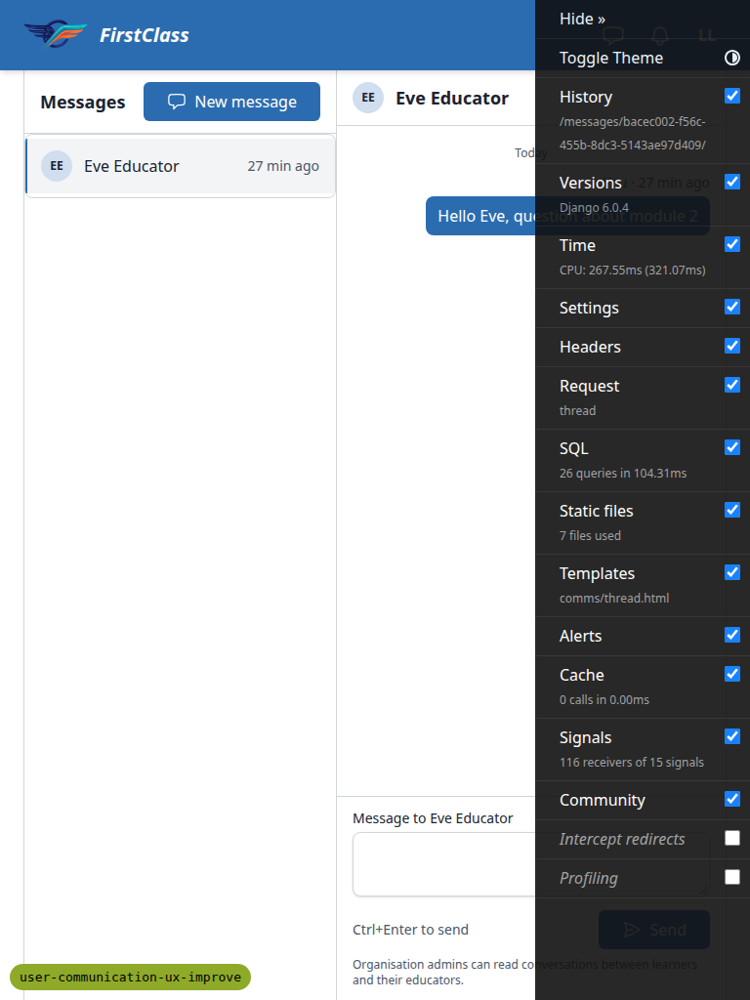
  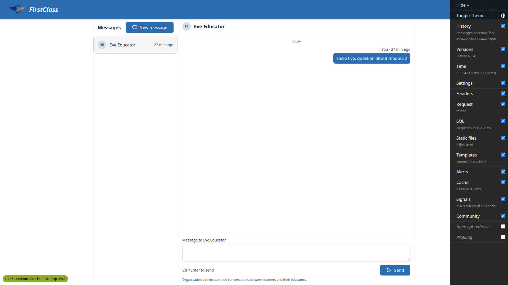

## General notes

- §8 was skipped because MESSAGING_ENABLED is hardcoded True in config/settings_dev.py.
- The Lena History tab already had 9 "Conversation viewed" rows from earlier QA runs (the audit log is not reset by the scenario command), so audit checks counted new rows.
- In the Django admin a Playwright mouse click on the organisation messaging config Save button did not submit the form (form.requestSubmit did). This is outside this feature and was not investigated.
- The debug branch badge overlaps the composer's disclosure line at phone width (dev-only element).
- The quick-view drawer's "Open conversation" control is an icon link whose text is screen-reader-only.

status: ok · reason: 1 bug — 1 fixed, 0 unresolved; report rendered, screenshots verified
